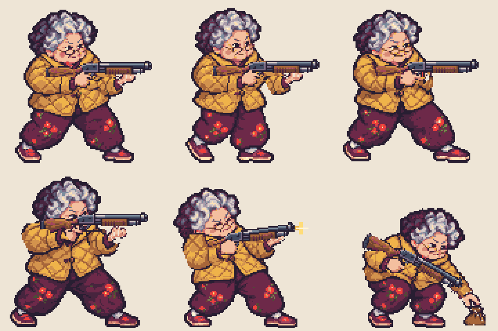
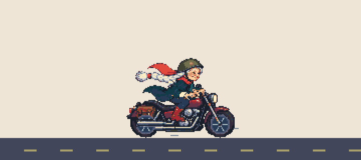

# GrandmaShooter120 · 120px 캐릭터 에셋

현재 결과는 **[v002 · 현재 base 기반 6동작 에셋](v002/README.md)**이다. 기획서_02 v1.7의 순덕 1차 6행동을 120×120, 공통 26색으로 생성하고 팔·몸·전용 샷건·탄약·소품·효과를 분리했다.

- [순덕 편집 정본 · 27프레임](v002/grandma_01_sundeok_120.aseprite)
- **[샷건 독립 편집 원본](v002/Weapons/Shotgun/sundeok_shotgun.aseprite)** · [PNG](v002/Weapons/Shotgun/sundeok_shotgun.png)
- [7개 분리 파츠 라이브러리](v002/Parts/Native) · [전체 파일 안내](v002/README.md)
- [걷기 중 조준·사격 GIF](v002/Previews/Walk_Aim_Fire_3x.gif) · [검수](v002/QA/review.md)
- [v001 · 현재 base와 이전 모션 시안 보존](v001/README.md)

## 오토바이 할머니 추가 · 2026-10-30

사용자 요청의 둥근 올리브색 1레벨 반모형 헬멧과 질주 중 수집을 반영했다. Idle 4 / Ride 6 / Collect 8, 총 18프레임이며 인물·팔·차체·바퀴·소품·속도 효과를 분리했다.

- **[오토바이 편집 정본](v002/grandma_05_motorcycle_120.aseprite)** · [파일 안내/검수](v002/Motorcycle/README.md)
- [독립 오토바이](v002/Motorcycle/Vehicle/motorcycle.aseprite) · [인물만](v002/Motorcycle/motorcycle_rider_120.aseprite)
- [주행 → 수집 → 계속 주행 · 24프레임 GIF](v002/Motorcycle/Previews/drive_by_pickup_world_2x.gif)

## 슬라임 인간형 몬스터 3종 추가 · 2026-10-30

일반 좀비·큰 좀비는 슬라임 재질의 인간형이며, 구조 대상은 청록 점액을 뒤집어쓴 실제 일반 사람이다. 각 120×120, Idle/Walk/Run/Attack/Dead, 총15클립·84포즈를 만들었다.

- **[편집 원본·PNG·GIF·프롬프트 안내](v002/Monsters/README.md)** · [검수](v002/Monsters/QA/review.md)
- [3종 전체 동작 GIF](v002/Monsters/Previews/three_characters_all_actions_3x.gif)

## 귀여운 몬스터 수정본 · 현재 v002

일반형·대형·구조 대상 3종을 둥근 얼굴과 말랑한 SD 인간형으로 다시 제작했다. 120×120,5동작,총15클립·84포즈다. 최신 파일은 **[Monsters_Cute 안내](v002/Monsters_Cute/README.md)**, 이전 Monsters는 보존한다.

- [귀여운 3종 전체 동작 GIF](v002/Monsters_Cute/Previews/three_characters_all_actions_3x.gif) · [검수](v002/Monsters_Cute/QA/review.md)
