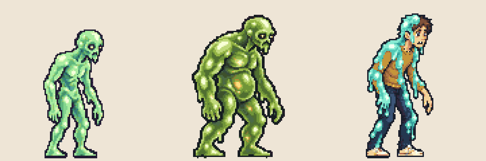

# 슬라임 인간형 좀비 · 120px · v002

2026-10-30. 사용자 정정인 **슬라임 재질 / 인간 형태의 좀비**를 반영했다. 사람의 머리·목·몸통·골반·두 팔·팔꿈치·손·두 다리·무릎·발을 유지한다. [기획서_01](https://app.notion.com/p/4047313398e0818db924d95c5c455419)의 **2.3 슬라임 좀비·구조 대상 120px 캐릭터 디자인**에 컨셉과 제작 결과를 기록했다.

## 바로 열기

| 구분 | 편집 정본 · 각 28프레임/5태그 | 포즈 시트 | 디자인과 마지막 상태 |
| --- | --- | --- | --- |
| 좀비1 · 일반 | [zombie_01_normal_120.aseprite](zombie_01_normal_120.aseprite) | [28포즈](z01_normal/Previews/all_actions_2x.png) | 마른 성인 인체, 민트/연두 점액, 젖은 하이라이트. Dead에서 점액 웅덩이로 붕괴 |
| 좀비2 · 큰 좀비 | [zombie_02_large_120.aseprite](zombie_02_large_120.aseprite) | [28포즈](z02_large/Previews/all_actions_2x.png) | 넓은 어깨·두꺼운 팔다리·큰 배, 올리브 점액과 호박색 내부 핵. Dead에서 큰 웅덩이로 붕괴 |
| 구조 대상 · 일반 사람 | [zombie_03_rescue_human_120.aseprite](zombie_03_rescue_human_120.aseprite) | [28포즈](z03_human/Previews/all_actions_2x.png) | 갈색 머리·겨자색 상의·남색 바지·밝은 운동화 위 청록색 점액. Dead에서 점액이 벗겨지고 살아서 무릎 꿇고 도움 요청 |

- [3종 전체 동작 GIF](Previews/three_characters_all_actions_3x.gif) · [실제 크기 비교](Previews/lineup_native.png) · [동작 대표 포즈](Previews/action_summary_2x.png)
- [점액을 끈 일반 사람 원본 · 28프레임](z03_human/human_without_slime_120.aseprite)
- [전체 파일 목록](asset_manifest.json) · [검수 기록](QA/review.md) · [생성 프롬프트 22건](Source/generation_prompts.json)

## 동작과 출력

3종 × 5동작 = **15클립 / 84포즈**. `atack` 요청은 파일과 태그에서 `Attack`으로 표준화했다. 모든 프레임 캔버스는 **120×120**, 시점은 오른쪽을 향한 측면/약한 3/4다.

| 동작 | 프레임 | 재생 정책 | 일반/구조 대상 시간 | 큰 좀비 시간 |
| --- | ---: | --- | --- | --- |
| Idle | 4 | 반복 | 각 200ms | 각 230ms |
| Walk | 6 | 반복 | 각 130ms | 각 150ms |
| Run | 6 | 반복 | 각 80ms | 각 90ms |
| Attack | 6 | 1회 | 120/90/70/80/100/140ms | 동일 |
| Dead | 6 | 1회, 마지막 유지 | 90/100/120/140/170/400ms | 동일 |

일반형은 손을 뻗어 후려치고, 큰 좀비는 두꺼운 팔과 몸을 낮춰 내려찍으며, 구조 대상은 점액에 끌려 팔을 뻗는다. Run은 Walk와 별도 작화이며 공중 구간과 팔 스윙을 포함한다.

각 `<id>`는 `z01_normal`, `z02_large`, `z03_human`, 각 `<Action>`은 위 표의 이름이다.

| 위치 | 내용 |
| --- | --- |
| `<id>/Clips/<id>_<action>.aseprite` | 120×120 편집 가능한 개별 동작, 소문자 파일명 |
| `<id>/Export/Frames/<Action>/` | 120×120 투명 프레임 PNG |
| `<id>/Export/Sheets/` | 동작별 가로 PNG 시트와 영역·재생시간 JSON |
| `<id>/Export/Left/<Action>/` | 좌우 반전 PNG. 추가 시점 작화가 아닌 수평 반전 |
| `<id>/Export/Gifs/` | 실제 120px GIF 5종 |
| `<id>/Previews/<Action>_3x.gif` | 최근접 3배 GIF 5종 |
| `<id>/Parts/<Action>/` | 비어 있지 않은 레이어의 잘라낸 PNG |
| `<id>/Parts/Native/` | 레이어별 28프레임/5태그 편집 라이브러리 |
| `<id>/Export/parts.json` | 잘린 PNG 원점·크기·피벗·레이어명 |
| `<id>/pose_metadata.json` | 프레임 시간·루프·원화 셀·샘플 배율·정렬 보정 |

Attack/Dead의 1회 재생·Dead 마지막 프레임 유지는 JSON 정책이다. Aseprite 태그만으로 Unity 재생을 설정하지 않는다. GIF는 반복 검토용이며, 3종 동시 비교 GIF는 일반형의 시간을 공통 사용한다. 각 개별 클립/GIF는 해당 종의 시간을 유지한다.

## 분리 파츠와 좌표

아래→위 레이어 순서는 일반/큰 좀비가 **GelBody / SurfaceHighlights / DripsFX**, 구조 대상이 **HumanBody / SlimeCoat / DripsFX**다. 기본 전부 표시, Normal, opacity 255. 점액 몸체는 사람의 팔다리를 포함한 연속 작화이며 팔·다리별 리깅 파츠는 아니다. SurfaceHighlights를 꺼도 밑에 점액 몸체가 남는다. 사람의 점액에 가려진 옷·피부는 별도 복원 원화로 채웠고, HumanBody만 표시해도 온전한 사람이 남는다. SlimeCoat에는 합성 외곽을 유지하는 인접 경계 픽셀도 포함한다.

파츠 라이브러리는 **9개 / 252프레임 슬롯**, 비어 있지 않은 잘린 PNG는 **188슬롯**이다. 슬롯 수는 고유 작화 수가 아니다. [역할별 중복 해시](QA/part_inventory.json). 각 PNG를 `parts.json`의 `origin_xy`에 레이어 순서대로 배치하면 원본과 픽셀 단위로 일치한다.

원점은 좌상단. 오른쪽 기준 피벗은 **(52,118)**, Unity 정규화는 **(0.433333,0.016667)**이다. 왼쪽 경계 피벗은 **(68,118)**. 픽셀 반전은 `x_left=119-x_right`, 경계 피벗 반전은 `x_left_root=120-x_right_root`다. 기준 바닥 마지막 픽셀 y117, 경계 y118이며, 걷기 일부는 -1px, 달리기 일부는 -1/-3px로 들린다. 정렬 마무리 이동은 프레임별 `finish_offset_xy`에 기록했다. Run은 몸체 경계 중심, 나머지는 아래쪽 발 범위 중심을 가로 정렬 기준으로 사용한다. 사냥 대상 Dead의 낮아지는 높이는 붕괴 연출이다.

투명 제외 전 동작 RGB 합집합은 일반 **26색**, 큰 좀비 **25색**, 사람 **26색**이며 종별 팔레트 상한은 26색이다. RGB 원본의 팔레트 슬롯은 투명 1+불투명 26개. 알파는 **0/255**, 확대는 최근접 정수 배율. 종별 `Export/<id>_26.gpl`을 함께 제공한다. 기본 실루엣 높이는 일반 약96px, 큰 좀비/사람 약108px이며 자세에 따라 달라진다.

## 제작과 재현

**Built-in ImageGen**으로 동작 원화 15장과 사람의 점액 아래 복원 원화 5장을 만들었다. 폐기한 초기 일반형 Idle/큰 좀비 Attack까지 총 22회이며 [원문 프롬프트](Source/generation_prompts.json), [최종 원화](Source/Generated), [정정한 디자인](Source/Notion/design_concept.md)을 보관한다. Aseprite에서 실제 알파 여백으로 셀을 나누고, 본체 중심 배율·최근접 샘플링·Oklab 팔레트 제한·2단계 알파·정렬·재질/효과 분리를 수행했다. 멀리 튄 방울이 몸을 축소시키지 않도록 본체 연결 영역을 따로 계산했고, 최종 편집 원본에서 PNG를 출력했다. 처음부터 120px에서 전부 손으로 그린 결과로 표기하지 않는다.

재현 순서: `Scripts/build_monsters.lua` → `Scripts/export_validate_monsters.lua` → `Scripts/qa_overviews.lua` → 저장된 native의 GIF 출력 → `Scripts/finalize_package.ps1`. Lua 실행 시 Aseprite `--script-param root=<이 폴더 절대 경로>`를 전달한다. PowerShell 검수는 `-Root <이 폴더 절대 경로>`를 사용한다. 기존 native 편집 후 다시 빌드하면 수정이 덮이므로 먼저 보존본과 해시를 남긴다.

84프레임의 규격·팔레트·알파·여백·PNG 일치·시트 복원·좌우 반전·파츠 재합성·15클립·9라이브러리·사람 복원본을 검사했고, 대표 동작 68개 실제 표시 상태를 저장/재오픈했다. [기계 검사](QA/validation.json) · [GIF 규격/시간 검사](QA/gif_validation.json) · [작화 검수](QA/review.md) · [기존 소스 보존](QA/source_preservation.json).

큰 좀비는 일반 전투 몬스터다. 구조 대상은 실제 사람을 별도 점액이 덮은 컨셉이며, 현재 기획의 CLEAR 진행·선택 모집을 유지한다. 이 아트 추가가 과거 보스·수레 포획·필수 구조 스테이지를 되살리는 것은 아니다. 배치·구조 판정·보상은 후속 게임 설계 범위다. 이번 결과는 **아트 에셋**이며 Unity Animator·프리팹·씬 연결과 게임 실화면 검수는 수행하지 않았다.
