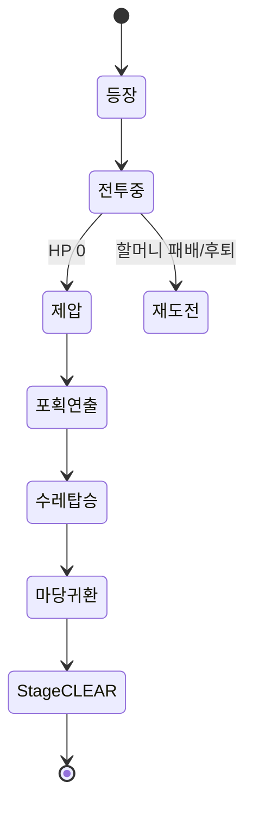

Here is the result of "fetch" for the Page with URL https://app.notion.com/p/4047313398e0818db924d95c5c455419 as of 2026-10-30T07:11:16.697Z:
<page url="https://app.notion.com/p/4047313398e0818db924d95c5c455419" icon="🧟">
<ancestor-path>
<parent-page url="https://app.notion.com/p/4037313398e081d0ba8addb38d803d6d" title="Project10_Hunter_grandma · 복사본"/>
</ancestor-path>
<properties>
{"title":"\\[기획서\\_01\\] 게임 루프·전투·포획"}
</properties>
<iconMetadata>{"type":"emoji","emoji":"🧟"}</iconMetadata>
<content>
<callout icon="📝" color="yellow_bg">
<b>보스 제거 반영 · </b><b><date start="2026-10-30" /></b><b>:</b> 기존 <s>보스 등장·전투·제압·수레 적재·마당 귀환·신규 포획</s> 관련 기획과 그에 의존한 성장·UI 요구는 취소선으로 보존하고 현행 범위에서 제외한다. 현재는 <b>일반 웨이브 소탕 → CLEAR → 다음 Stage 자동 이동</b>이며, 마지막 Stage에서는 전체 CLEAR로 정지한다. 과거 구현·검증 결과와 저장된 포획 기록은 이력으로 유지한다. 이번 수정은 Notion 표기 정리이며 새 코드 변경·실행 검증이 아니다.
</callout>

<callout icon="🧟" color="green_bg">
<b>게임의 핵심:</b> 샷건 할머니와 동료들이 좀비를 자동 사냥하는 2D 벨트스크롤 Desktop Companion. <s>소탕전/구조전 두 유형으로 구분</s> → <b>단일 Stage 진행 + 일부 Stage에서만 CLEAR 이후 동료 만남·영입</b>. 현행 보스 없는 일반 웨이브 → CLEAR → 다음 Stage 자동 이동(0.5)은 유지. 영입 이벤트는 새 기획.
</callout>

<b>문서 상태:</b> v3.2 · <b>단일 Stage 진행·선택적 영입 이벤트</b>(0.6) 반영 · <date start="2026-10-30" />. 0.5의 실제 구현과 0.6 신규 기획은 분리 기록하며 소탕/구조 유형·구출 필수안은 취소선으로 보존.

| 문서 | 담당 기준 |
| --- | --- |
| <mention url="https://app.notion.com/p/4047313398e0818db924d95c5c455419">[기획서_01] 게임 루프·전투·포획</mention> | 공통 전투·반복 규칙, 기존 포획 프로토타입의 적용 범위, 공통 미결정 항목 |
| <mention url="https://app.notion.com/p/4067313398e08130965aebafbb62a76d" /> | 할머니·무기·수레 성장, 재화, 동료 해금 조건 |
| <mention url="https://app.notion.com/p/4067313398e081fab3d4dedff019e11c" /> | <s>소탕전·구조전 목표 분리</s> → 단일 Stage·선택적 조우/영입·연출 |
| <mention url="https://app.notion.com/p/4067313398e081b5b0d1fe284d521bc3" /> | 화면·HUD·패널 명세, UI 작업 ID·구현 상태·검증 근거 |

<b>공통 표기:</b> 확정 = 기존 사용자 결정 / 제안 = 설계 후보 / 미결정 = 추가 선택 필요 / 구현 기록 = 특정 프로토타입에서 확인한 사실. 기획 확정과 구현 완료는 별도로 관리한다.

<b>읽는 순서:</b> 01 공통 규칙 → 02 성장 → 03 장면 → 04 UI/구현 상태. <mention url="https://app.notion.com/p/4067313398e081fabe70ea585a7f04de" />의 확정 흐름을 반영하되, <s>포획 귀환과 결합하는 세부 순서</s>는 현행 범위에서 제외한다. 진행은 0.5·0.6을 기준으로 한다. 초기 기획은 <mention url="https://app.notion.com/p/4037313398e081cf87e2f8f247f2a942" />를 참고한다.

<b>이전안의 적용 범위:</b> 기존 Stage 0\~6의 보스 제압 → 수레 적재 → 마당 귀환·정산 구현 및 4·7·8·11장의 지역/보스/저장 상세는 과거 기록·후속 검토 자료다. 현재 시제품은 0.5의 보스 없는 일반 소탕/다음 Stage 자동 이동으로 변경했다. 기존 내부 ID와 새 Stage 01/02 기획 번호는 아직 매핑되지 않았다.

<table-of-contents />

## 공통 미결정 목록 — 기획서 간 참조 ID

| ID | 결정할 내용 | 현재 적용 원칙 | 상세 담당 |
| --- | --- | --- | --- |
| D-01 | 기존 Stage 0\~6과 새 Stage 01/02 매핑·저장 호환 | 번호만 바꾸거나 저장 ID를 일괄 이동하지 않음 | 01·03 |
| D-02 | <s>유형별 완료 조건</s> → 단일 Stage의 CLEAR·정산<s>·향후 포획 결합</s> | 현재 일반 웨이브 CLEAR→다음 Stage 자동 진행(0.5). 동료 영입 이벤트는 별도 후처리. 보스 포획은 보류 | 01·03 |
| D-03 | 오토바이/운송 할머니 인물 관계, <s>구출→해금</s> → 조우·영입·출전 시점 | 만남 방식·영입 Stage 배정·영입 조건·즉시 합류는 미결정. 구조 필수 아님 | 02·03 |
| D-04 | 재화 종류·명칭·획득/소비처·강화 수식 | 목표 UI는 (미정)재화·(미정)성장 지표. 골드는 기존 구현명 | 02 |
| D-05 | 다인 목표 선택·자동 이동/사격·협력·수동 개입 | 자동 사냥 방향은 확정. 구체 행동 로직·동시 출전 상한은 미정 | 01·02 |
| D-06 | 최소 상주창 크기·OS 배율·UI 안전 영역 | 기존 3개 캡처 크기를 최종 규격으로 간주하지 않음 | 04 |
| D-07 | 최초/재방문 도입, <s>반복 구조전 목표</s> → 1회 영입 이벤트 재생·완료 기록·스킵 | 영입은 지정된 Stage에서만 최초 1회. 재진입 때 중복 영입 금지 | 03 |
| D-08 | <s>수레 정원·다수 포획·치료 대기 한도</s> / 오프라인 처리 | 포획 관련 논의는 현행 제외. 과거 저장 유지·오프라인 정책은 별도 | 01·02 |

<b>변경 원칙:</b> 같은 질문은 위 ID로 연결하고 세부안은 담당 문서에서 관리한다. 수정 날짜만으로 서로 다른 적용 범위를 덮어쓰지 않는다.

# 0. 확정된 화면 방식 — 2D 벨트스크롤 (2026-10-27 반영)

<callout icon="✅" color="green_bg">
<b>확정 결정:</b> 전투는 <b>2D 벨트스크롤(beat 'em up형)</b> 공간을 사용한다. X는 좌우 진행, Y는 화면 안쪽·바깥쪽 깊이다. <s>소탕전/구조전 별도 타입</s> → 스테이지별 카메라·이동 연출은 달라도 단일 진행 체계 사용. <s>기존 보스 제압·수레 귀환 루프</s>는 과거 기획으로만 보존하고 현행 보스 없는 진행(0.5)을 유지한다.
</callout>

## 0.1 좌표·화면의 기준

| 설계 축 | 정의 | 결정 상태 |
| --- | --- | --- |
| 화면 시점 | 2D 벨트스크롤 측면 기반 화면. 캐릭터는 측면 위주로 보이되 바닥의 깊이감이 읽히는 시점 | <b>확정</b> |
| 이동 X | 화면 좌↔우로 진행, 스테이지의 주된 전진 방향 | <b>확정</b> |
| 이동 Y(깊이) | 화면 위쪽(안쪽)↔아래쪽(바깥쪽), 걷는 벨트 영역 내에서 자유 이동 | <b>확정</b> |
| 이동 가능 영역 | 바닥 띠(벨트)의 Y 상·하 경계 및 벽·장애물로 제한 | 구현 제안 |
| 화면 스크롤 | <s>소탕전 고정 / 구조전 전진 추적이라는 타입 구분</s> → 공통 Stage 안에서 배경·연출에 따라 고정·X추적을 선택. 수치·전환 테스트 | <b>단일 체계 확정 / 카메라 구체값 제안</b> |
| 렌더링 정렬 | 캐릭터 발바닥 위치(Y)가 아래쪽일수록 앞에 그려 겹침 순서 표현 | 구현 제안 |
| 이동·사격 | 자동 사냥을 기본 방향으로 사용. 다인 탐색·위치 선정·목표 선택 및 수동 개입의 세부 규칙 | <b>방향 확정 / 상세 미결정 D-05</b> |
| 점프·회피·높낮이 | 별도 채택 전까지 필수 기능 아님 | <b>미결정</b> |

## 0.2 사냥·전투에 미치는 영향

- <b>조우:</b> 숲길 또는 마을 길을 좌우로 진행하며 좀비를 발견. 좀비는 X축 앞·뒤뿐 아니라 화면 안쪽/바깥쪽(Y 깊이)에서도 접근 가능.
- <b>샷건:</b> 사격 거리(X)만 보는 일직선 판정이 아니라, 목표와의 깊이 차이(Y)를 고려한 명중 영역이 필요. 산탄의 시각적 퍼짐과 실제 명중 폭이 일치하도록 프로토타입에서 확인.
- <b>넉백:</b> 기본적으로 사격 방향의 X축 반동을 읽기 쉽게 보여주되, 깊이 방향의 밀림/회피는 별도 기능으로 검증.
- <s><b>보스:</b></s><s> 거대한 숙주형 감염체도 벨트 안에서 이동·돌진·회전. 깊이 방향 이동이 가능한 보스와 불가능한 보스의 난이도를 테스트.</s>
- <s><b>수레:</b></s><s> 포획한 보스를 같은 2D 벨트 공간에서 수레에 싣는 실루엣으로 연출하고, 귀환은 기존 Stage CLEAR 조건을 유지.</s>
- <b>방치형:</b> 자동 사냥을 적용하더라도 캐릭터의 X/Y 탐색·접근·사격 위치 잡기·<s>수레 복귀</s>를 제외한 자동 사냥 동작을 화면에서 읽을 수 있게 함. 수동 조작 체계는 이 결정만으로 확정하지 않음.

## 0.3 64×64 아트·애니메이션 영향

- 캐릭터 기본 실루엣은 측면 기준으로 먼저 제작. 최소 좌·우 반전, 걷기, 사격, 피격, <s>제압/수레 탑승</s>(현재 제외)의 가독성 점검은 이전안으로 남김.
- 위·아래(Y) 이동을 구현할 때 상·하향 전용 스프라이트가 반드시 필요한 것은 아님. 프로토타입은 측면 동작으로 기능 검증하고, 필요하면 전/후면 걷기 방향을 추가.
- 발바닥 접지점·바닥 그림자·Y 정렬 기준을 공통으로 관리하여 앞뒤 겹침과 샷건 명중 위치의 어색함을 최소화.
- 근경(앞쪽)·원경(안쪽)의 크기, 장애물 위치, 길의 경계를 이용해 2D에서도 움직일 수 있는 깊이를 분명히 보여줌.

## 0.4 공통 규칙과 <s>유형별 예외</s> / Stage별 선택적 이벤트

- <s>일반 독립 감염체는 처치·용해, 실제 인간/동물 숙주형 보스는 제압·포획으로 구분한다.</s>
- <s>다음 지역이 열려도 현재 선택 Stage 자동 재사냥</s> → 현재 구현에서는 일반 CLEAR 후 <b>다음 Stage 자동 이동</b>, 기존 지도 선택/수동 재사냥 유지(0.5).
- <s>고유 동료 구조를 최초 1회 필수</s> → <b>지정 Stage의 동료 만남·영입 이벤트를 최초 1회</b>로 관리하며 다른 Stage에는 영입 이벤트가 없음.
- <s><b>포획 콘텐츠:</b></s><s> 보스 제압→적재→귀환, 유형별 보스 적용 검토</s> → <b>현행 범위 제외.</b> 재도입 결정은 없으며 과거 기록만 보존한다.
- <s>Stage 01 소탕전 / Stage 02 오토바이 할머니 구조전</s> → Stage 01 집/울타리 첫 사냥, Stage 02 집 밖 전진 및 <b>오토바이 조우 이벤트 시안</b>. 두 Stage 모두 진행 방식은 단일. 내부 ID 매핑 D-01 미정.

## 0.5 최신 적용 결정 — 보스 제외·다음 Stage 자동 이동

<date start="2026-10-30" /> 사용자 요청으로 <b>현재 내부 Stage 0\~6에서 모든 보스 등장을 우선 제외</b>한다. 아래 기존 보스 카탈로그·수레 포획·동일 Stage 자동 반복은 현재 시제품의 실행 규칙으로 적용하지 않으며 후속 검토 자료로 보존한다. 새 Stage 01/02와 내부 ID 매핑(D-01), 다인 AI·동료 구조의 세부 규칙까지 확정한 것은 아니다.

- 예정된 일반 좀비 웨이브를 모두 소탕하면 현 사냥 위치에서 <b>STAGE CLEAR</b>를 한 번 기록한다.
- 기존 웨이브 사이 이동/휴식은 유지한다. 마지막 웨이브 이후 보스 등장·전투·제압·수레 적재·마당 귀환은 시작하지 않는다.
- CLEAR 안내 <b>1.5 게임 초</b> 뒤 다음 Stage를 해금하고 클릭 없이 자동 시작한다. 지도/휴식 일시정지 동안 대기도 멈춘다. 재화·강화·기존 기록을 유지하고 새 회차의 체력/전투 집계는 초기화한다.
- 마지막 Stage 6은 <b>ALL STAGES CLEAR</b> 결과에서 멈춘다. Stage 0 자동 순환은 없으며 지도/재도전으로 다시 사냥할 수 있다.
- 일반 소탕은 CLEAR 수와 최초 시각만 저장한다. 신규 포획은 만들지 않는다. 실패/후퇴에는 CLEAR를 추가하지 않고, 획득 재화와 과거 기록은 보존한다.
- 과거 포획 개체/ID와 보스 아트·코드는 보존한다. 저장 필드/version 1은 유지하되 CLEAR 수가 과거 포획 수 이상일 수 있도록 검증을 분리한다. 기존 순덕 120px 동작·Stage 0 차/울타리·밤마실 스킬은 유지한다.

<b>구현·검증:</b> <code>GrandmaDefense</code>, <code>DefenseProgress</code>, <code>DefenseHud</code>, <code>DefenseMapView</code>. <code>Docs/BossFree-StageProgression.md</code>, <code>Docs/Validation/BeltScroll-validation.md</code>에 동일 코드/씬 사본의 Unity 6000.3.10f1 <b>배치·nographics 169개 PASS</b>를 기록했다. 실제 7개 Stage 자동 진행·마지막 정지·Stage 0 재사냥·지도 일시정지·저장/구 저장 호환·실패/후퇴를 확인했다. 게임플레이 오류 0건이며 배치 시작 시 Unity Editor 검색 인덱스 예외 1건은 별도 기록했다. 원본 Editor는 스크립트 재로딩 중 메모리 부족으로 중단되어 별도 사본에서 검증했다. 컴퓨터 사용 기능·네이티브 UI 조작·이번 화면 시각 검증·플레이어 빌드는 수행하지 않았다. 화면 상태표는 <mention url="https://app.notion.com/p/4067313398e081b5b0d1fe284d521bc3" /> E12를 따른다.

## 0.6 단일 Stage 공통 진행 + 선택적 동료 영입 이벤트 (2026-10-30 · 최신 기획)

<b>신규 확정:</b> <s>소탕전/구조전을 별개의 Stage 유형으로 정의하고 동료를 반드시 구출한다.</s> → <b>Stage 진행은 단일 체계</b>, 동료와의 만남은 <b>영입 이벤트를 가진 Stage에서만 CLEAR 이후 선택적·일회성</b>으로 발생한다. 영입 이벤트 없는 Stage는 아무 조우 없이 다음 Stage로 이동한다.

<b>진행 순서:</b> <code>일반 Stage 자동 사냥 → 웨이브 완료 → CLEAR → [동료 영입 이벤트가 있고 최초 조건 만족 시 만남·영입] → 다음 Stage 자동 이동</code>. 현재 시제품은 <b>영입 이벤트 분기를 제외한 CLEAR→다음 Stage 자동 이동까지 구현</b>됐다(0.5). 이벤트 대기/해금/출전/마커는 <b>새 기획이며 미구현</b>이다.

<b>Stage 구분:</b> 기존 소탕전·구조전은 현재 Stage 타입/완료 조건/플레이 모드로 사용하지 않는다. 지역별 배경·카메라·이동·전진 연출 차이는 가능하지만 <b>진행/종료 시스템 분기는 공통</b>이다.

<b>영입 이벤트:</b> 만남은 우연한 만남·공동 전투·오해와 충돌·도움받기·경쟁·길거리 만남·구조 중 하나일 수 있다. <b>구조를 필수 조건으로 두지 않는다.</b> 이벤트가 배정된 Stage는 지도/리스트에 <b>별도 동료 영입 마커</b>가 있어야 한다. 이벤트 완료는 고유 동료별 영구 저장해 재진입에서 중복 영입을 방지한다.

<b>구현 분리:</b> 기존 E12의 자동 Stage 진행/저장, 보스 제외·포획 보류는 유지한다. <b>해당 Stage에 영입 이벤트가 있는지</b>, <b>1회 이벤트 처리 여부</b>, <b>동료 해금·출전 시점</b>은 별도 기획/개발 대상이며 임의로 완료 처리하지 않는다. D-03과 D-07을 조우·영입 기준으로 재정의한다. 스테이지별 만남의 구체적 예시는 <mention url="https://app.notion.com/p/4067313398e081fab3d4dedff019e11c" /> 2.4에서, 지도 마커와 카드 전환은 <mention url="https://app.notion.com/p/4067313398e081b5b0d1fe284d521bc3" />에서 관리한다.

# 1. 경험 목표와 기존안의 변천

## 1.1 경험 목표

- <b>사냥의 쾌감:</b> 좀비가 우르르 몰려오고 샷건으로 쏴서 액체처럼 녹여버림.
- <s><b>진행의 성취감:</b></s><s> 마을 지도의 구역을 처음 클리어하면 다음 지역이 열리고, 이후에도 같은 Stage를 반복 클리어하며 포획 대상을 확보.</s>
- <s><b>포획의 차별화:</b></s><s> 무수한 일반 좀비는 소멸하지만, Stage를 클리어할 때마다 거대 인간 숙주형 감염체를 제압해 수레에 실음.</s>
- <s><b>만족스러운 소진:</b></s><s> 한 회차를 클리어하고 포획한 감염 인간을 수레로 데려오는 것이 선명한 완료. 반복 클리어할수록 치료 대상이 누적됨.</s>

## <s>1.2 기존 포획안의 변천 — 현재 공통 규칙과 구분</s>

<toggle>
<s>v0.2 → v2 포획 프로토타입 비교표</s>

<table fit-page-width="true" header-row="true">
<tr>
<td>
<s>항목</s>
</td>
<td>
<s>v0.2 기존안</s>
</td>
<td>
<s>v2 제안</s>
</td>
</tr>
<tr>
<td>
<s>진행</s>
</td>
<td>
<s>집 근처 단일 전투·90초 혼합 웨이브</s>
</td>
<td>
<s>집 습격 프롤로그 → 마을 6구역 선형 Stage</s>
</td>
</tr>
<tr>
<td>
<s>일반 적</s>
</td>
<td>
<s>빨간 공격좀비 + 초록 안정좀비</s>
</td>
<td>
<s>외계 생명체로 구성된 일반 좀비형. 사살 시 용해·골드 드롭</s>
</td>
</tr>
<tr>
<td>
<s>포획</s>
</td>
<td>
<s>웨이브 중 안정좀비 우클릭 드래그</s>
</td>
<td>
<s>지역 마지막의 </s><s><b>인간 감염형 거대 보스</b></s><s>를 제압한 뒤 포획</s>
</td>
</tr>
<tr>
<td>
<s>수레</s>
</td>
<td>
<s>안정좀비 3명 운반</s>
</td>
<td>
<s>매 클리어 시 제압한 감염 인간 개체를 수레에 싣고 귀환하는 반복 보상</s>
</td>
</tr>
<tr>
<td>
<s>종료 조건</s>
</td>
<td>
<s>제한시간 완료·자발적 귀환</s>
</td>
<td>
<s>보스 제압 → 수레 적재 → 마당 귀환 → Stage CLEAR</s>
</td>
</tr>
<tr>
<td>
<s>반복</s>
</td>
<td>
<s>동일 출정 반복</s>
</td>
<td>
<s>첫 클리어는 다음 구역 해금, 이후 같은 Stage 반복 클리어는 추가 치료 대상 확보</s>
</td>
</tr>
</table>
</toggle>

# 2. 세계관과 적의 두 종류

## 2.1 일반 외계 좀비

인간이 감염된 존재가 아니라 <b>외계 생명체가 좀비처럼 생긴 형태를 구성</b>한 독립 공격체. 마을에서 대규모로 나타나고 사살 시 형태가 무너져 바닥으로 녹아내린다.

- 작고 다수로 등장하며 외형은 인간형에 가깝지만 움직임과 표면 재질은 비정상적.
- 몸 전체에서 어두운 연기나 외계 입자가 피어나는 형태로 숙주형과 시각적으로 구분.
- HP 0 → 붕괴 애니메이션 → 녹아내림 → 골드 드롭 → 소멸.
- 반복 등장 가능한 적. 고유 ID 포획 대상이 아님.

## <s>2.2 거대 숙주형 감염체 보스</s>

<s>외계 생명체가 </s><s><b>실제 생물(주로 인간, Stage 0은 강아지)을 숙주로 감염시키면서 비정상적으로 성장한 개체</b></s><s>. 지역 마지막에 등장하며, 인간형의 옷·표정 또는 강아지형의 목걸이·습관처럼 원래 숙주였던 존재의 흔적이 남는 것이 핵심.</s>

- <s>일반 좀비보다 몇 배 큰 실루엣. 인간형은 얼굴·옷·직업 소품, 강아지형은 귀·털·목걸이로 구분되는 개별 디자인.</s>
- <s>눈이나 신체 특정 부위에서만 어두운 물질이 새어 나와 '인간 숙주'임을 강조.</s>
- <s>HP 0은 사망이 아니라 </s><s><b>제압·전투불능</b></s><s>. 몸체는 녹지 않고 남음.</s>
- <s>제압 성공 시 추가 사격 금지 → 수레 호출·적재 연출 → 집 마당 귀환.</s>
- <s>각 Stage의 보스 유형(옆집 강아지형·택배 기사형·댄서형·의사형 등)은 반복 등장한다. 매번 포획하는 실제 숙주형 감염체(사람 또는 동물)는 서로 다른 개체로 식별·누적한다(세부 외형 변주는 추후 결정).</s>

<s><b>연출 원칙:</b></s><s> 일반 개체는 '퐁—녹아 없어짐', 보스는 '쿵—제압되어 남음'. 설명문보다 두 결과 장면의 대비로 플레이어가 규칙을 이해하게 한다.</s>

# 3. 기존 전체 게임 진행 — 후속 검토안

1. <s>소탕전은 고정 교전, 구조전은 전진 교전</s> → 모든 Stage가 동일한 자동 사냥·진행 체계에 속한다. 배경·카메라·이동 연출 차이는 있을 수 있다.
2. 일반 좀비 처치·용해와 보상 피드백을 연결한다. 최종 재화 체계는 D-04에 따라 정한다.
3. <s>Stage 01 소탕 / Stage 02 최초 구출을 별도 완료 조건으로 둔다.</s> → 공통 웨이브 완료→CLEAR를 기준으로 한다. 영입 지정 Stage에서만 CLEAR 뒤 조우 이벤트를 재생하는 새 계획(0.6).
4. <s>V 포즈→CLEAR→동일 Stage 자동 반복</s> → 현재 일반 CLEAR→다음 Stage 자동 진행(E12). 영입 이벤트 Stage는 이후 1회 조우 연출을 삽입하는 계획(미구현).
5. 최초 클리어·<s>구출</s> 영입 이벤트 완료·캐릭터 해금 상태를 별도 영구 기록하는 방향. <s>다음 지역 선택은 수동이고 자동 이동하지 않는다.</s> → 현행은 다음 Stage 자동 이동.

| 구분 | 최초 플레이 | 반복 플레이 |
| --- | --- | --- |
| <s>Stage 01 소탕전</s> Stage 01 | 실내 도입→울타리 위협→샷건 첫 사냥 | <s>V/CLEAR→동일 반복</s> → 공통 CLEAR→다음 Stage |
| <s>Stage 02 구조전</s> Stage 02 | 전진 사냥 + <s>필수 구조</s> 오토바이 할머니 조우 이벤트 시안 | 공통 CLEAR→\[선택적 최초 영입 이벤트\]→다음 Stage |
| <s>기존 포획 콘텐츠</s> | <s>보스 제압·수레 귀환 → 신규 개체·첫 CLEAR·다음 구역 해금</s> | <s>같은 보스 유형의 다른 개체를 포획·누적. 자동 반복 연결 D-02</s> |

<b>구현과의 차이:</b> 기존 포획 프로토타입은 결과 패널의 수동 재사냥 버튼을 사용한다. 위 자동 재사냥 목표가 구현됐다는 뜻이 아니다. 실제 상태는 <mention url="https://app.notion.com/p/4067313398e081b5b0d1fe284d521bc3" />를 기준으로 한다.

# 4. 기존 Stage 0\~6 지역·해금 기준

<b>적용 범위:</b> 이 장은 기존 6구역 지도·포획 프로토타입의 기준이다. 새 Stage 01/02와의 매핑은 D-01이며, 최종 UI 배치는 <mention url="https://app.notion.com/p/4067313398e081b5b0d1fe284d521bc3" />에서 관리한다.

## 4.1 지역 선택 UI

첨부 이미지의 구조를 따르되 상태 전달을 강화한다.

- <b>좌측:</b> 전체 도시를 한 번에 보여주는 2열×3행 지도. 구역별 번호·명칭·선택 강조 표시.
- <b>우측 위:</b> 현재 위치 / 선택 구역명 / Stage 번호 / 지역 분위기 소개.
- <b>우측 중간:</b> 좀비 웨이브 특징, <s>보스 유형</s>, 최초 클리어 여부, 누적 클리어 횟수 및 <s>포획 인원</s>.
- <b>우측 아래:</b> '이 구역에서 전투 시작' 버튼. 클리어한 구역에서도 '다시 사냥<s>·포획</s>' 버튼으로 같은 Stage 재도전 가능.
- <b>구역 상태:</b> 잠김 → 도전 가능 → 진행 중 → 첫 CLEAR. 이후 반복 클리어<s>·포획 가능</s> 상태.
- <b>현재 진행 위치:</b> 지도에서 클리어 구역과 다음 도전 가능 구역이 즉시 식별되게 표시.
- 색상만으로 잠김·완료를 알리지 않고 자물쇠·체크·상태 텍스트 사용.
- Stage 0인 할머니 집은 6개 구역 지도 바깥의 프롤로그 지점.

## <s>4.2 6개 마을 구역 — 캐릭터 보스 적용안</s>

<table fit-page-width="true" header-row="true">
<tr>
<td>
<s>Stage</s>
</td>
<td>
<s>지역</s>
</td>
<td>
<s>일반 웨이브</s>
</td>
<td>
<s>반복 포획 가능한 보스 유형</s>
</td>
<td>
<s>플레이 차별화</s>
</td>
</tr>
<tr>
<td>
<s>0</s>
</td>
<td>
<s>할머니 집</s>
</td>
<td>
<s>집 앞 벨트형 길에서 좌우 전진·깊이 이동을 배우는 소규모 습격</s>
</td>
<td>
<s><b>옆집 강아지 → 동네 강아지형</b></s>
</td>
<td>
<s>짖기 전조 후 돌진. 첫 만남에는 실제 옆집 강아지 등장</s>
</td>
</tr>
<tr>
<td>
<s>1</s>
</td>
<td>
<s>북서 주거지</s>
</td>
<td>
<s>느린 다수형 군중</s>
</td>
<td>
<s><b>택배 기사 — 박스맨형</b></s>
</td>
<td>
<s>상자 내려놓기·박치기와 짧은 빈틈</s>
</td>
</tr>
<tr>
<td>
<s>2</s>
</td>
<td>
<s>북동 상가</s>
</td>
<td>
<s>빠른 골목 무리</s>
</td>
<td>
<s><b>마트 점원 — 카트맨형</b></s>
</td>
<td>
<s>쇼핑카트를 이용한 돌진</s>
</td>
</tr>
<tr>
<td>
<s>3</s>
</td>
<td>
<s>서부 창고</s>
</td>
<td>
<s>거구·소형 혼합</s>
</td>
<td>
<s><b>지게차 기사 — 안전모형</b></s>
</td>
<td>
<s>짐으로 몸을 가렸다가 내리침</s>
</td>
</tr>
<tr>
<td>
<s>4</s>
</td>
<td>
<s>중앙 광장</s>
</td>
<td>
<s>여러 방향 군집</s>
</td>
<td>
<s><b>거리 댄서 — 브레이커형</b></s>
</td>
<td>
<s>춤 전조 후 회전하며 이동</s>
</td>
</tr>
<tr>
<td>
<s>5</s>
</td>
<td>
<s>남서 주거지</s>
</td>
<td>
<s>밀집 무리 뒤 고속형</s>
</td>
<td>
<s><b>헬스 트레이너 — 벌크업형</b></s>
</td>
<td>
<s>스쿼트 전조 후 큰 도약</s>
</td>
</tr>
<tr>
<td>
<s>6</s>
</td>
<td>
<s>남동 시설(병원)</s>
</td>
<td>
<s>여러 유형의 복합 웨이브</s>
</td>
<td>
<s><b>의사 — 닥터형</b></s>
</td>
<td>
<s>제한적 자기 회복과 외계체 호출</s>
</td>
</tr>
</table>

<s>각 지역의 </s><s><b>보스는 이름 붙은 개인 1명을 무한 재포획하는 방식이 아니라 반복 출현 가능한 유형</b></s><s>이다. 매 클리어에서 감염된 다른 동물/인간 개체를 제압·수레 귀환시킨다. 캐릭터 콘셉트·모션·변주안은 </s><s><b>7장</b></s><s> 참고.</s>

## <s>4.3 해금과 재방문 규칙</s>

1. <s>프롤로그 최초 클리어 시 Stage 1 해금.</s>
2. <s>Stage N 첫 클리어(보스 제압, 수레 포획, 집 마당 귀환) 시 Stage N+1 해금.</s>
3. <s><b>이미 클리어한 Stage도 반복 클리어할 수 있음.</b></s><s> 일반 웨이브와 거대 감염체 보스가 매번 등장함.</s>
4. <s>반복 클리어할 때마다 해당 Stage에서 </s><s><b>새로운 치료 대상 인간 감염체를 포획해 수레로 집에 데려옴</b></s><s>.</s>
5. <s>같은 지역의 보스는 같은 </s><s><b>유형</b></s><s>이지만, 매번 포획하는 실제 인간 개체는 </s><s><b>별도의 개체</b></s><s>로 기록함.</s>
6. <s>Stage마다 최초 CLEAR 상태, 누적 클리어 횟수, 누적 포획 개체 수를 각각 기록.</s>
7. <s>실패 또는 후퇴 시 이번 출정 포획은 없으며, 과거 클리어·포획 내역은 보존.</s>
8. <s>최초 클리어 이후에도 해당 지역의 반복 포획이 핵심 목적. 일반 좀비만 사냥하는 골드 전용 모드가 아님.</s>

## <s>4.4 반복 포획의 단위</s>

<s>3장과 8장의 포획 흐름을 적용한다. 초기 가정은 </s><s><b>한 회차에 숙주형 감염체 1개체</b></s><s>이며, 수레 슬롯·다수 적재·수용 한도는 D-08이다. 최초 해금과 반복 포획 누적은 각각 기록한다.</s>

# 5. 전투 회차와 볼륨

## 5.1 회차 완료 조건의 범위

공통 루프는 3장을 기준으로 한다. <s>기존 포획 콘텐츠는 일반 웨이브 → 보스 HP 0 제압 → 수레 적재 → 마당 귀환 → 정산을 사용한다.</s> 현행은 일반 웨이브 종료만으로 CLEAR한다. 새 Stage 01/02의 웨이브·구조 목표·실패 조건은 <mention url="https://app.notion.com/p/4067313398e081fab3d4dedff019e11c" />에서 구체화하며, 기존 보스를 자동 추가하지 않는다.

<b>용어:</b> 회차 = 선택 Stage를 한 번 수행하는 단위 / 최초 클리어 = 영구 진척 / 반복 클리어 = 새로운 회차의 완료 / <s>신규 포획 = 해당 회차에서 새로 확보한 숙주형 개체.</s> 현재 신규 포획은 생성하지 않는다.

## <s>5.2 기존 Stage 0\~6의 시간·볼륨 가안</s>

<s><b>상태:</b></s><s> 아래는 기존 포획안의 테스트 초기값이다. 새 Stage 01/02의 전투 길이를 확정하는 수치가 아니다.</s>

- <s>Stage 0: 짧은 2개 무리 + 튜토리얼 보스, </s><s><b>45\~75초</b></s><s>.</s>
- <s>Stage 1\~2: 3개 웨이브 + 보스, 약 </s><s><b>1\~2분</b></s><s>.</s>
- <s>Stage 3\~4: 3\~4개 웨이브 + 보스, 약 </s><s><b>2\~3분</b></s><s>.</s>
- <s>Stage 5\~6: 4개 웨이브 + 보스, 약 </s><s><b>2\~4분</b></s><s>.</s>
- <s>웨이브 사이마다 불필요한 정산·출발 버튼을 요구하지 않고 자동 진행.</s>
- <s>단순 HP와 적 수만 기하급수적으로 늘려 플레이시간을 인위적으로 늘리지 않는다.</s>
- <s>64×64 픽셀아트 자산 규모를 고려해 좀비 신규 종 수보다 기존 개체의 </s><s><b>등장 조합과 X/Y 이동 패턴</b></s><s>을 우선 변주한다.</s>
- <s><b>벨트스크롤 구간 설계(제안):</b></s><s> 좌우 진행로와 깊이 이동 가능한 바닥 띠를 연결하고, 조우할 때 전투가 잘 보이도록 카메라·적 진입 위치·보스 등장 지점을 배치. 구역 길이와 카메라 정지/추적 규칙은 플레이테스트로 확정.</s>

# 6. 처치 피드백과 성장 연결

<b>재화 기준:</b> 아래 골드·코인 연출은 기존 프로토타입 사례다. 최종 명칭·획득/소비 규칙은 <mention url="https://app.notion.com/p/4067313398e08130965aebafbb62a76d" />의 D-04, 새 UI 표기는 (미정)재화를 따른다.

## 6.1 사살 연출

<code>등장 → 접근 → 샷건 피격·넉백 → HP 0 → 몸이 무너지고 녹아내림 → 골드가 튀어나옴 → HUD로 자동 흡수</code>

- 샷건 발사에 반동·짧은 타격 정지·산탄 범위를 명확하게 보여준다.
- <b>2D 벨트스크롤 명중:</b> 좌우 사격 방향과 목표의 Y 깊이 차이를 함께 판정. 서로 다른 깊이에 있는 좀비가 무조건 맞거나, 화면상 겹쳐도 판정이 빗나가지 않도록 피격 박스·표시 이펙트를 검증한다.
- 최종 타격을 받은 일반 좀비는 눕는 시체가 아니라 <b>점액·먼지처럼 붕괴</b>한다.
- 골드는 몇 개가 튀어 나오다가 자동으로 UI에 이동. 수동 줍기 요구하지 않음.
- 대량 사살 중에는 골드 이펙트를 묶어 표현해 화면을 가리지 않음.
- <s>일반 좀비는 반복 골드 수급, 거대 인간 감염체는 반복 클리어마다 새로운 치료 대상 포획이라는 별도 보상을 담당.</s>

## 6.2 기본 강화의 전투 연결

<table fit-page-width="true" header-row="true">
<tr>
<td>
강화
</td>
<td>
수치 변화
</td>
<td>
플레이어가 눈으로 느껴야 할 변화
</td>
</tr>
<tr>
<td>
공격력
</td>
<td>
발당 피해량 증가
</td>
<td>
두 발 필요했던 좀비가 한 발에 녹음. <s>보스 제압에 필요한 탄 수 감소</s>
</td>
</tr>
<tr>
<td>
발사속도
</td>
<td>
샷 사이 간격 감소
</td>
<td>
밀려드는 무리를 더 빠르게 정리하고 총성·소멸 리듬 증가
</td>
</tr>
</table>

수치 성장의 존재 이유는 <b>새 구역의 웨이브를 안정적으로 정리하는 것</b>. <s>거대 보스 제압을 위한 성장</s>은 현행 범위에서 제외한다. 장비·탄약·제작 시스템은 별도 문서에서 다룬다.

# <s>7. 기존 지역별 보스 카탈로그 — 반복 포획형</s>

<s><b>적용 범위:</b></s><s> 기존 Stage 0\~6에 대응하는 캐릭터 제안 자료다. 새 Stage 01/02의 보스 배정표가 아니며, 이 장의 강아지 보스를 새 집 소탕전에 자동 편입하지 않는다.</s>

<callout icon="🎭" color="blue_bg">
<s><b>보스는 단순히 큰 좀비가 아니라 '누구였는지' 알아볼 수 있는 캐릭터다.</b></s><s> 동네 강아지·택배 기사·마트 점원·지게차 기사·거리 댄서·헬스 트레이너·의사처럼 친숙한 일상의 사람과 동물이 외계 생명체에 감염되어 거대화한다. 같은 지역을 반복 클리어할 때마다 </s><s><b>같은 직업·생물 유형에 속한 다른 감염 개체</b></s><s>를 포획하여 수레로 데려온다.</s>
</callout>

## <s>7.1 캐릭터 설계 원칙</s>

<s><b>벨트스크롤 기준 추가:</b></s><s> 보스의 전면·측면 실루엣과 X/Y 이동 중 몸체 가림을 검증한다. 박치기·카트 돌진·회전 공격·점프 등 기존 시그니처 공격이 바닥 깊이 방향을 어떻게 활용하는지는 개별 테스트 사항이며, 화면 밖에서 불합리하게 공격받는 상황을 피한다.</s>

1. <s><b>1초 실루엣:</b></s><s> 얼굴 표정보다 먼저 강아지 귀·택배 상자·쇼핑카트·안전모·댄스 포즈·근육·의사 가운 같은 특징이 보이게 한다.</s>
2. <s><b>일상 행동의 좀비화:</b></s><s> 원래 하던 행동을 과장한 공격 패턴을 한 가지 부여한다. 직업 이름만 바꾼 HP 덩어리로 만들지 않는다.</s>
3. <s><b>반복 포획의 개연성:</b></s><s> 보스는 단일 고유 인물의 무한 부활이 아닌 '지역 보스 유형(Archetype)'이다. 첫 회차에 기억에 남는 대표 캐릭터를 만나고 이후 같은 유형의 다른 감염 개체를 만난다.</s>
4. <s><b>포획 장면 차별화:</b></s><s> HP 0 이후 시체로 녹지 않고 특유의 쓰러진 포즈를 유지하며, 수레에 실린 형태 자체가 수집의 보상이다.</s>
5. <s><b>저비용 변주:</b></s><s> 공통 기본 동작과 공격 로직은 재활용하고, 의상·소품·컬러·한두 프레임짜리 고유 동작으로 개성을 만든다.</s>
6. <s><b>생물 숙주 허용:</b></s><s> 옆집 강아지를 살리려면 숙주형 감염체의 범위를 '인간만'이 아닌 </s><s><b>사람 및 일부 동물</b></s><s>로 확장해야 한다. 일반 외계 좀비는 여전히 독립형으로 구분한다.</s>

## <s>7.2 Stage 0\~6 보스 캐릭터 요약</s>

<table fit-page-width="true" header-row="true">
<tr>
<td>
<s>Stage · 지역</s>
</td>
<td>
<s>보스 아키타입(가칭)</s>
</td>
<td>
<s>한눈에 보이는 특징</s>
</td>
<td>
<s>시그니처 공격</s>
</td>
<td>
<s>반복 포획 변주</s>
</td>
</tr>
<tr>
<td>
<s>0 · 할머니 집</s>
</td>
<td>
<s><b>옆집 강아지 — 왕왕이형</b></s>
</td>
<td>
<s>덩치가 커진 복슬복슬 강아지, 목걸이</s>
</td>
<td>
<s>짖기 전조 → 짧은 돌진</s>
</td>
<td>
<s>동네 다른 강아지·견종·귀·목걸이</s>
</td>
</tr>
<tr>
<td>
<s>1 · 북서 주거지</s>
</td>
<td>
<s><b>택배 기사 — 박스맨형</b></s>
</td>
<td>
<s>박스 더미, 배달 조끼·모자</s>
</td>
<td>
<s>박스 내려놓기 → 몸통 돌진</s>
</td>
<td>
<s>모자·조끼·박스 스티커·체형</s>
</td>
</tr>
<tr>
<td>
<s>2 · 북동 상가</s>
</td>
<td>
<s><b>마트 점원 — 카트맨형</b></s>
</td>
<td>
<s>가격표·앞치마·몸에 붙은 쇼핑카트</s>
</td>
<td>
<s>카트 밀기 돌진 → 충돌 후 빈틈</s>
</td>
<td>
<s>상점 유니폼·앞치마·카트 속 물건</s>
</td>
</tr>
<tr>
<td>
<s>3 · 서부 창고</s>
</td>
<td>
<s><b>지게차 기사 — 안전모형</b></s>
</td>
<td>
<s>큼직한 안전모·형광 조끼·팔에 붙은 짐</s>
</td>
<td>
<s>짐을 앞에 들어 막다가 내려침</s>
</td>
<td>
<s>안전모·조끼·작업 장갑·운반 상자</s>
</td>
</tr>
<tr>
<td>
<s>4 · 중앙 광장</s>
</td>
<td>
<s><b>거리 댄서 — 브레이커형</b></s>
</td>
<td>
<s>헤드폰·운동화·한 손 역립 자세</s>
</td>
<td>
<s>박자 전조 → 2\~3회 회전 이동</s>
</td>
<td>
<s>머리·모자·춤 동작·의상 색</s>
</td>
</tr>
<tr>
<td>
<s>5 · 남서 주거지</s>
</td>
<td>
<s><b>헬스 트레이너 — 벌크업형</b></s>
</td>
<td>
<s>터질 듯한 운동복·비대한 팔·헤어밴드</s>
</td>
<td>
<s>스쿼트 자세 → 크게 도약</s>
</td>
<td>
<s>운동복·헤어밴드·체형·보충제 통</s>
</td>
</tr>
<tr>
<td>
<s>6 · 남동 시설(병원)</s>
</td>
<td>
<s><b>의사 — 닥터형</b></s>
</td>
<td>
<s>거대한 흰 가운·청진기·마스크</s>
</td>
<td>
<s>회복 동작 → 작은 외계체 호출</s>
</td>
<td>
<s>의사·간호사 계열 유니폼, 안경·마스크·진료 소품</s>
</td>
</tr>
</table>

<s><b>지역 연출의 특징:</b></s><s> '옆집 강아지'는 할머니와 가까운 일상적 첫 만남이며, '거리 댄서'는 움직임 자체가 볼거리, '의사'는 감염이 병원까지 번졌다는 세계관 확장 포인트다. 위 이름과 행위는 </s><s><b>제안안</b></s><s>이다.</s>

## <s>7.3 개별 캐릭터 상세</s>

### <s>Stage 0. 할머니 집 — 옆집 강아지 '왕왕이형'</s>

- <s><b>첫 등장:</b></s><s> 집을 공격하던 잡몹들이 녹아내린 뒤, 대문 너머에서 평소 알던 \*\*옆집 강아지(임시 이름: 콩이)\*\*가 거대해진 채 등장. 목걸이는 그대로여서 '아는 강아지를 무조건 죽일 수 없다'는 포획 동기가 자연스러움.</s>
- <s><b>실루엣:</b></s><s> 머리와 귀가 크고 털이 부풀어 둥글며, 작은 목걸이와 꼬리만 봐도 강아지.</s>
- <s><b>전투:</b></s><s> 두 번 짖으며 몸을 움츠린 다음 낮게 돌진. 샷건에 맞으면 뒤로 밀리면서 꼬리가 흔들리는 코믹한 반응.</s>
- <s><b>제압·수레:</b></s><s> 혀를 내밀고 배를 보이며 네 다리를 뻗고 드러눕는다. 수레에는 커다란 귀와 꼬리가 양쪽으로 삐져나옴.</s>
- <s><b>반복 포획:</b></s><s> 처음에는 특정 '옆집 강아지'를 포획하고, 이후 같은 지역의 다른 동네 강아지들이 감염되어 등장. 말티즈형/시바형/웰시코기형처럼 </s><s><b>귀·주둥이·털 덩어리 실루엣</b></s><s>으로 외형을 바꿈. 실제 견종 수는 MVP 아트 비용에 맞춰 축소.</s>
- <s><b>플레이 감정:</b></s><s> 무서운 몬스터를 쓰러뜨림보다 </s><s><b>강아지를 겨우 데려와서 다행이다</b></s><s>에 가까움.</s>

### <s>Stage 1. 북서 주거지 — 택배 기사 '박스맨형'</s>

- <s><b>첫 등장:</b></s><s> 골목 끝에서 택배 상자가 산처럼 쌓인 수레를 밀어오던 감염 택배 기사가 나타남.</s>
- <s><b>실루엣:</b></s><s> 사람보다 큰 직사각형 상자 더미, 택배 모자, 조끼. 다리는 작고 상체가 비대칭으로 커짐.</s>
- <s><b>전투:</b></s><s> 상자 내려놓기/휘두르기 전조 → 전방 몸통 박치기. 공격 뒤 짐이 쏟아져 잠깐 빈틈.</s>
- <s><b>제압·수레:</b></s><s> 커다란 상자 속에 거꾸로 머리가 끼어 몸이 들썩임. 할머니가 상자째 수레에 싣는 코믹한 장면.</s>
- <s><b>반복 포획:</b></s><s> 다른 택배 기사·우편배달원·이삿짐 인부로 의상/상자 라벨 교체. 보스 전투 로직은 동일하게 유지.</s>
- <s><b>차별화:</b></s><s> 처음으로 '적의 들고 있는 물건이 공격 예고이자 실루엣'이 되는 Stage.</s>

### <s>Stage 2. 북동 상가 — 마트 점원 '카트맨형'</s>

- <s><b>첫 등장:</b></s><s> 셔터가 내려간 가게 사이에서 쇼핑카트를 밀고 나오는 거대 감염 점원.</s>
- <s><b>실루엣:</b></s><s> 앞치마·가격표·앞쪽 쇼핑카트. 카트 안에는 과자 박스나 양배추 같은 큼직한 소품.</s>
- <s><b>전투:</b></s><s> 카트 손잡이를 움켜쥐고 뒤로 한 걸음 → 카트 밀기 돌진 → 벽에 부딪혀 잠시 멍해짐.</s>
- <s><b>제압·수레:</b></s><s> 카트에 상체를 걸친 채 쓰러져 발만 파닥거림. 할머니의 작은 수레와 카트가 잠깐 엉켜 웃음을 줌.</s>
- <s><b>반복 포획:</b></s><s> 슈퍼마켓·편의점·정육점 유니폼, 다른 상품 소품, 안경·모자 변형.</s>
- <s><b>차별화:</b></s><s> 캐릭터 자체가 아니라 </s><s><b>캐릭터+카트</b></s><s>가 한 몸처럼 읽히는 보스.</s>

### <s>Stage 3. 서부 창고 — 지게차 기사 '안전모형'</s>

- <s><b>첫 등장:</b></s><s> 창고 문을 밀고 나오며 머리 위에 짐을 들어 올린 거대한 작업자.</s>
- <s><b>실루엣:</b></s><s> 큰 안전모·형광 조끼·작업 장갑, 상체 전방의 사각 상자.</s>
- <s><b>전투:</b></s><s> 앞에서 짐을 들고 방어 → 짐을 내리치는 순간 얼굴·상체가 노출되는 짧은 틈. 조작이 없는 자동전투라면 해당 순간의 타격 보너스 정도로 단순화.</s>
- <s><b>제압·수레:</b></s><s> 안전모가 얼굴을 덮으며 주저앉음. 할머니가 모자를 번쩍 들어 확인한 뒤 수레에 적재.</s>
- <s><b>반복 포획:</b></s><s> 안전모 색, 작업 조끼, 장갑, 다른 크기의 상자/팔레트. 아트가 부족할 경우 소품 색부터 바꿈.</s>
- <s><b>차별화:</b></s><s> 전진·돌진 이외에 </s><s><b>방어 자세가 실루엣을 바꾸는 보스</b></s><s>.</s>

### <s>Stage 4. 중앙 광장 — 거리 댄서 '브레이커형'</s>

- <s><b>첫 등장:</b></s><s> 텅 빈 광장에서 음악이 새어 나오더니 감염된 스트리트 댄서가 비정상적으로 관절을 꺾으며 춤추듯 접근.</s>
- <s><b>실루엣:</b></s><s> 큼직한 헤드폰/버킷햇, 운동화, 한 손 역립·다리 벌린 회전 동작.</s>
- <s><b>전투:</b></s><s> 무릎을 두 번 튕기는 리듬 전조 → 두세 차례 회전하며 이동 → 잠시 포즈 고정. </s><s><b>플레이어가 보는 맛</b></s><s>을 우선하며 음악 박자 입력은 요구하지 않음.</s>
- <s><b>제압·수레:</b></s><s> 쓰러지면서 마지막으로 '프리즈' 포즈를 취하고 그대로 굳음. 손과 발이 수레 밖으로 튀어나오는 자세.</s>
- <s><b>반복 포획:</b></s><s> 헤드폰, 모자, 운동복, 운동화 색, 마지막 포즈를 변주. 비슷한 체형의 댄서라도 동작이 달라 다시 보고 싶도록.</s>
- <s><b>차별화:</b></s><s> 포획하려는 이유가 수치가 아니라 </s><s><b>어떤 춤을 추고 어떤 자세로 실리는지 보고 싶은 기대</b></s><s>가 됨.</s>

### <s>Stage 5. 남서 주거지 — 헬스 트레이너 '벌크업형'</s>

- <s><b>첫 등장:</b></s><s> 동네 운동 시설 쪽에서 어깨가 문틀보다 넓어진 감염 트레이너가 나타남.</s>
- <s><b>실루엣:</b></s><s> 비대한 팔·딱 달라붙은 운동복·헤어밴드·작은 다리. 사람과 비교해 '상체만 과도하게 성장'한 코믹한 기형.</s>
- <s><b>전투:</b></s><s> 스쿼트 자세로 잠깐 굳었다가 큰 점프 → 착지 충격. 전조가 명확해 Stage 4 댄서의 연속 이동과 구분됨.</s>
- <s><b>제압·수레:</b></s><s> 자기 근육을 자랑하는 자세를 유지하다 푹 주저앉음. 수레가 무게를 버티지 못해 바퀴가 잠시 눌림.</s>
- <s><b>반복 포획:</b></s><s> 헤어밴드·운동복·신발·팔 둘레·운동 소품을 달리해 트레이너 유형별 차별화.</s>
- <s><b>차별화:</b></s><s> </s><s><b>체형 자체</b></s><s>가 보스의 재미와 포획 장면의 코미디를 만듦.</s>

### <s>Stage 6. 남동 시설(병원) — 의사 '닥터형'</s>

- <s><b>첫 등장:</b></s><s> 조용한 응급실 문이 열리고, 의사가 자신의 감염 상태를 알아채지 못한 듯 청진기를 쥔 채 거대해진 모습으로 등장.</s>
- <s><b>실루엣:</b></s><s> 길게 펄럭이는 하얀 가운, 청진기, 진료 마스크, 비정상적으로 길어진 팔.</s>
- <s><b>전투:</b></s><s> 자신을 '진료'하듯 가슴에 청진기를 대며 잠깐 회복하는 동작 → 외계체 무리 소량 호출. 무한 회복으로 전투가 끝나지 않는 구조는 금지.</s>
- <s><b>제압·수레:</b></s><s> 무릎을 꿇으며 청진기가 떨어지고 가운을 뒤집어쓴 채 쓰러짐. 할머니가 팔을 묶거나 겁박하기보다 조심히 수레에 태움.</s>
- <s><b>반복 포획:</b></s><s> 안경·머리 모양·가운/스크럽 색·마스크·목에 건 진료 소품 등으로 병원 내 서로 다른 의사와 의료진을 표현.</s>
- <s><b>차별화:</b></s><s> 가장 늦게 만나는 보스는 강력함뿐 아니라 </s><s><b>원래 타인을 돌보던 사람이 치료가 필요한 개체가 됐다</b></s><s>는 반전을 줌.</s>

## <s>7.4 반복 클리어의 '같은 캐릭터를 또 잡는' 문제 해결</s>

<s><b>정체성 단위는 3층으로 분리한다.</b></s>

| <s>층위</s> | <s>예시</s> | <s>반복 여부</s> |
| --- | --- | --- |
| <s>Stage 보스 유형</s> | <s>Stage 4의 거리 댄서</s> | <s>동일 지역에서 반복 사용</s> |
| <s>해당 출정의 외형/행동 변형</s> | <s>빨간 헤드폰 + 노란 신발 + 스핀 프리즈</s> | <s>출정별 바뀔 수 있음</s> |
| <s>실제 포획한 개체</s> | <s>'댄서 004번', 고유 ID</s> | <s>출정마다 신규 생성·별도 보관</s> |

- <s><b>첫 클리어만 기념되는 고유한 만남:</b></s><s> Stage 0의 옆집 강아지처럼 아는 개체는 첫 등장 한정. 이후 다른 동네 강아지를 포획하면 '같은 강아지를 무한히 복제'한다는 위화감을 피할 수 있다.</s>
- <s><b>이름은 아키타입과 개체를 구분:</b></s><s> 보스 카드 제목은 '거리 댄서', 포획 결과에는 '거리 댄서 · 버킷햇/빨간 운동화' 등 실루엣 특징을 적는다. 별도 이름 붙이기는 선택 사항.</s>
- <s><b>랜덤 요소는 2\~3개만:</b></s><s> 64×64 도트아트 작업 규모를 감안하면 몸체·기본 모션을 공유하고 머리/옷/소품을 조합하는 방식이 효율적. 얼굴·머리·소품을 전부 독립 아트로 만들기 전 프로토타입 결과 확인.</s>
- <s><b>직업·외형이 같아도 개체 ID는 다름:</b></s><s> 반복 포획 수가 증가하며, 동일 출정에서 중복 지급은 금지.</s>
- <s><b>치료 이후의 행위나 상점 개설 등은 이 문서에서 정의하지 않음.</b></s><s> 오직 보스의 사냥·제압·수레 포획에만 초점을 맞춘다.</s>

## <s>7.5 초기 아트·개발 우선순위</s>

<s><b>P0:</b></s><s> Stage 0 강아지 + Stage 4 댄서 + Stage 6 의사 중 </s><s><b>강아지 1종</b></s><s>을 먼저 제작해, '누구인지 읽히는가'와 '제압 후 수레로 데려오고 싶은가'를 검증. 일반 좀비 대비 커다란 실루엣과 두 동작(전조/공격)만 먼저 구현.</s>

<s><b>P1:</b></s><s> 지역별 1개 보스 아키타입과 1개 시그니처 동작. 이후 머리·옷·소품 변주를 순서대로 추가.</s>

<s><b>가장 중요한 검증:</b></s><s> 동일한 보스 유형을 두 번 포획하더라도 '또 똑같은 걸 잡았다'가 아니라 \*\*'이번엔 다른 동네 강아지/다른 댄서/다른 의사를 데려왔네'\*\*라는 감정이 생기는지 확인한다.</s>

# <s>8. 포획 콘텐츠의 상태·정산 계약</s>

<s><b>적용 범위:</b></s><s> 숙주형 보스 포획이 채택된 회차에 적용한다. 생존 동료 구출과는 다른 사건이다. D-02 결정 전까지 기존 마당 도착 후 정산 기준을 유지한다.</s>

## <s>8.1 상태 흐름</s>

<s>이전안 예시 — 보스 제거로 현행 적용 제외</s>



## <s>8.2 포획 장면의 필수 조건</s>

<s><b>공간 연출:</b></s><s> 보스 제압 지점을 벨트 영역의 발바닥 좌표로 유지하고, 할머니와 수레가 그 위치로 접근해 실어가는 동선으로 표현(세부 입력·자동화 방식은 미결정).</s>

1. <s>HP 0으로 제압한 보스가 일반 좀비처럼 녹아 없어지지 않음.</s>
2. <s>할머니가 수레를 끌고 와 </s><s><b>이번 회차의 새로운 인간 감염체</b></s><s>를 적재.</s>
3. <s>크고 무거운 몸체의 수레 탑승을 코믹한 실루엣과 반응으로 강조.</s>
4. <s>집 마당으로 돌아오면 </s><s><b>이번 회차 신규 포획 +1, 해당 Stage 누적 포획 N명</b></s><s> 표시.</s>
5. <s>귀환 이후 해당 회차 CLEAR 정산. 최초 1회 클리어에만 다음 지역 해금.</s>
6. <s>이미 클리어한 Stage에 다시 가면 </s><s><b>같은 보스 유형의 다른 인간 감염체</b></s><s>를 포획 가능.</s>

<s><b>기본 가정:</b></s><s> 한 회차에 치료 대상 1명을 수레로 귀환시킴. 수레 칸 수와 한 회차 다수 포획 여부는 미결정. 포획 과정의 자동 컷신 vs 1회 클릭도 별도 검증.</s>

## <s>8.3 실패와 중단</s>

- <s>보스 제압 전 패배·후퇴하면 이번 출정 포획 없음. 과거 Stage 클리어와 확보 개체는 유지.</s>
- <s>일반 좀비 골드는 이미 획득한 만큼 보존(제안).</s>
- <s><b>한 출정 ID 안의 동일 포획은 정산 한 번만</b></s><s> 처리해 중복 지급을 방지.</s>
- <s><b>다른 출정은 새 인간 개체 ID</b></s><s>를 부여해 같은 Stage에서도 반복 포획 가능.</s>
- <s>수레 만석·치료 대기 인원 제한 시 출정/귀환 방식은 추후 결정. 치료 진행 자체는 이번 문서 범위 밖.</s>

# 9. 반복 플레이의 경험 기준

- 반복 사냥은 강화 전후의 처리 속도·참여 동료·공격 방식 차이를 보여준다.
- <s>포획 콘텐츠에서는 회차마다 다른 개체를 확보하는 장면을 보상으로 유지한다.</s>
- <s>구조전의 최초 구출과 반복 파밍을 구분한다.</s> → <b>영입 이벤트가 있는 Stage만 최초 1회 조우·영입</b>을 실행하고, 재진입 시 반복하지 않는다.
- <s>V/CLEAR 후 동일 지역 자동 반복</s> → 현행 일반 CLEAR 후 다음 Stage 자동 진행. 영입 지정 Stage만 최초 CLEAR 뒤 짧은 만남 이벤트를 끼우는 방안(미구현).
- 다인 자동 행동의 상세 설계와 오프라인 보상은 D-05·D-08로 관리한다.

# 10. UI와 문서 간 연결

화면 인벤토리·와이어프레임·컴포넌트 상태는 <mention url="https://app.notion.com/p/4067313398e081b5b0d1fe284d521bc3" />을 기준으로 한다. 이 문서는 게임이 발생시키는 사건과 저장 의미를 정의하며, UI는 이를 표시한다.

| 게임 사건 | 전달할 의미 |
| --- | --- |
| 처치·자원 변화 | 실제 지급값과 HUD 증가가 일치 |
| 목표 완료·V/CLEAR | 이번 회차 성공. 표시 횟수와 정산 횟수 분리 |
| <s>첫 구출</s> 첫 만남·영입 | 고유 동료 영입 완료 상태를 영구 유지, Stage별 이벤트 완료 별도 기록(새 기획) |
| <s>마당 귀환</s> | <s>포획 회차의 신규 개체와 누적 수 확정</s> |
| 지역 해금 | <s>현재 선택 Stage 유지</s> → 최초 CLEAR 후 다음 Stage 자동 시작(현행 E12). 지도 수동 재방문 유지 |

치료·상점·연구·건설은 이번 01\~04 정리의 확정 구현 범위에 추가하지 않는다.

# 11. <s>기존 포획 프로토타입의 데이터 제안</s>

<b>보스 제거 반영:</b> 아래 코드는 과거 저장 구조 참고용으로만 보존한다. 현행 신규 회차에는 보스·포획 개체를 생성하지 않으며 과거 개체/ID는 유지한다.

<b>호환 기준:</b> 아래 타입은 과거 코드 설계 참고안이며 신규 스키마 확정이 아니다. <code>earnedGold</code>는 기존 임시 명칭. <s>소탕전/구조전 유형·최초 구출 상태를 추가</s> → 별도의 Stage 영입 이벤트 존재·완료/캐릭터 해금 데이터는 D-01·D-03·D-07에서 추후 설계한다.

<b>2D 공간 좌표 원칙(추가):</b> 전투 개체는 2D 월드 좌표 <code>(x, y)</code>를 사용하고, <code>x</code>는 좌우 진행, <code>y</code>는 화면 안쪽/바깥쪽 깊이를 의미한다. 이동 경계는 전투 가능 벨트의 Y 범위, 스프라이트 정렬은 발 위치 Y를 기준으로 정의한다. 사격 피격은 사거리와 깊이 편차를 분리해 판정한다. Unity 물리 표현(Transform 축·SortingGroup·Collider 구성)은 구현 시 결정.

```ts
type StageState = "locked" | "unlocked" | "in_progress" | "cleared";
interface DistrictStage {
  stageId: number;
  districtName: string;
  bossTypeId: string;        // 반복 가능한 보스 유형
  state: StageState;
  firstClearAt?: string;     // 최초 CLEAR에서만 저장
  clearCount: number;        // 반복 CLEAR 누적 횟수
  capturedCount: number;     // 반복 포획 누적 인원
}
interface Captive {
  captiveId: string;         // 매번 포획한 인간 개체의 고유 ID
  originStageId: number;
  bossTypeId: string;
  sourceRunId: string;       // 출정 단위 중복 지급 방지
  returnedToYard: boolean;
}
interface HuntRun {
  runId: string;
  stageId: number;
  earnedGold: number;
  bossSubdued: boolean;
  capturedId?: string;
  settled: boolean;
}
```

<s><b>저장 원칙:</b></s><s> </s><s><code>bossTypeId</code></s><s>는 Stage마다 반복 사용되지만, 실제로 수레에 실린 감염 인간에는 매 회차 서로 다른 </s><s><code>captiveId</code></s><s>를 발급한다. 같은 </s><s><code>runId</code></s><s>의 포획 정산은 딱 한 번, 다른 </s><s><code>runId</code></s><s>의 포획은 정상적으로 누적한다. 최초 클리어 표시와 누적 클리어·포획 횟수를 분리한다.</s>

<s><b>미결정:</b></s><s> 수레 적재 정원, 한 회차 다수 포획 여부, 치료 대기 인원 한도.</s>

# 12. 제작 순서와 수락 기준

<b>현재 다음 작업:</b> D-01 스테이지 매핑·저장 호환. <s>D-02 유형별 완료/포획 정산 연결 → UI-003 V/CLEAR·동일 Stage 자동 재사냥.</s> 현재는 보스 없는 CLEAR·다음 Stage 자동 이동을 유지하며 동료 영입 이벤트는 별도 기획이다. 기존 HUD·강화·지도를 재사용한다. 상세 우선순위와 실제 상태는 <mention url="https://app.notion.com/p/4067313398e081b5b0d1fe284d521bc3" />에서 관리한다.

<toggle>
<s>기존 포획 프로토타입의 MVP 순서 — 과거 범위 참고</s>

<table fit-page-width="true" header-row="true">
<tr>
<td>
<s>우선순위</s>
</td>
<td>
<s>구현 항목</s>
</td>
<td>
<s>통과 조건</s>
</td>
</tr>
<tr>
<td>
<s>P0</s>
</td>
<td>
<s>2D 벨트스크롤 집 습격 씬(X/Y 이동·깊이 정렬) + 샷건 + 일반 외계 좀비</s>
</td>
<td>
<s>할머니와 좀비가 좌우·깊이 방향으로 움직이며 앞뒤가 올바르게 정렬되고, 샷건에 맞은 일반 좀비가 녹아 골드를 드롭함</s>
</td>
</tr>
<tr>
<td>
<s>P0</s>
</td>
<td>
<s>웨이브 2\~3개 + 인간 감염형 거대 보스 1종</s>
</td>
<td>
<s>일반 적과 보스의 정체·등장·제압 결과가 구분됨</s>
</td>
</tr>
<tr>
<td>
<s>P0</s>
</td>
<td>
<s>보스 제압→수레 적재→마당 귀환</s>
</td>
<td>
<s>보스가 녹지 않고 포획되며 보상이 눈에 남음</s>
</td>
</tr>
<tr>
<td>
<s>P0</s>
</td>
<td>
<s>지역 선택 지도 2구역 + 선형 해금</s>
</td>
<td>
<s>첫 CLEAR는 다음 구역 해금, 이후에도 같은 구역 반복 클리어·추가 포획 가능</s>
</td>
</tr>
<tr>
<td>
<s>P0</s>
</td>
<td>
<s>공격력·발사속도 강화</s>
</td>
<td>
<s>강화 전후 실제 사냥·보스 제압 시간에 체감 차이</s>
</td>
</tr>
<tr>
<td>
<s>P1</s>
</td>
<td>
<s>6구역별 웨이브·보스 차별화</s>
</td>
<td>
<s>구역마다 군중 출현이나 보스 대응이 서로 다름</s>
</td>
</tr>
<tr>
<td>
<s>P1</s>
</td>
<td>
<s>클리어 구역 반복 클리어·감염체 포획·골드 저장</s>
</td>
<td>
<s>같은 보스 유형과 싸우되 매 출정 서로 다른 인간 감염체를 새로 포획하고 누적 가능</s>
</td>
</tr>
</table>
</toggle>

# 13. 플레이테스트 질문과 미결정 상세

<b>읽는 기준:</b> <s>아래 포획 관련 질문은 포획 콘텐츠에 한정한다.</s> 취소선 질문은 현행 수락 기준에서 제외한다. 새 Stage 01/02 장면 검증은 <mention url="https://app.notion.com/p/4067313398e081fab3d4dedff019e11c" />의 8장, 공통 미결정 색인은 이 문서 상단 D-01\~08을 따른다.

## 13.1 테스트 질문

- [ ] 전투 화면을 설명 없이 보아도 <b>좌우 진행 + 위·아래 깊이 이동</b>이 가능한 2D 벨트스크롤임을 이해하는가?
- [ ] 좀비들이 서로 다른 Y 위치에서 접근할 때 샷건 사격과 피격 판정이 시각적으로 납득되는가?
- [ ] <s>64×64 스프라이트의 발바닥 Y 정렬, 그림자, 수레 적재/귀환 연출이 겹침 없이 읽히는가?</s>
- [ ] 자동 이동/자동 사격이 적용되더라도 할머니가 벨트 공간을 탐색하는 모습에 보는 재미가 있는가?
- [ ] 샷건 사격 → 외계 좀비 용해 → 골드 드롭이 짧은 시간에도 반복해서 보고 싶은 장면인가?
- [ ] <s>일반 좀비와 인간 숙주형 보스가 다른 정체임을 설명 없이 구분하는가?</s>
- [ ] <s>보스 등장 자체가 '한 구역의 마무리'로 느껴지는가?</s>
- [ ] <s>HP 0 보스의 상태가 사망보다 </s><s><b>제압</b></s><s>으로 읽히는가?</s>
- [ ] <s>보스를 수레에 실어 마당으로 데려오는 장면이 </s><s><b>첫 클리어뿐 아니라 반복 클리어에서도</b></s><s> 포획 보상으로 충분한가?</s>
- [ ] <s>동일 Stage를 반복 클리어하며 </s><s><b>치료해야 할 새로운 감염 인간을 계속 포획할 수 있다는 목적</b></s><s>이 플레이어에게 분명한가?</s>
- [ ] <s>반복 클리어마다 수레에 새로운 개체가 실리고, 누적 포획 인원이 증가하는 것이 만족스럽게 보이는가?</s>

## 13.2 프로토타입에서 결정할 항목

1. 자동 사냥의 다인 목표 선택·이동·사격 상세와 수동 개입 범위(D-05).
2. <s>보스 포획은 자동 컷신 vs 플레이어 1회 상호작용.</s>
3. Stage 길이: 일정한 짧은 판 vs 후반부에 조금 더 길어지는 판.
4. <s>반복 포획한 감염체를 수레·마당에서 어떻게 누적 표시할지 및 수용량.</s>
5. <s>반복 Stage 전투·포획의 자동화 범위와 오프라인 진행 처리.</s>
6. <s>보스 패배 시 골드를 보존하는 정책(현재 보존 권장).</s>
7. <s>일반 좀비의 소멸 연출과 보스 제압 연출의 톤·효과음.</s>

<callout icon="🎯" color="blue_bg">
<s><b>v2 프로토타입에서 반드시 확인할 한 장면:</b></s><s> 좀비 수십 마리가 샷건에 맞아 녹아내리면서 골드를 떨어뜨린다. 마지막에 인간의 흔적이 남은 거대한 감염체가 나타난다. 할머니가 끝내 보스를 제압하고, 수레에 겨우 실어 집 마당으로 돌아온다. 지도에 CLEAR가 찍히고 다음 구역이 열린다. </s><s><b>이 일련의 장면이 한 구역을 끝냈다는 만족감을 주는가?</b></s>
</callout>

<page url="https://app.notion.com/p/4047313398e081708791ed0d9751c261">
Stage 보스 7종 — 픽셀아트 원본·다운로드 (64×64 근접 레퍼런스)
</page>
</content>
</page>
