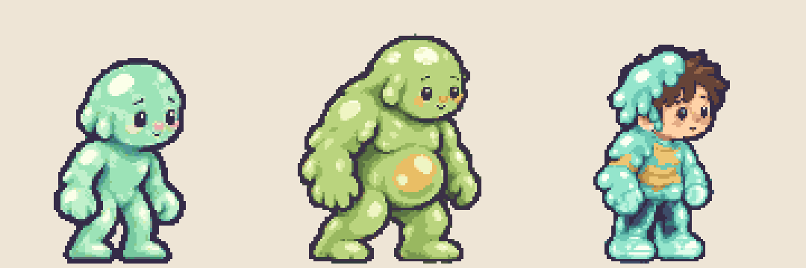

# 귀여운 슬라임 인간형 3종 · 120px · v002

사용자의 “좀 귀여운 느낌” 피드백에 맞춘 v002 미술 수정본이다. 사람의 머리·목·몸통·두 팔·두 다리를 유지하면서, 둥근 얼굴·작은 반짝이는 눈·짧고 말랑한 손발·파스텔 젤리 표면으로 바꿨다. 작은 표정과 부드러운 명암으로 일반형·통통한 대형·실제 사람 구조 대상을 구분한다. 이전 디자인은 [Monsters](../Monsters/README.md)에 그대로 보존한다.

## 편집 정본

| 구분 | Aseprite · 각28프레임/5태그 | 전체 포즈 |
| --- | --- | --- |
| 일반 좀비 · 민트 | [zombie_01_normal_120.aseprite](zombie_01_normal_120.aseprite) | [시트](z01_normal/Previews/all_actions_2x.png) |
| 큰 좀비 · 피스타치오 | [zombie_02_large_120.aseprite](zombie_02_large_120.aseprite) | [시트](z02_large/Previews/all_actions_2x.png) |
| 일반 사람 · 청록 전신 점액 코팅 | [zombie_03_rescue_human_120.aseprite](zombie_03_rescue_human_120.aseprite) | [시트](z03_human/Previews/all_actions_2x.png) |

[3종 전체 동작 GIF](Previews/three_characters_all_actions_3x.gif) · [실제 크기](Previews/lineup_native.png) · [점액 없는 사람 원본](z03_human/human_without_slime_120.aseprite) · [에셋 목록](asset_manifest.json) · [검수](QA/review.md)

## 동작과 파일

3종 × Idle4 / Walk6 / Run6 / Attack6 / Dead6 = **15클립·84프레임**. 합성 캔버스120×120, 오른쪽 측면/약한3/4 시점, 알파0/255, 종별 전 동작 불투명 RGB 상한26색이다. `atack`은 `Attack` 태그로 제공한다.

| 동작 | 재생 정책 | 일반/사람 시간 | 큰 좀비 시간 |
| --- | --- | --- | --- |
| Idle | 반복 | 각200ms | 각230ms |
| Walk | 반복 | 각130ms | 각150ms |
| Run | 반복 | 각80ms | 각90ms |
| Attack | 1회 | 120/90/70/80/100/140ms | 동일 |
| Dead | 1회·마지막 유지 | 90/100/120/140/170/400ms | 동일 |

Walk는 느린 뒤뚱거림, Run은 팔 스윙·큰 보폭·공중 구간을 포함한 별도 작화다. 일반형은 말랑한 한손 휘두르기, 큰 좀비는 두 팔 내려찍기, 사람은 점액에 끌린 팔 뻗기다. 사냥종의 Dead는 낮은 젤리 웅덩이로 끝난다. 구조 대상 Dead는 점액이 벗겨지고 **살아 있는 사람이 무릎을 꿇고 도움을 요청**한다.

각 `<id>`는 `z01_normal`, `z02_large`, `z03_human`이다.

| 위치 | 내용 |
| --- | --- |
| `<id>/Clips/` | 동작별120px 편집 원본5개 |
| `<id>/Export/Frames/<Action>/` | 120×120 투명 PNG 프레임 |
| `<id>/Export/Sheets/` | 가로 PNG 시트·프레임 영역·시간 JSON |
| `<id>/Export/Left/<Action>/` | 오른쪽 원본의 수평 반전 PNG |
| `<id>/Export/Gifs/` | 실제120px GIF5개 |
| `<id>/Previews/` | 최근접3배 GIF·전체 포즈·밝고 어두운 배경 |
| `<id>/Parts/Native/` | 레이어별28프레임/5태그 라이브러리 |
| `<id>/Parts/<Action>/` | 비어 있지 않은 잘린 파츠 PNG |
| `<id>/Export/parts.json` | 파츠별 원점·크기·피벗·레이어 |
| `<id>/pose_metadata.json` | 시간·루프·원화 셀·배율·정렬 보정 |

GIF는 반복 검토용이다. Attack/Dead 단발과 Dead 마지막 유지 정책은 JSON에 있다. 3종 동시 비교 GIF는 일반형의 시간을 공통 사용하며, 각 개별 클립과 GIF는 종별 시간을 유지한다. 왼쪽 PNG는 별도 시점 작화가 아닌 수평 반전이다.

## 파츠·좌표

레이어 순서는 아래→위 일반/대형 **GelBody / SurfaceHighlights / DripsFX**, 사람 **HumanBody / SlimeCoat / DripsFX**. 기본 전부 표시, Normal, opacity255. 하이라이트를 끈 아래에도 점액 몸체를 채웠고, 사람의 코팅 아래에는 완전한 옷·피부·머리를 복원했다. DripsFX는 분리된 점액 방울과 벗겨진 웅덩이를 담으며 해당 효과가 없는 프레임은 비어 있다. 일반형 DripsFX는 비어 있다. 점액 본체는 연속 작화이므로 팔·다리별 리깅 파츠로 분리한 형태는 아니다. SlimeCoat에는 원래 합성의 노출면 색/외곽선을 맞추는 보정 픽셀도 포함한다.

9개 파츠 라이브러리는 총252프레임 슬롯, 비어 있지 않은 PNG는173슬롯이다. 중복 해시는 [part_inventory.json](QA/part_inventory.json)에 있다. 슬롯은 고유 작화 수를 뜻하지 않는다. 각 PNG를 `parts.json`의 `origin_xy`에 순서대로 놓으면 native 합성과 일치한다. 84포즈 모두 실제26색이고,64개 저장/재오픈 표시 상태와 복원 HumanBody28포즈를 검증했다.

좌상단 원점, 오른쪽 피벗(52,118), 왼쪽 피벗(68,118). Unity 정규화는 오른쪽(0.433333,0.016667). 픽셀 반전은 `x_left=119-x_right`, 경계 피벗은 `120-x_right_root`다. 기준 바닥 마지막 픽셀y117/경계y118, Walk 일부 -1px, Run 일부 -1/-3px. 프레임별 마무리 이동은 `finish_offset_xy`다. Run은 몸체 경계 중심, 나머지는 낮은 발 범위 중심을 가로 정렬에 사용한다.

## 제작·보존

**Built-in ImageGen**으로 귀여운 디자인 기준과 종별 동작 보드·사람 아래층 복원 보드·사람의 점액 해제/전신 코팅 보완을 총7회 생성했다. [정확한 프롬프트와 참조](Source/generation_prompts.json), [생성 보드](Source/Generated/Boards), [미술 방향](Source/art_direction.md)을 보관한다. 6열×5행 보드의 Idle6셀 중4셀, 나머지 동작은 각6셀을 선택해 종별28포즈를 만들었다. [추출 기록](Source/board_splitting.json). 실제로 이어진 몸체 전체를 먼저 추출한 뒤 행/열에 배정해 셀 경계를 넘은 손발을 보존했다. 재배열한20장 중간 시트에서 Aseprite 최근접 샘플링·Oklab 팔레트 제한·2단계 알파·정렬·재질 분리·복원을 수행했다. 120px 전부 수작업 신규 작화로 표기하지 않는다.

재현 순서: `Scripts/split_boards.lua` → `Scripts/build_monsters.lua` → `Scripts/export_validate_monsters.lua` → `Scripts/qa_overviews.lua` → 저장 native에서 GIF 출력 → `Scripts/finalize_package.ps1`. Lua에는 `--script-param root=<이 폴더 절대 경로>`, PowerShell에는 `-Root <이 폴더 절대 경로>`를 전달한다. native를 편집한 뒤 재빌드하기 전에는 편집본과 해시를 보존한다.

기존 Monsters3종·순덕·오토바이 native는 보존했고 [SHA-256 결과](QA/source_preservation.json)에 기록한다. 이 폴더는 아트 출력이며 Unity Animator·프리팹·씬 연결과 게임 실화면 검수는 수행하지 않았다. 큰 좀비는 일반 몬스터, 구조 대상은 실제 사람이라는 역할을 유지한다.

## 인간 구조 대상 전신 슬라임 수정

기존 v002의 같은 파일을 갱신했다. 머리·양어깨·가슴/배/등·허리/골반·양팔/양손·양다리/무릎/발목/신발까지 청록색 외피가 이어진다. 따뜻한 얼굴과 작은 의상 패치를 남겨 실제 사람이 내부에 있음을 구분한다. Idle/Walk/Run/Attack과 Dead 전반에 적용하고, Dead 후반은 전신 외피가 내려앉아 마지막 두 포즈에서 살아 있는 사람이 드러나게 했다.

코팅 없는 복원 원화는 기존 것을 그대로 사용했다. 수정 전 인간형과 원화·동작/파츠/출력은 [보존 폴더](QA/BeforeFullBodyCoat_20261030_194506)에 해시와 함께 남겼다. 사람만 재생성할 때 split_boards/build_monsters에 추가로 `--script-param only=z03_human`을 전달하면 다른 두 native를 쓰지 않고 공통 인덱스만 합친다.
