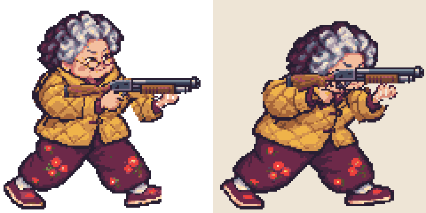

# 순덕 Walking v2 · tactical · 2026-11-02

기존 순덕 Aseprite에 전방으로 몸을 숙이고 무릎을 가볍게 굽힌 전투 보행6포즈를 추가했다. 기존 순덕의 회색 곱슬머리·안경·겨자색 깔깔이·꽃무늬 바지·와인색 신발과 독립 샷건을 유지한다. 새 몸체/다리 작화에 기존 Aim3의 분리 팔·샷건을 머리/볼 기준으로 정렬해, 걷는 중에도 총이 안정적으로 어깨 가까이 유지되게 했다.

- **[추가된 편집 정본 · 33프레임/7태그](../grandma_01_sundeok_120.aseprite)**
- [기존 걷기 · walk_v1_normal](../Clips/sundeok_walk_v1_normal.aseprite) · [새 걷기 · walk_v2_tactical](../Clips/sundeok_walk_v2_tactical.aseprite)
- [두 걷기 비교 GIF](Previews/normal_vs_tactical_3x.gif) · [전술 걷기 GIF](Previews/walk_v2_tactical_3x.gif) · [PNG 시트](Export/Sheets/sundeok_walk_v2_tactical.png)
- [프롬프트](Source/generation_prompts.json) · [원화](Source/walk_v2_tactical_body_generated.png) · [좌표/시간](pose_metadata.json) · [검사](QA/validation.json)

## 태그와 프레임

| 태그 | master 프레임 | 시간 |
| --- | --- | --- |
| Idle | 1–4 | 기존 유지 |
| walk_v1_normal | 5–10 | 각110ms |
| Reload | 11–16 | 기존 유지 |
| Aim | 17–19 | 기존 유지 |
| Fire | 20–23 | 기존 유지 |
| Collect | 24–27 | 기존 유지 |
| walk_v2_tactical | 28–33 | 각140ms · 반복 |

기존27프레임은 모든 레이어의 픽셀과 프레임 시간을 그대로 보존했다. 이전 master는 동작 태그의 끝이27프레임까지 늘어나 있었으므로, 원래 동작별 프레임 구간에 맞춰 명시적으로 정리했다. 기존 `Clips/sundeok_walk.aseprite`는 같은 v1 영상/새 태그를 가진 호환 파일로 유지한다. Source 메타데이터의 기존 `action=Walk`는 런타임 호환 별칭이며 `aseprite_tag=walk_v1_normal`과 대응한다.

비교 GIF에서는 양쪽6포즈를 대응해 보여주려고 둘 다140ms로 재생한다. 실제 v1 클립/GIF의110ms는 유지한다. 실제 게임에 연결된 걷기는 현재 v1이며, 이번 요청으로 추가한 v2는 Aseprite·PNG·GIF 아트다.

## 파츠와 좌표

Body / BackArm / Weapon / FrontArm / Ammo / Pickup / FX의7레이어를 유지한다. 새 걷기는 Body·BackArm·Weapon·FrontArm이 비어 있지 않고, Ammo/Pickup/FX는 비어 있다. 무기를 끄면 팔/손이 남고, 팔/무기를 끄면 가려졌던 완전한 깔깔이 몸체가 남는다. 기존 Aim 프레임19의 무기는 이동만 했으며 회전·변형·재생성하지 않았다. 독립 샷건 원본도 그대로다.

새 동작의6프레임 파츠 라이브러리는 [Parts/Native](Parts/Native), 잘린24개 PNG와 원점/피벗은 [parts.json](Export/parts.json)에 있다. 기존 root의7개 Parts/Native 라이브러리는33프레임/7태그로 확장했고 전체231슬롯이다. 기존116개 PNG와 새24개를 합친140슬롯은 고유 작화140개라는 의미가 아니다.

120×120, 기존 공통26색, 알파0/255, 기본 전 레이어 표시. 피벗(60,118), 바닥 마지막 픽셀y117. 총구·손잡이·머리·허리·상체 이동값은 pose_metadata.json에 있다. 새 머리의 좌우 흔들림은 약1px 이내이며 총은 머리 움직임에 맞춰 안정적으로 유지한다.

## 제작·검수

Built-in ImageGen으로 팔/손/무기가 없는 새로운 전방 기울임6포즈 원화를1회 생성했다. Aseprite에서 최근접 샘플링·기존26색 매핑·머리/바닥 정렬 후 기존의 독립 Aim 팔·샷건을 합성했다. 기존 walk를 단순 회전해 만든 결과로 표기하지 않는다.

저장/재오픈한33프레임/7태그를 확인했고 기존27×7레이어 슬롯 및 기존 시간은 차이0이다. 새 PNG·시트·분리 파츠 재합성·7개33프레임 라이브러리는 master와 일치한다. 새6포즈는 서로 다르고 v1과도 구별된다. 각각26색/이진 알파/캔버스 여백을 통과했다. 샷건은 Aim19의 무기와 평행 이동 후 정확히 같다. 대표1/3/5포즈의4파츠를 solo/hidden으로 저장/재오픈한24개 상태를 검사했다. [파일 검사](QA/validation.json) · [GIF 크기/프레임/시간](QA/gif_validation.json) · [기존 소스 해시](QA/source_preservation.json).

실제 크기와 확대 비교, 무기 숨김, 몸체 단독, 어두운 배경에서 시각 확인했다. 원본/이전 파츠·클립·문서는 [수정 전 보존](../QA/BeforeTacticalWalk_20261102_003156)에 있다. 빌드/검수 Lua는 [Scripts](Scripts)에 있으며 생성 후보를 검증한 뒤 canonical을 저장한다. 재생성 전에 최신 편집본을 보존해야 한다. 기존6동작용 build_asset_pack.lua는 v2가 추가된 master를 덮어쓰지 않도록 보호했다.
