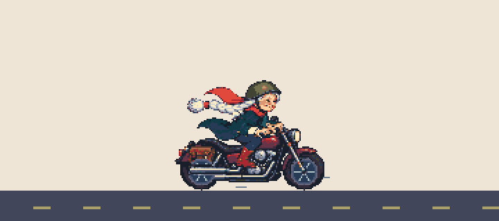

# GrandmaShooter120 · v002 캐릭터 에셋

2026-10-29. 현재 v001의 순덕 base를 기준으로 [기획서_02 v1.7](https://app.notion.com/p/4067313398e08130965aebafbb62a76d)의 1차 6행동을 새로 작화한 v002다. 회색 곱슬머리·안경·겨자색 깔깔이·꽃무늬 자주 바지·와인색 신발과 독립 샷건을 유지했다. v001의 파츠 변형 모션을 재출력한 것이 아니라 동작별 생성 원화를 사용했다.

## 바로 열기

- **[편집 정본 · 43프레임/9태그](grandma_01_sundeok_120.aseprite)**
- **[최신 전술 v2 · 좁은 앞꿈치 보행/장전/발사](TacticalV2/README.md)** · [연속 GIF](TacticalV2/Previews/tactical_v2_set_3x.gif)
- **[독립 샷건 원본](Weapons/Shotgun/sundeok_shotgun.aseprite)** · [PNG](Weapons/Shotgun/sundeok_shotgun.png) · [무기 좌표](Weapons/Shotgun/sundeok_shotgun.json)
- [전체 포즈 · 실제 크기](Previews/all_poses_native.png) · [2배](Previews/all_poses_2x.png) · [6동작 대표 포즈](Previews/six_actions_3x.png)
- [걷기 중 조준·사격 GIF](Previews/Walk_Aim_Fire_3x.gif) · [편집 원본](sundeok_walk_aim_fire_demo.aseprite)
- [에셋 목록](asset_manifest.json) · [검수](QA/review.md)

## 동작 파일

| 동작 | 프레임 | 편집 원본 | 확대 GIF | PNG 시트 |
| --- | ---: | --- | --- | --- |
| Idle · 대기 | 4 | [Aseprite](Clips/sundeok_idle.aseprite) | [GIF](Previews/Idle_3x.gif) | [PNG](Export/Sheets/sundeok_idle.png) |
| walk_v1_normal · 기존 걷기 | 6 | [Aseprite](Clips/sundeok_walk_v1_normal.aseprite) | [GIF](Previews/Walk_3x.gif) | [PNG](Export/Sheets/sundeok_walk.png) |
| walk_v2_tactical · 좁은 앞꿈치 걷기 | 6 | [Aseprite](Clips/sundeok_walk_v2_tactical.aseprite) | [GIF](TacticalV2/Previews/walk_v2_tactical_3x.gif) | [PNG](TacticalV2/Export/Sheets/walk_v2_tactical.png) |
| reload_v1_normal · 기존 장전 | 6 | [Aseprite](Clips/sundeok_reload_v1_normal.aseprite) | [GIF](Previews/Reload_3x.gif) | [PNG](Export/Sheets/sundeok_reload.png) |
| reload_v2_tactical · 전술 장전 | 6 | [Aseprite](Clips/sundeok_reload_v2_tactical.aseprite) | [GIF](TacticalV2/Previews/reload_v2_tactical_3x.gif) | [PNG](TacticalV2/Export/Sheets/reload_v2_tactical.png) |
| Aim · 총 올려 조준 | 3 | [Aseprite](Clips/sundeok_aim.aseprite) | [GIF](Previews/Aim_3x.gif) | [PNG](Export/Sheets/sundeok_aim.png) |
| fire_v1_normal · 기존 발사 | 4 | [Aseprite](Clips/sundeok_fire_v1_normal.aseprite) | [GIF](Previews/Fire_3x.gif) | [PNG](Export/Sheets/sundeok_fire.png) |
| fire_v2_tactical · 짧은 반동/회복 | 4 | [Aseprite](Clips/sundeok_fire_v2_tactical.aseprite) | [GIF](TacticalV2/Previews/fire_v2_tactical_3x.gif) | [PNG](TacticalV2/Export/Sheets/fire_v2_tactical.png) |
| Collect · 숙여 줍기/일어나기 | 4 | [Aseprite](Clips/sundeok_collect.aseprite) | [GIF](Previews/Collect_3x.gif) | [PNG](Export/Sheets/sundeok_collect.png) |

`Export/Frames/<동작>/`에는 120×120 투명 합성 PNG, `Export/Left/<동작>/`에는 좌우 반전 검수용 PNG, `Export/Gifs/`에는 실제 120px GIF가 있다. 시트 JSON에는 프레임 영역과 시간이 있다. 왼쪽 이미지는 별도 시점 작화가 아닌 수평 반전이다.

## 파츠와 합성

레이어는 아래→위 **Body / BackArm / Weapon / FrontArm / Ammo / Pickup / FX**. 기본 전부 표시, Normal, opacity 255. Body는 팔·총을 지운 뒤 옷을 복원한 몸체다. 소매에 남던 원화의 총 픽셀을 제거하고 무기에 가렸던 소매·일부 손을 Aseprite에서 보완했다. Idle도 편집 원본은 팔과 무기를 분리하며 기획의 통그림 용도는 합성 PNG/GIF로 제공한다.

| 독립 파츠 라이브러리 | 내용 |
| --- | --- |
| [Body](Parts/Native/sundeok_body.aseprite) | 머리·몸통·다리, 43프레임/9태그 |
| [BackArm](Parts/Native/sundeok_backarm.aseprite) · [FrontArm](Parts/Native/sundeok_frontarm.aseprite) | 분리 팔, 각 43프레임/9태그 |
| [Weapon](Parts/Native/sundeok_weapon.aseprite) | 포즈별 샷건 배치, 43프레임/9태그 |
| [Ammo](Parts/Native/sundeok_ammo.aseprite) · [Pickup](Parts/Native/sundeok_pickup.aseprite) · [FX](Parts/Native/sundeok_fx.aseprite) | 장전 탄약·수거 주머니·총구 섬광, 사용하지 않는 프레임은 비움 |

기존 `Parts/<동작>/`의116개와 `TacticalV2/Parts/Frames/<태그>/`의68개를 합쳐 현재 **184개 PNG 슬롯**이 있다. 이는 고유 작화184장을 뜻하지 않는다. 역할별 중복 제거 수는 [part_inventory.json](QA/part_inventory.json)에 있다. [sundeok_parts.json](Export/sundeok_parts.json)의 `origin_xy`에 각 PNG를 놓고 레이어 순서대로 합성하면 원본과 정확히 일치한다. `pivot_crop_xy`는 잘린 PNG 기준, `pivot_canvas_xy`는 전체 120px 기준이다. Ammo/Pickup의 기본 피벗은 무기 기준 참조 좌표이므로 직접 부착할 때 해당 프레임의 손/PNG 원점도 함께 사용한다.

독립 샷건은 **78×17px**이며 v001의 원본/PNG를 그대로 보존 복사했다. 손과 몸체가 없고 가려진 개머리판·방아쇠/가드·펌프·총열을 포함한다. 포즈별 Weapon PNG는 이 원본을 배치·회전한 것이다. 수거 주머니는 재화 종류가 미정인 시험 소품이다.

합성 캔버스 **120×120**, 투명 제외 전 동작 RGB 합집합 **26색**, 알파 **0/255**. [26색 GPL](Export/sundeok_26.gpl). 원점은 좌상단, 바닥 마지막 픽셀 y117/경계 y118, 캐릭터 기준 피벗 `(60,118)`/Unity 정규화 `(0.5, 0.016667)`. 포즈별 어깨·손·총구는 [pose_metadata.json](Source/pose_metadata.json), 걷기 합성 이동값은 [demo_metadata.json](Source/demo_metadata.json)에 있다.

[컬러 UI 초상](UI/sundeok_portrait.aseprite) · [PNG](UI/sundeok_portrait.png), [잠금 UI 초상](UI/sundeok_portrait_locked.aseprite) · [PNG](UI/sundeok_portrait_locked.png)도 별도로 저장했다. `Export/sundeok_locked.png`는 월드 전신 실루엣이다.

## 제작·보존·검수

Built-in ImageGen으로 base를 참조한 동작 원화 6종, 팔/무기를 제거해 옷을 복원한 몸체 원화 5종, 걷기 보완 1회를 생성했다. 최초12건에 이전 전술 걷기1건·이번 전술 v2 보완5건을 더한 [원문 프롬프트18건](Source/generation_prompts.json), [생성 원본](Source/Generated), [기획서 스냅샷](Source/notion_02_snapshot.md)을 보관한다. Aseprite에서 최근접 샘플링·26색 매핑·셀 정렬·무기 분리·가려진 소매/손 복원·접점 보완·작은 섬광/탄약을 작업했다. 처음부터 120px에서 전부 손으로 그렸다고 표기하지 않는다. 걷기는 보완 생성 원화를 사용하며 다리/신발을 좌우로 뒤집는 변형은 최종본에서 사용하지 않는다.

재현 순서: `sample_actions.lua` → `build_asset_pack.lua` → `export_validate.lua` → `export_ui.lua` → `validate_packages.lua`. 각 스크립트의 `root`는 v002 절대 경로. GIF는 저장된 Aseprite 파일에서 Aseprite export_gif로 출력했다. 사용자 편집 후 재실행 전 보존본과 해시를 만든다.

기존 v001 base·원본·무기 5개 해시는 전부 일치했다. [이전/이후 비교](QA/base_hashes_after.json). 기존 64px와 게임 사용 아트는 변경하지 않았다.

최초27프레임의26색·알파·바닥/좌우 여백·PNG/시트/분리 재합성·좌우 반전·54개 저장/재오픈 표시 상태를 검증했다. 별도 6클립 27프레임과 7파츠 라이브러리 189프레임 슬롯, UI 2쌍도 원본과 픽셀 일치했다. [기계 검사](QA/validation.json) · [패키지 검사](QA/package_validation.json) · [GIF 검사](QA/gif_validation.json).

이번 결과는 아트 에셋과 합성 시험이다. Unity Clip·Animator·씬·PPU 연결과 게임 실화면 검수는 수행 범위에 포함하지 않았다. Hit/Victory/차 마시기/추가 시점/다른 할매는 후속 범위다.

## 오토바이 할머니 추가 · 2026-10-30

사용자 요청의 둥근 올리브색 1레벨 반모형 헬멧과 질주 중 수집을 반영했다. Idle 4 / Ride 6 / Collect 8, 총 18프레임이며 인물·팔·차체·바퀴·소품·속도 효과를 분리했다.

- **[오토바이 편집 정본](grandma_05_motorcycle_120.aseprite)** · [파일 안내/검수](Motorcycle/README.md)
- [독립 오토바이](Motorcycle/Vehicle/motorcycle.aseprite) · [인물만](Motorcycle/motorcycle_rider_120.aseprite)
- [주행 → 수집 → 계속 주행 · 24프레임 GIF](Motorcycle/Previews/drive_by_pickup_world_2x.gif)

## 슬라임 인간형 몬스터 3종 추가 · 2026-10-30

**슬라임 재질 / 인간 좀비 형태**의 일반형·큰 좀비와, 별도 청록 점액을 뒤집어쓴 실제 사람 구조 대상을 만들었다. 각 120×120, Idle 4 / Walk 6 / Run 6 / Attack 6 / Dead 6, 총 **15클립 / 84포즈**다. 구조 대상의 Dead는 점액이 벗겨진 뒤 사람이 살아서 도움을 요청하는 마무리다.

- **[3종 편집 원본·출력·프롬프트 안내](Monsters/README.md)** · [검수](Monsters/QA/review.md)
- [일반 좀비](Monsters/zombie_01_normal_120.aseprite) · [큰 좀비](Monsters/zombie_02_large_120.aseprite) · [구조 대상](Monsters/zombie_03_rescue_human_120.aseprite)
- [전체 동작 GIF](Monsters/Previews/three_characters_all_actions_3x.gif)

## 귀여운 몬스터 수정본 · 현재 v002

징그러운 인상을 줄이라는 사용자 피드백에 맞춰 3종을 둥근 얼굴·작은 반짝이는 눈·말랑한 손발·파스텔 젤리의 SD 인간형으로 다시 제작했다. Idle/Walk/Run/Attack/Dead,120×120,15클립·84포즈를 유지한다. 이전 Monsters는 보존하며 **최신 귀여운 정본은 Monsters_Cute**다.

- **[귀여운 v002 파일 안내](Monsters_Cute/README.md)** · [검수](Monsters_Cute/QA/review.md)
- [일반 좀비](Monsters_Cute/zombie_01_normal_120.aseprite) · [큰 좀비](Monsters_Cute/zombie_02_large_120.aseprite) · [구조 대상](Monsters_Cute/zombie_03_rescue_human_120.aseprite)
- [귀여운 3종 전체 동작 GIF](Monsters_Cute/Previews/three_characters_all_actions_3x.gif)

## Tactical v2 보완 · 2026-11-02

최신 master는 **43프레임/9태그**다. walk_v1_normal(5–10) / reload_v1_normal(11–16) / fire_v1_normal(20–23)을 보존하고, walk_v2_tactical(28–33)을 좁은 앞꿈치 걸음으로 수정했다. 같은 준비 자세의 reload_v2_tactical(34–39), fire_v2_tactical(40–43)을 추가했다. 기존 첫27프레임의 픽셀·시간은 차이0이며7개 파츠 라이브러리도43프레임/9태그로 확장했다.

**[현재 v2 파일·방법·검수](TacticalV2/README.md)** · [보행/장전/발사 GIF](TacticalV2/Previews/tactical_v2_set_3x.gif) · [기계 검사](TacticalV2/QA/validation.json). Body·팔·무기·탄약·효과를 분리했다. 2026-11-02 Unity 후속에서 Walk/Aim/Fire를 v2로 연결했다. 조준은 master40의 준비 자세를 유지하며, [게임 연결·검증 기록](../../../../../Docs/Sundeok-TacticalV2-Integration.md)에 원본 선택과 결과가 있다.

[TacticalWalk](TacticalWalk/README.md)는 이전 넓은 보폭 v2의 보존 기록이다. 현재 출력은 TacticalV2 폴더에서 찾는다. 편집 전33프레임 원본과 관련 파일의 [보존본·해시](QA/BeforeTacticalV2Set_20261102_005752/backup_hashes.json)를 남겼다.
