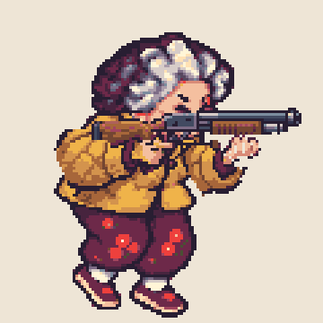

# 순덕 Tactical v2 · 좁은 앞꿈치 보행 / 장전 / 발사

2026-11-02. 사용자의 “보폭을 더 좁히고 발끝으로 걷는 느낌, 장전과 fire도 v2” 요청을 반영한 현재 v002다. 이전 넓은 전술 걷기 6프레임을 교체하고 같은 낮은 전방 자세의 장전 6프레임·발사 4프레임을 추가했다. 편집 정본은 아래 한 파일이다.

- **[편집 정본 · 120×120 / 43프레임 / 9태그](../grandma_01_sundeok_120.aseprite)**
- [세 동작 연속 GIF · 3배](Previews/tactical_v2_set_3x.gif) · [포즈 시트 · 실제 크기](Previews/v2_set_native.png) · [2배](Previews/v2_set_2x.png)
- [좌표·시간](pose_metadata.json) · [분리 파츠](Export/parts.json) · [프롬프트 5건](Source/generation_prompts.json) · [검수](QA/review.md)

| 태그 | master 프레임 | 시간 | 독립 클립 | GIF / PNG |
| --- | --- | --- | --- | --- |
| walk_v1_normal | 5–10 | 각110ms | [Aseprite](../Clips/sundeok_walk_v1_normal.aseprite) | 기존 그대로 |
| reload_v1_normal | 11–16 | 각150ms | [Aseprite](../Clips/sundeok_reload_v1_normal.aseprite) | 기존 그대로 |
| fire_v1_normal | 20–23 | 100/70/110/150ms | [Aseprite](../Clips/sundeok_fire_v1_normal.aseprite) | 기존 그대로 |
| walk_v2_tactical | 28–33 | 각140ms · 반복 | [Aseprite](../Clips/sundeok_walk_v2_tactical.aseprite) | [GIF](Previews/walk_v2_tactical_3x.gif) / [PNG](Export/Sheets/walk_v2_tactical.png) |
| reload_v2_tactical | 34–39 | 각150ms · 단발 | [Aseprite](../Clips/sundeok_reload_v2_tactical.aseprite) | [GIF](Previews/reload_v2_tactical_3x.gif) / [PNG](Export/Sheets/reload_v2_tactical.png) |
| fire_v2_tactical | 40–43 | 100/70/100/150ms · 단발 | [Aseprite](../Clips/sundeok_fire_v2_tactical.aseprite) | [GIF](Previews/fire_v2_tactical_3x.gif) / [PNG](Export/Sheets/fire_v2_tactical.png) |

나머지 태그는 Idle1–4 / Aim17–19 / Collect24–27이다. 기존 첫27프레임의 모든 레이어 픽셀과 시간을 보존했다. 기존 Reload/Fire의 태그만 v1 이름으로 변경했다. `sundeok_walk.aseprite`, `sundeok_reload.aseprite`, `sundeok_fire.aseprite`는 같은 v1 영상을 가진 호환 파일이다.

보행은 신발을 골반 아래에 모으고 뒤꿈치를 들어 작은 앞꿈치 걸음을 만들었다. Body의 y100–117 영역 가로 폭은 이전 전술 걷기의 평균52.7%로 줄었다. 이는 발 주변 실루엣 폭의 측정값이며 이동 거리나 보행 속도가 아니다. 몸의 전방 기울기와 낮은 무릎을 유지한다.

장전·발사는 같은 새 보행의 좁은 준비 자세 Body를 사용한다. 장전은 기존 탄 삽입·손동작·Ammo를 분리한 채 샷건 위치를 높게 맞췄다. 몸통은 허리 y82를 기준으로0–2px 눌리고 다리·발 y83–119는 고정된다. 발사는 몸통을0/−2/−1/0px로 짧게 반동 처리하고 독립 Aim 팔·샷건을0/−3/−1/0px 이동한다. 총구 섬광은 두 번째 프레임(master41)에만 별도 FX로 표시한다.

## 분리 파일과 좌표

레이어는 아래→위 **Body / BackArm / Weapon / FrontArm / Ammo / Pickup / FX**. 기본 전부 표시, Normal, opacity255. Body에는 무기·팔 아래의 깔깔이 몸통이 복원되어 있다. 별도 [78×17 샷건 원본](../Weapons/Shotgun/sundeok_shotgun.aseprite)은 변경하지 않았다.

- `Export/Frames/<태그>/01.png…`: 120×120 투명 합성16장.
- `Export/Left/<태그>/01.png…`: 수평 반전16장, 별도 시점 작화가 아니다.
- `Parts/Frames/<태그>/<레이어>_01.png…`: 비어 있지 않은 잘린 파츠68슬롯. 좌표는 [parts.json](Export/parts.json).
- `Parts/Native/<레이어>.aseprite`: 각16프레임/3태그의 독립 레이어7개. 빈 Ammo/Pickup/FX 셀도 시간 슬롯으로 보존한다.
- 상위 `../Parts/Native/sundeok_<레이어>.aseprite`: 전체43프레임/9태그, 총301시간 슬롯.
- 상위 [전체 파츠 목록](../Export/sundeok_parts.json): 기존116 + 현재 v2의68 =184슬롯. 슬롯 수는 고유 작화 수가 아니다.

합성26색, 알파0/255. 바닥 마지막 픽셀 y117/경계 y118, 기준 피벗(60,118). 좌표는 좌상단 기준이다. 부분 PNG는 `origin_xy`에 놓고 레이어 순서대로 합성한다. 무기·팔 피벗과 손·총구 좌표는 메타데이터를 사용한다. Ammo/FX 피벗은 무기 기준 참조이며 소품의 실제 위치는 원점/손 좌표도 함께 사용한다.

## 제작 방법과 보존

Built-in ImageGen으로 보행·장전·발사 몸체 원화3종, 보행 앞꿈치 보완1회, 배경 알파 추출1회, 총5회를 실행했다. 최종 선택은 [보행 몸체 원화](Source/walk_v2_tiptoe_body.png)다. 장전·발사 생성 원화는 자세·비례의 일관성을 위해 **연구용으로만 보관**하며 최종 셀에는 쓰지 않았다. 최종 두 동작은 새 보행 Body의 준비 자세와 Aseprite의 작은 몸통 압축/반동, 기존 별도 팔·탄약·샷건·섬광을 조합했다. 전부 새로 손으로 그린 작화라고 표기하지 않는다.

[프롬프트 원문·선택 상태](Source/generation_prompts.json)에 입력·출력을 기록했다. 최초 보행 원화와 앞꿈치 보완 원화도 Source에 보존한다. Aseprite에서 최근접 샘플링·26색 매핑·머리 위치 정렬·독립 파츠 조합·팔/총 아래의 몸통 보존을 수행했다.

편집 전33프레임 master와 관련 클립·라이브러리·메타데이터는 [보존본](../QA/BeforeTacticalV2Set_20261102_005752/backup_hashes.json)에 해시와 함께 저장했다. `TacticalWalk`는 이전 넓은 보폭 v2의 보존 기록이고 **현재 출력은 이 TacticalV2 폴더**다.

재현 스크립트: [build_v2_set.lua](Scripts/build_v2_set.lua) → [validate_install.lua](Scripts/validate_install.lua) → 저장 native의 GIF 출력 → [update_catalogs.ps1](Scripts/update_catalogs.ps1). 빌더는 편집 전33프레임 원본을 요구하며 현재43프레임 정본에 재실행하면 중단된다. 사용자 편집 후에는 보존본과 해시를 먼저 남긴다.

원화 제작 시점의 Source 메타데이터에서 `action=Walk/Reload/Fire`는 v1 런타임 호환 별칭이고 `aseprite_tag`가 해당 원본 태그를 가리킨다. GIF는 반복 미리보기이며 장전·발사의 게임 재생 정책은 단발이다.

2026-11-02 Unity 후속: 사용자 요청한 Walk/Aim/Fire를 게임에 연결했다. Walk28–33, Fire40–43, 별도 v2 Aim 태그가 없는 조준은 master40 준비 자세를 유지한다. 실제 게임 선택은 `Assets/HunterGrandma/Art/Sundeok120/pose_metadata.json`에 있으며 6동작/25활성 포즈다. 애니메이션42개·장전음28개 검사 PASS, Unity RenderTexture 캡처 확인. 원본43프레임/9태그와 파츠는 보존했고 native Game View/플레이어 빌드 검수는 미실시다. [Unity 연결 기록](../../../../../../Docs/Sundeok-TacticalV2-Integration.md).
