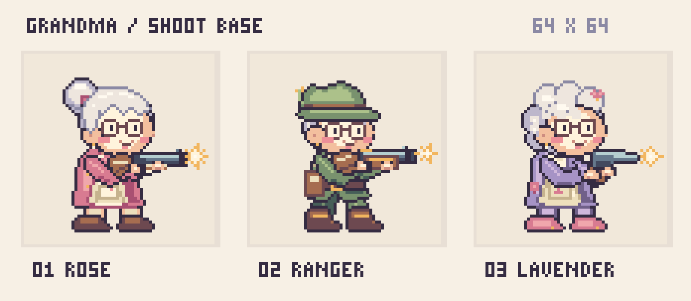

# HG-BASE64 · 할머니 사격 베이스 후보 1–3 · v001

2026-10-21 · **후보 제작·정적 검수 완료 / 디자인 선택 전**

## 후보와 편집 정본

| 후보 | 디자인 | Aseprite 편집 정본 | 투명 PNG |
| --- | --- | --- | --- |
| 1 · Rose | 은색 올림머리, 분홍 가디건, 크림 앞치마, 나무 개머리판 산탄총 | [grandma_01_rose.aseprite](grandma_01_rose.aseprite) | [64×64](Export/grandma_01_rose.png) · [효과 없음](Export/grandma_01_rose_no_fx.png) |
| 2 · Ranger | 은빛 옆머리, 초록 사냥모와 코트, 가방·부츠, 긴 사냥총 | [grandma_02_ranger.aseprite](grandma_02_ranger.aseprite) | [64×64](Export/grandma_02_ranger.png) · [효과 없음](Export/grandma_02_ranger_no_fx.png) |
| 3 · Lavender | 은색 곱슬머리, 꽃핀, 라벤더 옷과 앞치마, 분홍 실내화, 소형 권총 | [grandma_03_lavender.aseprite](grandma_03_lavender.aseprite) | [64×64](Export/grandma_03_lavender.png) · [효과 없음](Export/grandma_03_lavender_no_fx.png) |

각 행의 `.aseprite` 한 개가 그 후보의 편집 정본이다. `Source/InitialPass`는 안경·팔레트 설정을 보정하기 전 첫 시안 보존본이며 현재 정본이 아니다.

## 규격과 제작 방법

- **Aseprite 1.3.18.6**에서 Lua 픽셀 API로 새로 작화·레이어 편집·저장했다. [실제 제작 코드](Scripts/build_candidates.lua)를 함께 보관한다. 외부 캐릭터 그림이나 생성 이미지를 입력으로 사용하지 않았다.
- 캔버스·PNG: **64×64 RGBA**, 논리 픽셀 1px, 오른쪽을 향하는 사격 자세의 **정적 1프레임**. 태그 `shoot_base`, 프레임 duration 100ms는 정적 프레임의 파일 설정이다.
- 흰 머리·큰 안경·장밋빛 볼·웃는 입을 공통으로 두고 머리 모양, 옷, 신발, 총 종류와 팔 자세를 바꿨다. 단순 색상 교체 후보가 아니다.
- 팔레트 28칸: 투명 1 + 후보 공통 불투명 27색. 실제 합성 사용색은 후보 1 **20색**, 후보 2 **19색**, 후보 3 **23색**. project10 후보용 새 팔레트이며 project09 공통 팔레트 채택을 의미하지 않는다.
- 밝은 왼쪽 위 광원, 어두운 자주색 외곽, 완전 투명/불투명 알파, 정수 배율 최근접 확대를 사용한다.

## 레이어와 표시 정책

아래→위 순서이며, 기본은 **7개 모두 표시 / opacity 255 / Normal**이다.

| 순서 | 역할 | 비고 |
| --- | --- | --- |
| 01 | 다리·신발 | 발 접지 유지 |
| 02 | 의상·몸통·앞치마 또는 가방 | 팔과 무기를 숨겨도 몸통 면이 남음 |
| 03 | 머리·머리카락·얼굴·안경·모자/장식 | 머리 전체로 함께 편집 가능 |
| 04 | 소매·양팔 | 어깨–팔꿈치 연결 |
| 05 | 총 | 몸과 분리된 장비 |
| 06 | 손·그립 | 총 위에 놓는 손가락 |
| 07 | 총구 효과 | 끄면 효과 없는 베이스. 참조·마스크·배경 레이어는 없음 |

## 좌표와 접점

PNG 좌상단 `(0,0)`, 오른쪽 +x·아래 +y, 단위 px. 모든 후보의 발 바닥 픽셀은 `y=59`, 바닥 경계는 `y=60`이다. 공통 몸 기준은 `(29,60)`. 추후 Unity 피벗을 같은 기준으로 쓸 경우 `(0.453125,0.0625)`가 후보값이며 importer에 적용한 값은 아니다.

| 후보 | 주손 그립 기준 | 받치는 손 기준 | 총구 기준 | 전체 불투명 bounds `(x,y,w,h)` |
| --- | --- | --- | --- | --- |
| 1 | `(37,39)` | `(44,37)` | `(54,35)` | `(13,8,49,52)` |
| 2 | `(37,38)` | `(45,37)` | `(54,34)` | `(15,9,48,51)` |
| 3 | `(43,40)` | `(39,40)` | `(54,35)` | `(15,9,48,51)` |

위 접점은 후속 작화용 기준점이다. 총구 효과의 끝이나 자동 크롭 경계와 구분한다. PNG는 자동 trim 없이 64×64를 유지한다.

## 출력·검수·다음 작업

- [후보 비교 시트](Previews/grandma_candidates_1-3.png) · [실제 64px 나열](Previews/grandma_candidates_native.png)
- [파일 검사](QA/native_validation.json) · [작화 검수](QA/visual_review.md) · [납품 해시](QA/delivery_hashes.json)
- [제작 메타데이터](Export/grandma_candidates.json) · [27색 편집 팔레트](Export/grandma_palette.gpl)
- 저장된 native를 다시 열어 PNG 차이 0, 부분 알파 0, 팔레트 포함 여부와 42개 실제 표시 상태를 확인했다. 모든 레이어의 단독 표시·하나씩 숨김, 전체 합성, 64px, 밝고 어두운 배경을 시각 검수했다.
- 이번 범위는 베이스 후보 3개다. 연속 발사 동작·방향별 포즈·게임 씬 연결은 후속 범위다. `Assets/Artsource`에 파일을 둔 것과 런타임 연결은 별개다.
- 디자인을 선택하면 새 버전에서 선택 후보를 입력으로 보존하고 idle·반동·발사·장전 등 필요한 동작을 발전시킨다.

공통 기준: [Aseprite 작업 규칙](../../../Guides/AsepriteWorkflow.md). 검수 재현은 [validate_and_preview.lua](Scripts/validate_and_preview.lua)를 `root=<이 폴더의 절대 경로>`로 실행한다. 검수 스크립트는 정본 native를 저장하지 않고 `QA/LayerReview/States` 복사본만 저장한다. 제작 스크립트는 기존 native가 있으면 기본적으로 덮어쓰기를 거부한다.
