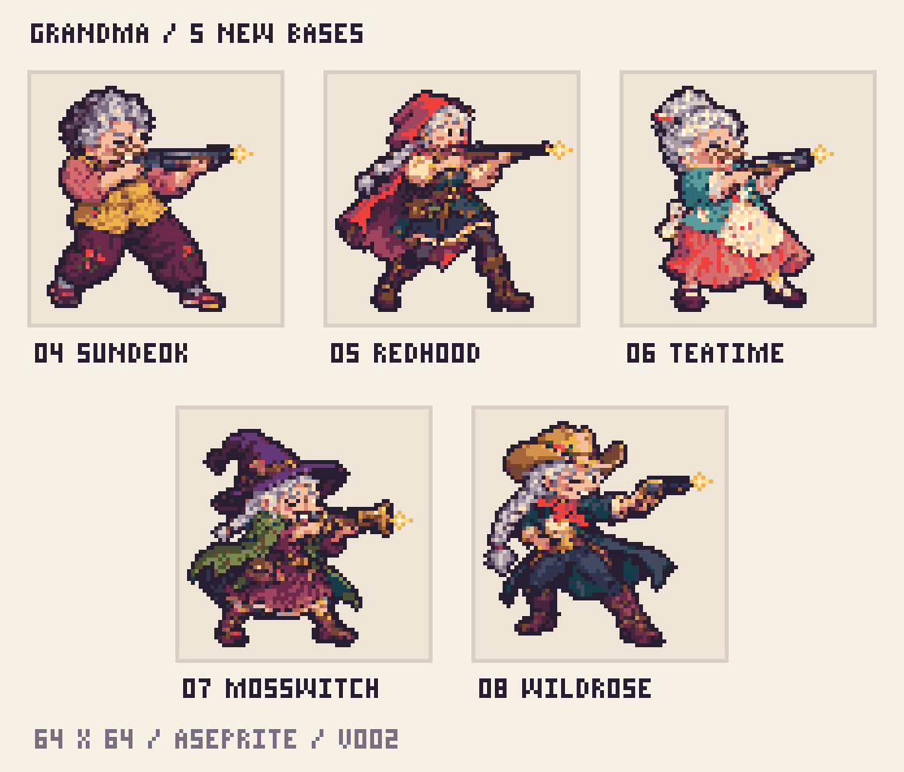

# HG-BASE64 · 추가 베이스 후보 04–08 · v002

## 추가 포즈 · 순덕 할매 앉아서 차 마시기 · 2026-10-28

- 편집 정본: [grandma_04_sundeok_tea.aseprite](grandma_04_sundeok_tea.aseprite)
- 투명 PNG: [grandma_04_sundeok_tea.png](Export/grandma_04_sundeok_tea.png)
- 미리보기: [밝음 8배](Previews/grandma_04_sundeok_tea_8x.png) · [어두움 8배](Previews/grandma_04_sundeok_tea_dark_8x.png)
- 기존 차 마시는 포즈의 머리·상체·팔·손·찻잔·김을 보존해 아래로 2px 이동하고, 의자와 무릎을 굽힌 하체를 Aseprite Lua로 직접 작화했다. 64×64, RGB/RGBA, 정적 1프레임(100ms), `tea_sip_seated` 태그, 기존 33슬롯 팔레트 중 불투명 23색, 기본 10레이어 모두 표시다.
- 아래→위 레이어: `01_Chair`, `02_Seated_Legs_Shoes`, `03_Torso_Vest`, `04_Far_Arm_Sleeve`, `05_Head_Hair`, `06_Face_Glasses`, `07_Teacup`, `08_Near_Arm_Sleeve`, `09_Hands`, `10_Tea_Steam`. 표정 레이어는 머리 위 보정 픽셀이며, 이 파일은 정적 포즈 편집용이다.
- 전체 bounds `(5,5,41,56)`, 발/의자의 마지막 불투명 행 `y=60`/바닥 경계 `y=61`. 입–찻잔 림 접점 `(28,23)`, 받치는 손–잔 밑면 `(30,30)`, 손잡이 쥔 손 `(39,27)`, 의자 좌판 위쪽 `y=45`; 총구는 해당 없음. 좌상단 `(0,0)` 기준.
- 기본 출력은 모든 레이어를 합성하고 64×64/투명을 유지한다. `10_Tea_Steam`을 끄면 김만 숨기고, `01_Chair`를 끄면 의자를 숨긴다. 게임 연결과 애니메이션은 이번 추가 범위에 포함하지 않았다.
- [검수 기록](QA/SundeokTea/review.md) · [규격/20개 표시 상태 검사](QA/SundeokTea/Seated/validation.json) · [앉은 자세 재현 스크립트](Scripts/seat_sundeok_tea.lua)
- 수정 전 서 있는 차 마시기 버전과 해시는 [보존 폴더](QA/SundeokTea/BeforeSeated-20261028-000602/preservation.json)에 있다. 기존 순덕 발사 정본 및 게임용 PNG는 유지했다.

아래는 기존 후보 04–08 제작 기록이다.

2026-10-21 · **새 디자인 방향 5개 제작 / 정적 파일 검수 완료 / 사용자 선택 전**

## 후보와 편집 정본

| 번호 | 방향 | Aseprite 편집 정본 | 투명 64×64 PNG |
| --- | --- | --- | --- |
| 04 | 순덕 할매 — 파마머리·겨자 조끼·꽃무늬 몸빼·산탄총 | [grandma_04_sundeok.aseprite](grandma_04_sundeok.aseprite) | [발사](Export/grandma_04_sundeok.png) · [효과 없음](Export/grandma_04_sundeok_no_fx.png) |
| 05 | 빨간 두건 숲지기 — 붉은 망토·은색 땋은 머리·장총 | [grandma_05_redhood.aseprite](grandma_05_redhood.aseprite) | [발사](Export/grandma_05_redhood.png) · [효과 없음](Export/grandma_05_redhood_no_fx.png) |
| 06 | 찻집 해결사 — 큰 올림머리·청록 가디건·둥근 앞치마·쌍열총 | [grandma_06_teatime.aseprite](grandma_06_teatime.aseprite) | [발사](Export/grandma_06_teatime.png) · [효과 없음](Export/grandma_06_teatime_no_fx.png) |
| 07 | 이끼숲 마녀 할매 — 비뚤어진 보라 모자·초록 망토·나팔총 | [grandma_07_mosswitch.aseprite](grandma_07_mosswitch.aseprite) | [발사](Export/grandma_07_mosswitch.png) · [효과 없음](Export/grandma_07_mosswitch_no_fx.png) |
| 08 | 서부의 꽃할매 — 카우보이 모자·은색 땋은 머리·목수건·권총 | [grandma_08_wildrose.aseprite](grandma_08_wildrose.aseprite) | [발사](Export/grandma_08_wildrose.png) · [효과 없음](Export/grandma_08_wildrose_no_fx.png) |

각 행의 루트 `.aseprite`가 그 후보의 편집 정본이다. 이번 번호는 이전 01–03에 이어 붙였다. [이전 v001](../v001/README.md)은 바이트 그대로 보존했다. 사용자 피드백에 따라 새로 디자인한 후보이며 v001의 색상만 바꾼 결과가 아니다.

## 조사와 원화

- [레퍼런스 조사·출처·후보별 디자인 가설](Reference/Research.md)
- [생성 원화 방향 비교](Previews/concept_directions.png): 1254px 원화를 비교하는 별도 이미지다. **64px 결과는 위의 첫 비교 시트**를 따른다.
- [최종 사용 프롬프트 세트](Source/generation_prompts.json): built-in ImageGen을 후보별 한 번씩 사용했다. CLI/API 생성은 사용하지 않았다.
- [생성 원본 보관](Source/README.md): 모든 원본은 현재 프로젝트 안에 복사했다. 외부 레퍼런스 이미지의 픽셀을 제작물에 붙이지 않았다.

## 규격과 실제 작업

1. 이전 시안의 같은 얼굴·안경·체형·팔 자세를 재검토하고 실루엣과 이야기부터 다섯 방향으로 나눴다.
2. 신규 원화 5개를 생성했다. 실제 파일은 각각 **1254×1254**이며 64px 직접 작화로 표기하지 않는다.
3. Aseprite 1.3.18.6에서 투명 영역의 bounds를 확인하고 같은 중심 샘플 기준으로 64px에 옮겼다. 알파는 128 기준으로 0/255를 정했다. [축소 기록](QA/sampling.json).
4. Aseprite Lua에서 32색의 재질별 명암 팔레트로 대응시킨 후 머리카락의 철색 잔색, 얼굴의 과한 황금색, 안경·눈·입과 외곽선을 보정했다. 총구 효과는 작은 픽셀 도형으로 다시 그려 별도 레이어에 뒀다. [보정 기록](QA/refinement.json).
5. 저장 native 재개봉, 출력 비교, 모든 레이어 단독/숨김, 64px·확대·밝고 어두운 배경을 검수했다.

캔버스·PNG는 모두 **64×64**, RGB 편집 / RGBA 출력, 정적 **1프레임**이다. 태그는 `shoot_base`, 파일상의 duration은 100ms이며 연속 발사 애니메이션이 아니다. 팔레트는 **33칸 = 투명 1 + 불투명 32색**. 실제 합성 사용색은 04부터 **26 / 27 / 27 / 28 / 27색**이다. [최종 GPL 팔레트](Export/grandma_v002_palette.gpl).

## 레이어와 기본 표시

아래→위 순서이며 모두 기본 표시 / opacity 255 / Normal이다.

| 레이어 | 역할 | 편집 범위 |
| --- | --- | --- |
| 01_Contour | 외곽선 보강 | 합성 실루엣의 바깥 1px 윤곽 |
| 02_Character_Combined | 캐릭터·의상·팔다리·손·총의 통합 베이스 | 정적 자세 전체를 픽셀 편집 |
| 03_Face_Expression | 눈썹·눈·안경·볼·입의 보정 픽셀 | 베이스 얼굴 위에 얹는 표정 보정이며 완전한 머리 파츠가 아님 |
| 04_Muzzle_FX | 새로 그린 작은 총구 효과 | 끄면 동일 자세의 효과 없는 베이스 |

이번 작업은 디자인 탐색용 정적 베이스다. 몸통·팔·손·총을 각각 움직일 수 있는 애니메이션 파츠 구조는 아직 만들지 않았다. 선택 후 동작을 만들 때 부위를 분리하고 가려진 면을 그린 뒤 관절·손–총 접점을 다시 검수한다. 현재 4레이어 파일을 완성 애니메이션 리그로 사용하지 않는다.

## 크기·접점

좌상단 `(0,0)`, 오른쪽 +x·아래 +y, 단위 px. 자동 trim 없이 64×64를 유지한다. 전 후보 발 바닥의 마지막 픽셀은 **y=60**, 바닥 경계는 **y=61**이다. 총구 기준 좌표는 효과를 그리는 시작 열과 중심 행이다.

| 후보 | 전체 불투명 bounds `(x,y,w,h)` | 총구 `(x,y)` |
| --- | --- | --- |
| 04 | `(4,3,53,58)` | `(51,20)` |
| 05 | `(2,4,61,57)` | `(57,19)` |
| 06 | `(7,3,47,58)` | `(48,20)` |
| 07 | `(2,5,58,56)` | `(54,28)` |
| 08 | `(2,3,59,58)` | `(55,18)` |

## 검수와 관리

[파일 검수](QA/native_validation.json) · [작화 판단과 남은 범위](QA/visual_review.md) · [납품 해시](QA/delivery_hashes.json) · [제작 메타](Export/grandma_candidates.json)

5개 편집 정본과 발사/효과 없음 PNG 10개는 재개봉 렌더와 픽셀 차이 0이다. 부분 알파 0, 팔레트 밖 사용색 0을 확인했다. 40개 실제 visible 상태를 저장·재개봉해 단독/숨김 시트를 만들었다. 검수용 상태는 `QA/LayerReview/States`에 있으며 정본이 아니다.

원화의 세부 장식·손가락·얼굴 묘사는 64px에서 간략화했다. 특히 05의 얼굴은 다른 후보보다 작고, 어두운 배경에서 04의 바지·07의 모자끝·08의 코트끝 대비가 낮아질 수 있다. 현재는 디자인 비교용 후보 판정이며 최종 선호도 승인이나 실제 게임 장면 검수는 아니다.

제작 코드는 [Scripts](Scripts/refine_candidates.lua), 공통 기준은 [Aseprite 작업 규칙](../../../Guides/AsepriteWorkflow.md)을 따른다. 원본을 다시 생성하는 스크립트는 사용자 수정본에 실행하지 않는다. 루트 파일을 덮기 전 새 버전/보존본·해시를 만든다.
