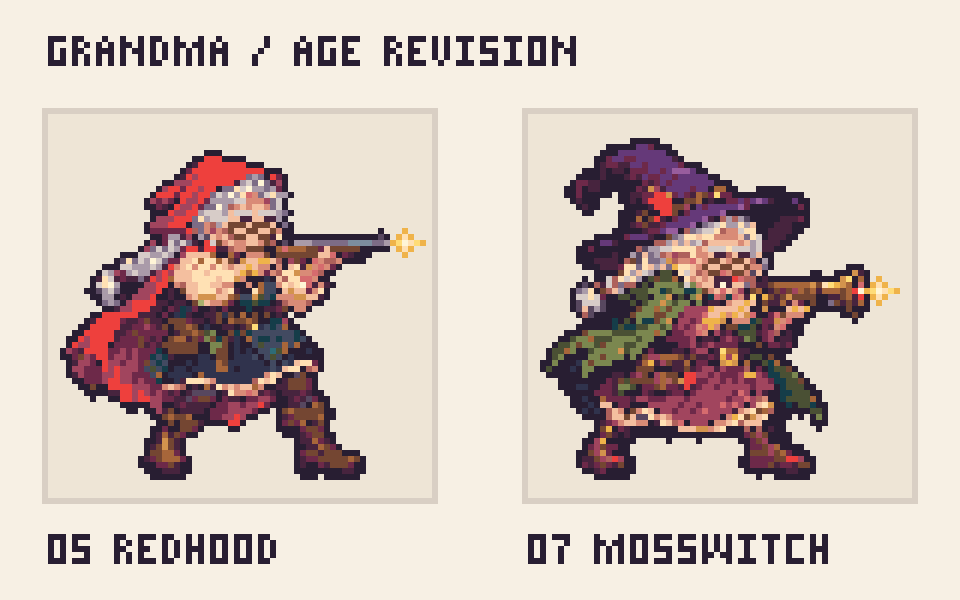

# HG-BASE64 v003 · 05·07 할머니 인상 수정

2026-10-21 · 사용자 요청: **“5,7은 할머니 같지가 않음 수정”**

## 현재 후보 관리

05와 07만 이번 v003 파일을 사용한다. 04·06·08은 v002 정본을 유지한다.

| 후보 | 현재 편집 정본 | PNG |
| --- | --- | --- |
| 04 순덕 할매 | [v002](../v002/grandma_04_sundeok.aseprite) | [PNG](../v002/Export/grandma_04_sundeok.png) |
| **05 빨간 두건 숲지기** | **[grandma_05_redhood.aseprite](grandma_05_redhood.aseprite)** | [발사](Export/grandma_05_redhood.png) · [효과 없음](Export/grandma_05_redhood_no_fx.png) |
| 06 찻집 해결사 | [v002](../v002/grandma_06_teatime.aseprite) | [PNG](../v002/Export/grandma_06_teatime.png) |
| **07 이끼숲 마녀 할매** | **[grandma_07_mosswitch.aseprite](grandma_07_mosswitch.aseprite)** | [발사](Export/grandma_07_mosswitch.png) · [효과 없음](Export/grandma_07_mosswitch_no_fx.png) |
| 08 서부의 꽃할매 | [v002](../v002/grandma_08_wildrose.aseprite) | [PNG](../v002/Export/grandma_08_wildrose.png) |

[현재 다섯 후보 비교](Previews/current_candidates_04-08_64px.png) · [64px 수정 전후](Previews/age_before_after_64px_6x.png) · [원화 수정 전후](Previews/age_before_after_concepts.png)

## 바꾼 점

- 05: 작은 매끈한 얼굴을 더 넓고 아래 볼이 처진 얼굴로 수정. 흰 눈썹, 작은 눈, 낮게 걸친 안경, 큰 코, 이마·웃음 주름과 둥근 턱을 보강. 몸통과 허리를 둥글게 하고 다리 비율을 짧게 조정했다.
- 07: 웃는 표정은 유지하면서 처진 볼·턱, 큰 코, 흰 눈썹과 작은 눈, 낮은 안경·주름을 보강. 상체를 더 둥글고 굽은 형태로 바꾸고 하체를 짧고 튼튼하게 조정했다.
- 빨간 두건·붉은 망토·장총, 보라 모자·초록 망토·나팔총의 정체성과 오른쪽 두손 사격은 유지했다.

사용자 피드백은 원화의 얼굴·체형에서 시작된 문제로 판단했다. **기존 원화를 편집 대상으로 지정한 built-in ImageGen 수정 2회**와 **Aseprite 픽셀 정리**를 사용했다. [프롬프트·입력·생성 경로](Source/generation_prompts.json)를 보관했다. 기존 원본 위에 주름만 추가한 작업이나 Aseprite 픽셀만으로 전부 재작화한 작업으로 표기하지 않는다.

## 출력과 레이어

- 각 후보: **64×64, RGB 편집 / RGBA PNG, 정적 1프레임**. `shoot_base`, 100ms.
- 팔레트: 33칸 = 투명 1 + 불투명 32. 실제 합성 사용색은 05 **28색**, 07 **26색**. [팔레트](Export/grandma_v003_palette.gpl).
- 아래→위: `01_Contour`, `02_Character_Combined`, `03_Aged_Face_Details`, `04_Muzzle_FX`. 기본 4개 표시, opacity 255, Normal. 표정 레이어는 나이 특징을 보정하는 픽셀이고 완전한 머리 파츠가 아니다.
- 본체는 의상·팔·손·총이 합쳐진 정적 베이스다. 독립 애니메이션 파츠 분리는 이번 범위가 아니다.
- 좌표: 좌상단 `(0,0)`, x 오른쪽·y 아래, px. 발 바닥 픽셀 `y=60`, 바닥 경계 `y=61`. 총구 기준은 05 `(57,21)`, 07 `(56,29)`.

## 보존과 검수

v002의 모든 후보는 기존 경로에서 바이트 그대로 유지한다. 수정 전 05·07의 native·PNG·원화도 `Source/Before/`에 복사하고 해시를 남겼다. [사전 해시](QA/previous_version_hashes.json).

저장 파일을 독립 재개봉해 PNG 4개와 픽셀 차이 0, 부분 알파 0, 팔레트 밖 색 0을 확인했다. 16개 표시 상태를 실제 저장·재개봉해 레이어 단독/숨김, 전체, 64px, 확대와 배경을 확인했다.

[검사 JSON](QA/native_validation.json) · [시각 검수](QA/visual_review.md) · [납품 해시](QA/delivery_hashes.json) · [제작 메타](Export/grandma_candidates.json)

완료 범위는 05·07의 노년 인상 수정과 정적 후보 납품이다. 사용자 선호도나 나이 인식의 최종 승인은 대기 상태이며 기술 검수 통과와 구분한다.
