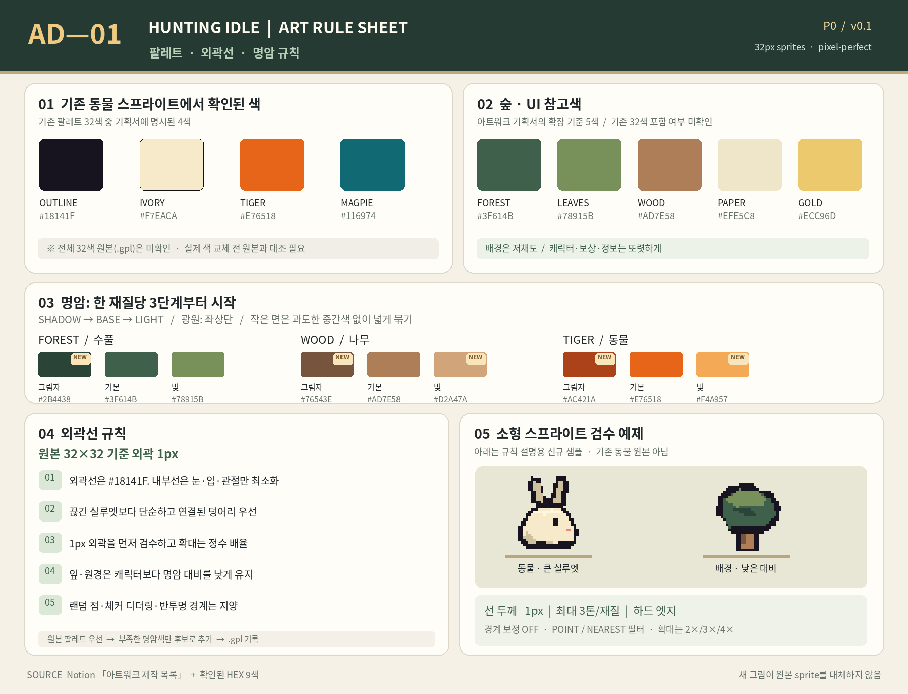

# AD-01 · 팔레트·외곽선·명암 규칙

우선순위 P0 · 2026-10-11 · 기존 작업본 v0.1 보존 / 팔레트 대조 완료

## 기존 작업본

- [규칙 문서 v0.1](hunting_idle_AD-01_rules.md)
- [규칙 시트 PNG v0.1](hunting_idle_AD-01_style_guide.png) — 1800×1376, 검수용 문서 이미지
- [참고/후보 팔레트 GPL v0.1](hunting_idle_AD-01_reference_palette.gpl) — 18색, 원본 팔레트 대체용 아님

위 세 파일은 기존 `Docs/AI/Art/`에서 이 폴더로 이동했으며 내용은 그대로 보존했다. 그림 안의 토끼/나무는 규칙 설명용 신규 샘플이다. 기존 게임 캐릭터를 교체하는 승인 시안으로 취급하지 않는다.

## 현재 해석

기존 v0.1의 「원본 32색 미확인」은 작성 당시 기록이다. 2026-10-11에 실제 GPL과 PNG를 읽어 대조했으므로 **[PaletteAudit.md](PaletteAudit.md)가 최신 색 검증 기준**이다.

- 원본 GPL: 서로 다른 32색 확인.
- 후보 GPL: 기존 4색 + 기획 참고 5색 + 제안 명암 9색.
- 원본과 정확히 겹치는 색은 4개, GPL에 없는 추가 후보는 14개.
- 토끼/사냥꾼 PNG에는 원본 GPL 밖 실사용색이 있다. 원본을 맞추기 위한 일괄 색 교체는 하지 않는다.
- 기존 호랑이/까치의 명암색부터 재사용하고, 실제로 부족한 새 재질의 색만 추가 검토한다.

## 후속 시트 갱신 지시

v0.2 이미지가 필요하면 v0.1을 덮어쓰지 않고 새 버전으로 제작한다. 해당 시트에는 「기존 GPL / 실제 원본 예외색 / 참고색 / 채택 전 후보」를 구분하고, 실제 사냥꾼·토끼·호랑이와 새 숲/UI 합성 예시를 넣는다.

원본 격자의 외곽선 1px, 좌상단 광원, 넓은 3톤 덩어리, 낮은 배경 대비를 기준으로 검수한다. 기존 동물의 무늬/색 수를 기계적으로 3색으로 줄이지 않는다. 확대 시트 검수와 실제 UI 배율에서의 판독 검수를 구분한다.

현재 완료 범위는 **기존 작업본 보존과 대조 문서 작성**이다. 새로운 규칙 시트 이미지, 확장 팔레트 정식 채택, 게임 내 색 교체는 아직 수행하지 않았다.

[전체 방향](../ArtDirection.md) · [저장·납품 규칙](../../02_Production/ProductionGuide.md)
