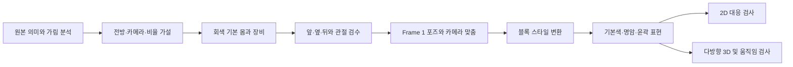

# 단일 2D 캐릭터 → 실제 3D 전환 스터디

2026-10-13 · Hunting Idle · 원본 `idle_breath.aseprite` Frame 1 / HunterVoxel v001–v003

## 1. 결론

이 캐릭터에는 **여러 시점에서 성립하는 기본 3D 몸을 먼저 만들고, 원본 포즈와 기준 카메라를 맞춘 뒤, 블록 스타일과 재질을 적용하는 방식**을 권한다. 픽셀마다 깊이를 주거나 원본 실루엣을 깊이 전체에 강제로 적용하는 방식은 2D 대응에는 유리하지만, 입체 조형의 주된 제작 방법으로 삼기 어렵다.

한 시점의 렌더가 원본과 일치하는 것과 좋은 3D 캐릭터가 되는 것은 서로 다른 평가다. 단일 이미지 감독에서 잘못된 형상과 잘못된 포즈의 조합도 원본을 설명할 수 있다는 문제는 실제 연구에서도 다룬다. [Shape-Pose Ambiguity, AAAI 2021](https://ojs.aaai.org/index.php/AAAI/article/view/16405)

**기존 v003의 ‘RGBA 차이 0픽셀’은 실제 렌더 대응 검사로서 유효하다. 그러나 그 수치와 큐브 연결 검사만으로 자연스러운 3D 조형의 완성까지 보증한 판단은 과했다.** 이번 스터디에서는 v003을 ‘한 시점 투영을 정확히 맞춘 3D 실험’으로 구분하고, 캐릭터 조형·포즈·재질·다른 시점 검수를 강화할 방향을 정리한다.

이 문서는 논문·제작사 원문 조사와 프로젝트 코드 검토다. 조사한 AI 모델을 이 캐릭터에 실제 실행해 비교한 벤치마크는 아니며, Blender 모델이나 이전 검수 파일을 수정하지 않았다.

## 2. 한 장으로 알 수 있는 것과 알 수 없는 것

| 구분 | 이 입력에서 확인·해석할 내용 |
| --- | --- |
| 관찰 가능한 사실 | 캔버스, 팔레트, 원본 방향의 윤곽, 눈·귀·손·발·장비의 화면 위치, 가림 순서 |
| 여러 해석이 가능한 것 | 카메라 각도, 몸의 전방, 어깨·골반 폭, 팔의 깊이, 발의 실제 방향, 모자·가방 두께 |
| 원본에 없는 것 | 뒷면 디자인, 가려진 팔·다리의 전체 모양, 의상 안쪽, 관절을 움직일 때 드러날 면 |

가려진 면을 복원하는 모호성 때문에 Front2Back은 앞면 깊이·법선과 대칭성 정보를 이용해 뒤쪽 면도 추정한다. 보이지 않는 부분은 원본에서 읽어낸 사실과 구분해야 한다. [Front2Back 논문](https://arxiv.org/abs/1912.10589)

정사영을 단순화하면 화면 좌표는 `(x,y,z) → (x,z)`로 생각할 수 있다. 깊이 `y`가 서로 다른 수많은 모델이 같은 윤곽을 만들 수 있다. 카메라 정사영의 크기가 거리와 독립적이라는 성질은 Blender 매뉴얼에도 설명되어 있다. 위 식은 이해를 위한 단순화이며 Blender 카메라의 전체 변환식은 아니다. [Blender Cameras](https://docs.blender.org/manual/en/4.5/render/cameras.html)

그래서 뒤에서 봐도 자연스러운 머리, 실제 어깨에서 시작하는 팔, 골반 아래에 달린 다리 같은 **3D 구조의 사전 지식**이 필요하다. 추가 정면·측면·후면 그림은 모호성을 줄인다. 생성한 추가 시점은 실제 관찰 자료가 아니라 검토해야 할 디자인 후보다.

## 3. 왜 픽셀을 그대로 두껍게 만들면 문제가 생기는가

원본 픽셀은 모두 같은 의미가 아니다.

| 원본 표시 | 3D에서 해석할 방식 |
| --- | --- |
| 피부·의상의 기본색 | 재질의 기본색 |
| 밝은 면·어두운 면 | 조명, 면 방향, 혹은 의도한 색 구분을 검토 |
| 검은 외곽선 | 대부분 화면 표현. 눈·장비 줄 등의 실제 검은 디테일과 구분 |
| 부위의 경계 | 형상 경계인지, 가림 경계인지, 재질 경계인지 판단 |
| 투명한 틈 | 실제 빈 공간인지, 포즈로 생긴 틈인지 판단 |

일러스트의 윤곽선과 복잡한 머리·장식이 자연 이미지와 다른 재구성 문제를 만든다는 점은 PAniC-3D가 명시한다. 이 연구는 선을 보완하는 모델을 사용해 일러스트와 3D 표현 사이의 차이를 다룬다. 다만 이 논문은 애니메이션 **머리 초상화** 연구이며 우리 64×64 전신 픽셀 캐릭터의 성능 근거는 아니다. [PAniC-3D, CVPR 2023](https://arxiv.org/abs/2303.14587)

원본 그림자를 이미 재질에 넣은 상태에서 3D 조명을 더하면 같은 음영이 중복된다. 원본 윤곽을 부위의 두께·돌출로 해석하면 다른 방향에서 검은 띠나 패임이 조형처럼 나타날 수 있다. 이는 이 프로젝트에 적용한 해석이다. Stable Fast 3D가 색에서 조명을 분리하는 기법을 포함하는 것도 형상·재질·조명을 별도로 다룰 필요를 보여준다. [Stable Fast 3D 공식 저장소](https://github.com/stability-ai/stable-fast-3d)

블록 스타일과 픽셀 돌출은 다르다. **먼저 몸·장비의 3D 부피를 설계하고 그 표면을 블록으로 표현**하는 편이 적합하다. 원본의 모든 색 조각을 한 칸씩 튀어나온 장식으로 만들 필요는 없다.

## 4. 조사한 접근법 비교

아래의 적합성은 이번 입력에 대한 판단이다. 논문 간 순위나 실측 성능 비교가 아니다.

| 접근 | 방법 | 장점 | 이 캐릭터에서의 한계·용도 |
| --- | --- | --- | --- |
| 픽셀별 돌출 / 얕은 부조 | 원본 픽셀 위치에 깊이를 부여 | 원본 한 방향을 쉽게 유지 | 옆모습·뒷면·관절의 자연스러움을 따로 해결해야 함. 장식·메달·평면 소품에 더 적합 |
| 부위별 수작업 3D + 카메라 맞춤 | 머리·몸·사지·장비를 입체로 설계하고 원본 방향에 맞춤 | 구조·비율·포즈를 직접 통제 | 숨은 면을 설계할 필요. **이번 캐릭터의 권장 기본 방식** |
| 포즈를 정리한 다중시점 재구성 | 단일 입력에서 일관된 여러 시점과 표준 포즈를 만든 뒤 3D화 | 포즈와 가림 문제를 분리 | 생성 시점의 디자인 변화·환각을 검사해야 함 |
| 단일 이미지 → AI 메시 | 학습된 3D 사전 지식으로 형상·재질 추정 | 빠른 3D 초안 | 픽셀 아트 특유의 선·과장 비율·작은 장비를 정확히 지킨다는 보장 없음 |
| 형상 이후 블록화 | 3D 몸이 정리된 뒤 격자에 맞춰 스타일 변경 | 자연스러운 입체와 블록 감성을 함께 관리 | 작은 손·새총 줄·깃털은 별도 해상도나 수작업 보정 필요 |

### 연구에서 가져올 제작 원칙

- **CharacterGen:** 포즈가 다른 입력을 A-pose와 일관된 여러 시점으로 정리한 뒤 캐릭터를 재구성한다. 여기서 가져올 핵심은 ‘현재 보이는 포즈를 그대로 부피로 고정하기 전에 기본 몸과 포즈를 분리한다’는 점이다. 극단적인 포즈·드문 시점에서 정보를 충분히 유지하지 못할 수 있다는 한계도 명시한다. [논문 본문](https://arxiv.org/html/2402.17214v3)
- **Wonder3D:** 여러 시점의 색뿐 아니라 표면 법선도 함께 생성하고, 서로 일관되게 융합한다. 색만 그럴듯한 여러 그림보다 면의 방향까지 맞는 시점 자료가 중요하다. [공식 프로젝트](https://www.xxlong.site/Wonder3D/)
- **Era3D:** 입력 카메라의 초점거리·높이 가정이 틀리면 형상이 왜곡될 수 있음을 다룬다. 3D 몸을 매번 찌그러뜨리기 전에 기준 카메라와 포즈 가정을 검토해야 한다. [공식 프로젝트](https://penghtyx.github.io/Era3D/)
- **Hunyuan3D 2.0:** 무채색 메시 생성과 텍스처 생성을 두 단계로 분리한다. 수작업에서도 회색 조형 검수와 컬러 검수를 나누는 것이 유용하다는 제작 제안으로 연결된다. [공식 저장소](https://github.com/Tencent-Hunyuan/Hunyuan3D-2)

### 도구 후보의 현재 역할

| 후보 | 원문에서 확인한 기능 | 이번 프로젝트에서 제안하는 역할 |
| --- | --- | --- |
| CharacterGen | 표준 포즈, 다중시점, 캐릭터 메시 | 전신 캐릭터의 접근법 참고. 64px 입력에 실제 시험하기 전 품질 판단 보류 |
| Wonder3D / Era3D | 다중시점 색·법선, 카메라 정리 | 옆·뒤 디자인 후보와 입체 면 추정 자료 |
| Stable Fast 3D | UV가 있는 메시, 조명 분리, 재질 추정, remesh 옵션 | 보조 초안과 재질 분리 참고. 공식 설명에서 Windows 지원은 experimental |
| Hunyuan3D 계열 | 형상과 텍스처 단계 분리 | 무채색 초안만 활용한 뒤 직접 팔·다리·장비 수정 |
| TRELLIS.2 | O-Voxel 기반 형상·표면 속성, PBR 자산 출력 | 입체 후보 생성. 내부 voxel 표현이 곧 정육면체 외관을 뜻하지는 않음 |

Stable Fast 3D의 기능·플랫폼 설명은 [공식 README](https://github.com/stability-ai/stable-fast-3d), TRELLIS.2의 기능과 조건은 [Microsoft 공식 README](https://github.com/microsoft/TRELLIS.2)를 확인했다. TRELLIS.2 원문은 Linux 테스트와 NVIDIA GPU 24GB 이상을 제시한다. 여기서는 설치하거나 이미지 생성 서비스를 실행하지 않았다. 숫자는 제작사 조건이며 우리 컴퓨터의 실측 속도·호환성 정보가 아니다.

AI 생성 메시나 자동 remesh가 나왔다는 사실만으로 손·눈·새총·부츠의 원본 대응과 애니메이션 가능한 관절이 확인되지는 않는다. 이번 입력의 재현성은 직접 시험해야 한다.

## 5. v003 코드와 결과에 적용한 진단

검토 대상: [prepare_anatomy.py](../../../../ArtSource/Try/HunterVoxel/v003/Scripts/prepare_anatomy.py), [실제 렌더 검사](../../../../ArtSource/Try/HunterVoxel/v003/QA/saved_blend_validation.json), [24방향 비교](../../../../ArtSource/Try/HunterVoxel/v003/QA/turntable_contact.png).

### 남길 것

- 같은 모델을 3D 장면과 2D 확인 장면에서 공유하는 구조.
- 실제 저장 파일을 재개봉한 렌더 비교, 원본·이전 버전 보존.
- 캐릭터의 전방·왼쪽 축, 관절 위치를 명시한 점.
- 카메라·모델을 따로 관리하고 여러 방향에서 보는 절차.

### 바꿀 것

1. 코드의 `for (xi,zi),source_index in target.items()`는 원본 불투명 픽셀이 있는 투영 열에서만 입체를 생성한다. 공간 형태를 먼저 정의했더라도 최종 볼륨이 원본 화면 마스크의 제한을 강하게 받는다. 이는 정상적인 팔·모자·얼굴을 모든 방향에서 만드는 문제와 별개의 제약이다.
2. `allowed[name]`은 원본 2D 부위 분류를 3D의 허용 영역으로 사용한다. 화면상의 색·가림 경계가 실제 몸의 부위 경계와 일치한다는 보장은 없다.
3. 투영에서 빠지는 픽셀에 `fallback` 큐브를 추가한다. 원본 일치에는 도움이 되지만 조형에 없는 작은 돌출을 추가할 수 있다.
4. `reference_faces`는 앞에서 보이는 면에 원본 색을 정확히 기록한다. 숫자 검증에는 유리하지만 선·명암·재질의 의미를 분리한 표면 설계와는 다르다.
5. ‘모든 큐브가 연결되어 있다’는 검사로 어깨·팔꿈치의 볼륨, 발의 방향, 자연스러운 얼굴이 판정되지는 않는다. 부위별 해석을 평가하는 별도 기준이 필요하다.

이 진단은 프로젝트 코드의 구현과 목표를 비교한 판단이며, 연구 모델을 실제 적용해서 얻은 결과가 아니다. **0픽셀 일치를 취소하는 것이 아니라, 그 수치에 3D 조형 완성이라는 의미를 추가하지 않도록 평가를 분리한다.**

## 6. 다음 제작에 권하는 순서

### 1단계 — 원본의 의미와 숨은 디자인 정리

머리·얼굴·귀·모자·깃털·몸통·팔·손·하체·부츠·새총·가방의 역할을 정한다. 기존 Aseprite 레이어는 입력 자료이며 자동으로 완성된 3D 부위 분할로 취급하지 않는다. 눈·손·장비 그립·발바닥처럼 반드시 맞출 접점을 기록한다.

가려진 팔, 뒷머리, 모자 뒷챙, 가방의 부착 위치를 디자인한다. 정면·측면·후면과 위에서 본 발 배치의 간단한 턴어라운드를 만든다. AI 후보를 사용하더라도 서로 다른 캐릭터처럼 변한 시점은 채택하지 않는다.

### 2단계 — 회색 기본 3D 몸

픽셀 위치마다 큐브를 세우지 않는다. 머리·목·흉곽·골반을 먼저 만들고 어깨→팔꿈치→손, 골반→무릎→발목을 실제 3D로 연결한다. 모자와 장비는 별도 입체다. 가능한 한 양팔이 가려지지 않는 중립 자세에서 기본 구조를 만든 후 Frame 1 포즈를 적용한다.

처음에는 원본 재질을 붙이지 않는다. 회색 상태의 앞·옆·뒤에서도 몸과 팔다리가 자연스럽게 읽혀야 한다. 표면의 계단·큐브 수를 늘려 해결하지 않고 큰 비율과 관절부터 수정한다.

### 3단계 — 카메라와 Frame 1 포즈

투영 형식, 방위각, 높이, 이미지 크기, 정사영 스케일을 별도 변수로 둔다. 원본에서 측정한 눈·귀·손·발·장비 끝과 모델의 같은 접점을 대응시킨다. 카메라 오류를 몸 전체의 기형적 변형으로 보상하지 않는다.

기준 카메라를 맞출 때마다 최소 하나의 측면 또는 후면을 함께 확인한다. 원본에서 보이지 않는 어깨 폭·무릎 위치·부츠 뒤꿈치를 희생하는 수정은 되돌린다.

### 4단계 — 블록 외관

기본 몸이 성립한 다음 voxel/remesh/격자 샘플링을 적용한다. Blender Remesh의 Blocks 모드는 입체 메시의 블록화 수단이다. 손가락·장비·깃털처럼 얇은 부분은 변환 후 누락·합쳐짐을 따로 검사한다. [Blender Remesh Modifier](https://docs.blender.org/manual/en/4.5/modeling/modifiers/generate/remesh.html)

격자에 맞추는 것은 표면 표현이며 모든 관절·두께를 원본 2D 픽셀의 열로 제한한다는 뜻이 아니다. 팔과 다리는 먼저 만든 입체 몸의 비율을 유지해야 한다.

### 5단계 — 재질과 2D 스타일

원본 기본색, 의도한 색 무늬, 조명으로 생긴 명암, 화면 외곽선을 분리한다. 피부·초록 의상·가죽·목재·고무줄은 각각 일관된 재질로 만든다. 기존 명암을 기본색에 전부 넣어 조명을 중복시키지 않는다.

검은 눈·장비 줄은 실제 디테일로 유지한다. 화면 외곽선은 시점마다 생기는 선으로 처리할 수 있다. Blender Freestyle은 메시와 깊이 정보에서 선을 만드는 NPR 렌더링 방식이다. 이번 스타일에 사용할 수 있는 수단 중 하나이지 픽셀 원본을 자동 복원하는 기능은 아니다. [Blender Freestyle](https://docs.blender.org/manual/en/4.5/render/freestyle/introduction.html)

원본과 정확히 일치하는 고정 시점 출력이 목표라면 마지막에 별도로 검사한다. 그 차이를 없애기 위해 3D 전체를 원본 알파 모양으로 일괄 잘라내거나, 눈·명암·손을 무조건 면의 색으로 덮어 해결하지 않는다. 충돌하는 픽셀은 카메라·포즈·조형·선 표현 중 어느 요소의 문제인지 분류한다.

## 7. 완료 기준을 두 갈래로 나누기

| 2D 대응 검사 | 3D 캐릭터 검사 |
| --- | --- |
| 기준 카메라의 실루엣 | 앞·옆·뒤에서 자연스러운 머리와 몸 |
| 눈·귀·손·발·새총의 화면 접점 | 어깨·팔꿈치·골반·무릎·발목의 연결과 축 |
| 기본색·재질 구분 | 얼굴·모자·장비의 실제 두께와 뒷면 |
| 픽셀·알파 차이 및 원인 | 양발·부츠의 방향과 바닥 접지 |
| 팔·장비의 가림 순서 | 팔과 장비·다리와 몸통의 불필요한 관통 |
| 64px에서 같은 캐릭터로 읽히는가 | 팔꿈치·무릎·어깨를 조금 움직여도 구조가 유지되는가 |

실루엣은 IoU나 경계 거리, 접점은 화면상 픽셀 오차로 측정할 수 있다. 이는 제안하는 프로젝트 지표이며 이 논문들의 공통 합격 수치를 가져온 것이 아니다. 3D 쪽은 부위 단독·숨김·여러 시점·관절 움직임의 시각 검수로 따로 판정한다. 한쪽 합격을 다른 쪽 합격으로 대신하지 않는다.

## 8. 우리 캐릭터에 대한 실행 제안

다음 모델 작업에서는 v003을 보존하고, **회색 머리·모자·몸통·사지·장비 블록아웃**을 별도 파일에 먼저 만든다. 원본 F1을 닮은 색을 잠시 빼고 실제 부피와 관절이 올바른지 앞·옆·뒤에서 확인한다.

그다음 원본 카메라와 포즈를 맞추고, 블록 크기를 선택하고, 색·윤곽·명암을 마지막에 적용한다. AI는 옆·뒤 디자인 후보나 초기 메시 보조로 시험할 수 있지만, 원본 팔레트·얼굴·손·새총의 최종 통제는 직접 한다.

한 시점의 완전한 픽셀 복제와 자연스러운 3D의 요구가 충돌하면 어느 부위·픽셀에서 왜 충돌하는지 기록한다. ‘3D 복원’에 필요한 숨은 디자인을 정하는 단계와 ‘원본 고정 시점 재현’ 단계를 분명히 나눠 작업한다. 이번 요청은 스터디이므로 신규 모델·AI 설치·외부 생성 실행은 진행하지 않았다.

## 9. 자료와 읽는 순서

자료 확인일: 2026-10-13. 논문·저자 프로젝트 페이지·제작사 저장소·Blender 공식 문서만 기술 판단의 근거로 사용했다.

1. [Shape-Pose Ambiguity, AAAI 2021](https://ojs.aaai.org/index.php/AAAI/article/view/16405) — 한 시점의 일치로 3D를 판정할 수 없는 이유.
2. [Front2Back](https://arxiv.org/abs/1912.10589) — 앞면과 뒷면의 추정, 깊이·법선·대칭.
3. [PAniC-3D, CVPR 2023](https://arxiv.org/abs/2303.14587) — 일러스트 윤곽선·과장 디자인의 문제.
4. [CharacterGen, SIGGRAPH/TOG 2024](https://arxiv.org/html/2402.17214v3) — 여러 시점과 표준 포즈를 먼저 정리하는 방법, §3.2와 §5.
5. [Wonder3D, CVPR 2024](https://www.xxlong.site/Wonder3D/) — 일관된 색과 법선의 다중시점 생성.
6. [Era3D, NeurIPS 2024](https://penghtyx.github.io/Era3D/) — 카메라 가정과 형상 왜곡.
7. [Stable Fast 3D](https://github.com/stability-ai/stable-fast-3d) — 형상, UV, 조명 분리, 재질.
8. [Hunyuan3D-2](https://github.com/Tencent-Hunyuan/Hunyuan3D-2) — 형상/텍스처 단계 분리.
9. [TRELLIS.2](https://github.com/microsoft/TRELLIS.2), [논문](https://arxiv.org/abs/2512.14692) — 현대 이미지→3D의 공간 표현과 표면 속성.
10. Blender 4.5 공식 문서: [Cameras](https://docs.blender.org/manual/en/4.5/render/cameras.html), [Remesh](https://docs.blender.org/manual/en/4.5/modeling/modifiers/generate/remesh.html), [Freestyle](https://docs.blender.org/manual/en/4.5/render/freestyle/introduction.html).

논문 결과를 이 프로젝트의 64×64 픽셀 입력에 그대로 적용할 수 있다고 단정하지 않았다. 다음 제작 절차는 위 연구에서 확인한 원칙과 현재 구현의 문제를 종합한 프로젝트 제안이다.
