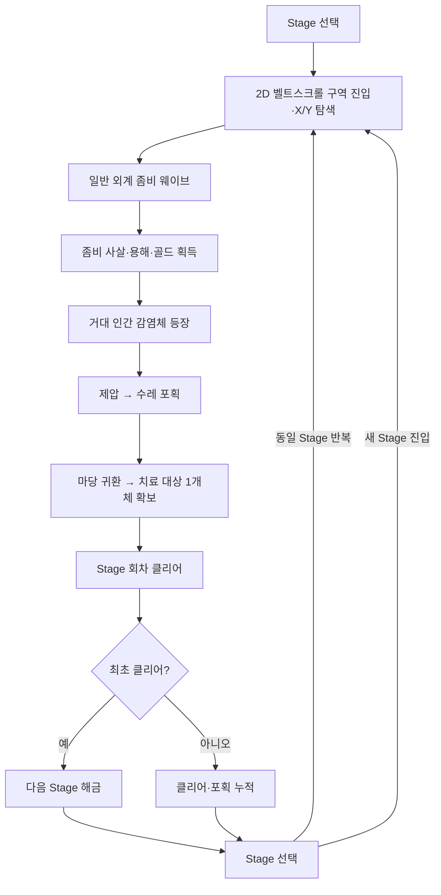
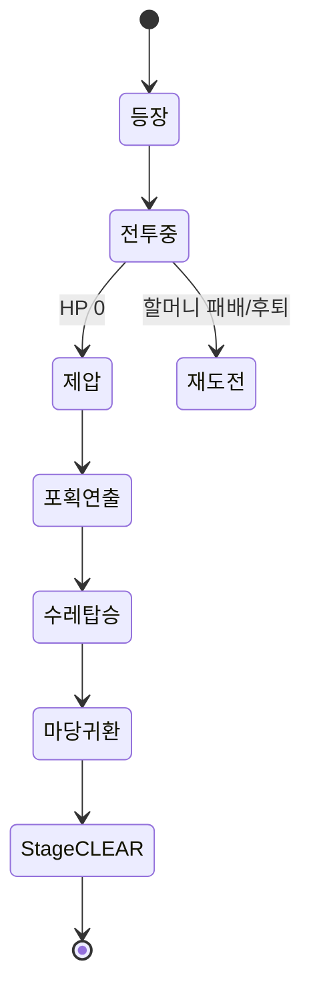

Here is the result of "fetch" for the Page with URL https://app.notion.com/p/4047313398e0818db924d95c5c455419 as of 2026-10-27T00:52:43.724Z:
<page url="https://app.notion.com/p/4047313398e0818db924d95c5c455419" icon="🧟">
<ancestor-path>
<parent-page url="https://app.notion.com/p/4037313398e081d0ba8addb38d803d6d" title="Project10_Hunter_grandma · 복사본"/>
</ancestor-path>
<properties>
{"title":"\\[기획서\\_01\\] Desktop Companion — Stage·좀비 사냥·거대 보스 포획 기획 v2"}
</properties>
<iconMetadata>{"type":"emoji","emoji":"🧟"}</iconMetadata>
<content>
<callout icon="🧟" color="green_bg">
<b>핵심 콘셉트:</b> 할머니 집에 쳐들어온 좀비를 샷건으로 물리친다. 이후 폐허가 된 마을의 구역들을 지도에서 순차적으로 진압한다. 일반 좀비는 외계 생명체가 구성한 공격체로, 사살하면 녹아내리며 골드를 떨어뜨린다. 지역 최종 보스는 외계 생명체가 사람 또는 동물을 감염시켜 만든 <b>거대한 숙주형 감염체</b>다. 보스는 사살이 아닌 제압 후 수레에 실어 할머니 집 마당으로 데려온다. 같은 Stage를 반복 클리어하면서 매번 새로운 치료 대상 인간 감염체를 포획해 수레로 옮기는 것이 핵심 반복 루프다.
</callout>

<b>버전:</b> v2.3 · 2D 벨트스크롤 화면·이동 구조 반영 · <date start="2026-10-27" /> (v2.2: Stage별 캐릭터형 보스·반복 포획 설계)<br /><b>참고:</b> <mention url="https://app.notion.com/p/4037313398e081cf87e2f8f247f2a942" /><br /><b>소속:</b> <mention url="https://app.notion.com/p/4037313398e081d0ba8addb38d803d6d">Project10_Hunter_grandma · 복사본</mention><br /><b>UI 레퍼런스:</b> 사용자 제공 「폐허 도시 · 지역 선택」 이미지(2열×3행 마을 지도, 지역 선택 강조, 우측 설명 패널, 전투 시작 버튼).<br /><b>범위:</b> 2D 벨트스크롤 화면·이동·전투 공간, 지역 Stage, 좀비 사냥·사살, 외계/숙주형 구분, 웨이브, 보스 제압·포획, 수레 귀환, 골드와 공격력·발사속도 강화까지만. 치료·동료·상점·연구·오두막 건설 등은 의도적으로 제외한다.<br /><b>결정 구분:</b> 사용자 확정 설정을 기준으로 작성했으며 구역명·웨이브 시간·보스 행동·자동화 규칙은 설계 제안이다.

<table-of-contents />

# 0. 확정된 화면 방식 — 2D 벨트스크롤 (2026-10-27 반영)

<callout icon="✅" color="green_bg">
<b>확정 결정:</b> Hunter Grandma의 스테이지 전투 화면은 <b>2D 벨트스크롤(beat 'em up형)</b>이다. 플레이어/할머니는 좌우로 진행하면서 화면 안쪽·바깥쪽(위·아래 깊이 방향)으로도 이동한다. <b>순수 2D 횡스크롤(좌우만 이동) 및 2D 쿼터뷰/아이소메트릭은 기본 전제가 아님.</b> 기존 좀비 사살 → 지역 보스 제압 → 수레 적재 → 귀환 → Stage 반복 클리어 루프는 유지한다.
</callout>

## 0.1 좌표·화면의 기준

| 설계 축 | 정의 | 결정 상태 |
| --- | --- | --- |
| 화면 시점 | 2D 벨트스크롤 측면 기반 화면. 캐릭터는 측면 위주로 보이되 바닥의 깊이감이 읽히는 시점 | <b>확정</b> |
| 이동 X | 화면 좌↔우로 진행, 스테이지의 주된 전진 방향 | <b>확정</b> |
| 이동 Y(깊이) | 화면 위쪽(안쪽)↔아래쪽(바깥쪽), 걷는 벨트 영역 내에서 자유 이동 | <b>확정</b> |
| 이동 가능 영역 | 바닥 띠(벨트)의 Y 상·하 경계 및 벽·장애물로 제한 | 구현 제안 |
| 화면 스크롤 | X 방향으로 카메라가 이동·추적하며 웨이브/보스 구역을 보여줌 | 구현 제안 |
| 렌더링 정렬 | 캐릭터 발바닥 위치(Y)가 아래쪽일수록 앞에 그려 겹침 순서 표현 | 구현 제안 |
| 이동 조작 | 수동 직접 이동인지 자동 탐색/자동 전진인지, 유저 개입 정도 | <b>미결정</b> |
| 점프·회피·높낮이 | 별도 채택 전까지 필수 기능 아님 | <b>미결정</b> |

## 0.2 사냥·전투에 미치는 영향

- <b>조우:</b> 숲길 또는 마을 길을 좌우로 진행하며 좀비를 발견. 좀비는 X축 앞·뒤뿐 아니라 화면 안쪽/바깥쪽(Y 깊이)에서도 접근 가능.
- <b>샷건:</b> 사격 거리(X)만 보는 일직선 판정이 아니라, 목표와의 깊이 차이(Y)를 고려한 명중 영역이 필요. 산탄의 시각적 퍼짐과 실제 명중 폭이 일치하도록 프로토타입에서 확인.
- <b>넉백:</b> 기본적으로 사격 방향의 X축 반동을 읽기 쉽게 보여주되, 깊이 방향의 밀림/회피는 별도 기능으로 검증.
- <b>보스:</b> 거대한 숙주형 감염체도 벨트 안에서 이동·돌진·회전. 깊이 방향 이동이 가능한 보스와 불가능한 보스의 난이도를 테스트.
- <b>수레:</b> 포획한 보스를 같은 2D 벨트 공간에서 수레에 싣는 실루엣으로 연출하고, 귀환은 기존 Stage CLEAR 조건을 유지.
- <b>방치형:</b> 자동 사냥을 적용하더라도 캐릭터의 X/Y 탐색·접근·사격 위치 잡기·수레 복귀를 화면에서 읽을 수 있게 함. 수동 조작 체계는 이 결정만으로 확정하지 않음.

## 0.3 64×64 아트·애니메이션 영향

- 캐릭터 기본 실루엣은 측면 기준으로 먼저 제작. 최소 좌·우 반전, 걷기, 사격, 피격, 제압/수레 탑승의 가독성 점검.
- 위·아래(Y) 이동을 구현할 때 상·하향 전용 스프라이트가 반드시 필요한 것은 아님. 프로토타입은 측면 동작으로 기능 검증하고, 필요하면 전/후면 걷기 방향을 추가.
- 발바닥 접지점·바닥 그림자·Y 정렬 기준을 공통으로 관리하여 앞뒤 겹침과 샷건 명중 위치의 어색함을 최소화.
- 근경(앞쪽)·원경(안쪽)의 크기, 장애물 위치, 길의 경계를 이용해 2D에서도 움직일 수 있는 깊이를 분명히 보여줌.

## 0.4 이번 결정으로 바뀌지 않는 것

- 지도에서 Stage 선택, 최초 클리어 시 다음 Stage 해금, 같은 Stage 반복 클리어 시 <b>매회 다른 치료 대상 포획</b>.
- 일반 독립 감염체는 처치·용해·골드, 실제 인간/동물 숙주형 보스는 HP 0에서 제압·포획.
- 회차 종료는 보스 포획 → 수레 적재 → 마당 귀환 → 정산. 한 회차 다수 포획, 수레 정원, 오프라인 자동진행은 계속 미결정.

# 1. 기획 목표와 v1 → v2 개량

## 1.1 경험 목표

- <b>사냥의 쾌감:</b> 좀비가 우르르 몰려오고 샷건으로 쏴서 액체처럼 녹여버림.
- <b>진행의 성취감:</b> 마을 지도의 구역을 처음 클리어하면 다음 지역이 열리고, 이후에도 같은 Stage를 반복 클리어하며 포획 대상을 확보.
- <b>포획의 차별화:</b> 무수한 일반 좀비는 소멸하지만, Stage를 클리어할 때마다 거대 인간 숙주형 감염체를 제압해 수레에 실음.
- <b>만족스러운 소진:</b> 한 회차를 클리어하고 포획한 감염 인간을 수레로 데려오는 것이 선명한 완료. 반복 클리어할수록 치료 대상이 누적됨.

## 1.2 주요 변경

<table fit-page-width="true" header-row="true">
<tr>
<td>
항목
</td>
<td>
v0.2 기존안
</td>
<td>
v2 제안
</td>
</tr>
<tr>
<td>
진행
</td>
<td>
집 근처 단일 전투·90초 혼합 웨이브
</td>
<td>
집 습격 프롤로그 → 마을 6구역 선형 Stage
</td>
</tr>
<tr>
<td>
일반 적
</td>
<td>
빨간 공격좀비 + 초록 안정좀비
</td>
<td>
외계 생명체로 구성된 일반 좀비형. 사살 시 용해·골드 드롭
</td>
</tr>
<tr>
<td>
포획
</td>
<td>
웨이브 중 안정좀비 우클릭 드래그
</td>
<td>
지역 마지막의 <b>인간 감염형 거대 보스</b>를 제압한 뒤 포획
</td>
</tr>
<tr>
<td>
수레
</td>
<td>
안정좀비 3명 운반
</td>
<td>
매 클리어 시 제압한 감염 인간 개체를 수레에 싣고 귀환하는 반복 보상
</td>
</tr>
<tr>
<td>
종료 조건
</td>
<td>
제한시간 완료·자발적 귀환
</td>
<td>
보스 제압 → 수레 적재 → 마당 귀환 → Stage CLEAR
</td>
</tr>
<tr>
<td>
반복
</td>
<td>
동일 출정 반복
</td>
<td>
첫 클리어는 다음 구역 해금, 이후 같은 Stage 반복 클리어는 추가 치료 대상 확보
</td>
</tr>
</table>

# 2. 세계관과 적의 두 종류

## 2.1 일반 외계 좀비

인간이 감염된 존재가 아니라 <b>외계 생명체가 좀비처럼 생긴 형태를 구성</b>한 독립 공격체. 마을에서 대규모로 나타나고 사살 시 형태가 무너져 바닥으로 녹아내린다.

- 작고 다수로 등장하며 외형은 인간형에 가깝지만 움직임과 표면 재질은 비정상적.
- 몸 전체에서 어두운 연기나 외계 입자가 피어나는 형태로 숙주형과 시각적으로 구분.
- HP 0 → 붕괴 애니메이션 → 녹아내림 → 골드 드롭 → 소멸.
- 반복 등장 가능한 적. 고유 ID 포획 대상이 아님.

## 2.2 거대 숙주형 감염체 보스

외계 생명체가 <b>실제 생물(주로 인간, Stage 0은 강아지)을 숙주로 감염시키면서 비정상적으로 성장한 개체</b>. 지역 마지막에 등장하며, 인간형의 옷·표정 또는 강아지형의 목걸이·습관처럼 원래 숙주였던 존재의 흔적이 남는 것이 핵심.

- 일반 좀비보다 몇 배 큰 실루엣. 인간형은 얼굴·옷·직업 소품, 강아지형은 귀·털·목걸이로 구분되는 개별 디자인.
- 눈이나 신체 특정 부위에서만 어두운 물질이 새어 나와 '인간 숙주'임을 강조.
- HP 0은 사망이 아니라 <b>제압·전투불능</b>. 몸체는 녹지 않고 남음.
- 제압 성공 시 추가 사격 금지 → 수레 호출·적재 연출 → 집 마당 귀환.
- 각 Stage의 보스 유형(옆집 강아지형·택배 기사형·댄서형·의사형 등)은 반복 등장한다. 매번 포획하는 실제 숙주형 감염체(사람 또는 동물)는 서로 다른 개체로 식별·누적한다(세부 외형 변주는 추후 결정).

<b>연출 원칙:</b> 일반 개체는 '퐁—녹아 없어짐', 보스는 '쿵—제압되어 남음'. 설명문보다 두 결과 장면의 대비로 플레이어가 규칙을 이해하게 한다.

# 3. 전체 게임 진행



<b>핵심 구조:</b> 지역 최초 클리어는 다음 구역을 열고, <b>그 이후의 반복 클리어는 추가 인간 감염체 포획</b>을 위해 존재한다. 같은 지역의 일반 웨이브와 보스 포획 장면이 재발생한다.

# 4. 맵형 Stage 시스템

## 4.1 지역 선택 UI

첨부 이미지의 구조를 따르되 상태 전달을 강화한다.

- <b>좌측:</b> 전체 도시를 한 번에 보여주는 2열×3행 지도. 구역별 번호·명칭·선택 강조 표시.
- <b>우측 위:</b> 현재 위치 / 선택 구역명 / Stage 번호 / 지역 분위기 소개.
- <b>우측 중간:</b> 좀비 웨이브 특징, 보스 유형, 최초 클리어 여부, 누적 클리어 횟수 및 포획 인원.
- <b>우측 아래:</b> '이 구역에서 전투 시작' 버튼. 클리어한 구역에서도 '다시 사냥·포획' 버튼으로 같은 Stage 재도전 가능.
- <b>구역 상태:</b> 잠김 → 도전 가능 → 진행 중 → 첫 CLEAR. 이후 반복 클리어·포획 가능 상태.
- <b>현재 진행 위치:</b> 지도에서 클리어 구역과 다음 도전 가능 구역이 즉시 식별되게 표시.
- 색상만으로 잠김·완료를 알리지 않고 자물쇠·체크·상태 텍스트 사용.
- Stage 0인 할머니 집은 6개 구역 지도 바깥의 프롤로그 지점.

## 4.2 6개 마을 구역 — 캐릭터 보스 적용안

<table fit-page-width="true" header-row="true">
<tr>
<td>
Stage
</td>
<td>
지역
</td>
<td>
일반 웨이브
</td>
<td>
반복 포획 가능한 보스 유형
</td>
<td>
플레이 차별화
</td>
</tr>
<tr>
<td>
0
</td>
<td>
할머니 집
</td>
<td>
집 앞 벨트형 길에서 좌우 전진·깊이 이동을 배우는 소규모 습격
</td>
<td>
<b>옆집 강아지 → 동네 강아지형</b>
</td>
<td>
짖기 전조 후 돌진. 첫 만남에는 실제 옆집 강아지 등장
</td>
</tr>
<tr>
<td>
1
</td>
<td>
북서 주거지
</td>
<td>
느린 다수형 군중
</td>
<td>
<b>택배 기사 — 박스맨형</b>
</td>
<td>
상자 내려놓기·박치기와 짧은 빈틈
</td>
</tr>
<tr>
<td>
2
</td>
<td>
북동 상가
</td>
<td>
빠른 골목 무리
</td>
<td>
<b>마트 점원 — 카트맨형</b>
</td>
<td>
쇼핑카트를 이용한 돌진
</td>
</tr>
<tr>
<td>
3
</td>
<td>
서부 창고
</td>
<td>
거구·소형 혼합
</td>
<td>
<b>지게차 기사 — 안전모형</b>
</td>
<td>
짐으로 몸을 가렸다가 내리침
</td>
</tr>
<tr>
<td>
4
</td>
<td>
중앙 광장
</td>
<td>
여러 방향 군집
</td>
<td>
<b>거리 댄서 — 브레이커형</b>
</td>
<td>
춤 전조 후 회전하며 이동
</td>
</tr>
<tr>
<td>
5
</td>
<td>
남서 주거지
</td>
<td>
밀집 무리 뒤 고속형
</td>
<td>
<b>헬스 트레이너 — 벌크업형</b>
</td>
<td>
스쿼트 전조 후 큰 도약
</td>
</tr>
<tr>
<td>
6
</td>
<td>
남동 시설(병원)
</td>
<td>
여러 유형의 복합 웨이브
</td>
<td>
<b>의사 — 닥터형</b>
</td>
<td>
제한적 자기 회복과 외계체 호출
</td>
</tr>
</table>

각 지역의 <b>보스는 이름 붙은 개인 1명을 무한 재포획하는 방식이 아니라 반복 출현 가능한 유형</b>이다. 매 클리어에서 감염된 다른 동물/인간 개체를 제압·수레 귀환시킨다. 캐릭터 콘셉트·모션·변주안은 <b>7장</b> 참고.

## 4.3 해금과 재방문 규칙

1. 프롤로그 최초 클리어 시 Stage 1 해금.
2. Stage N 첫 클리어(보스 제압, 수레 포획, 집 마당 귀환) 시 Stage N+1 해금.
3. <b>이미 클리어한 Stage도 반복 클리어할 수 있음.</b> 일반 웨이브와 거대 감염체 보스가 매번 등장함.
4. 반복 클리어할 때마다 해당 Stage에서 <b>새로운 치료 대상 인간 감염체를 포획해 수레로 집에 데려옴</b>.
5. 같은 지역의 보스는 같은 <b>유형</b>이지만, 매번 포획하는 실제 인간 개체는 <b>별도의 개체</b>로 기록함.
6. Stage마다 최초 CLEAR 상태, 누적 클리어 횟수, 누적 포획 개체 수를 각각 기록.
7. 실패 또는 후퇴 시 이번 출정 포획은 없으며, 과거 클리어·포획 내역은 보존.
8. 최초 클리어 이후에도 해당 지역의 반복 포획이 핵심 목적. 일반 좀비만 사냥하는 골드 전용 모드가 아님.

## 4.4 반복 Stage 포획 루프

지역 선택 → 좀비 웨이브 사살·골드 → 해당 지역의 거대 인간 감염체 보스 제압 → 수레 적재 → 마당 귀환 → 치료 대상 누적 → 같은 Stage 재출정.

<b>초기안:</b> Stage 1회 클리어마다 감염 인간 1개체 운반. 수레 슬롯 수와 1회 출정에서 여러 명을 태울지, 수용 한도 등은 아직 미확정.

# 5. 구역 1회의 전투 루프

## 5.1 기본 순서

1. 지역 선택 후 <b>2D 벨트스크롤 전투 공간</b>에 출정. 최초 도전과 반복 도전 모두 가능. 좌우(X)로 진행하며 화면 위·아래(Y 깊이)로 위치를 바꿀 수 있음.
2. 일반 외계 좀비 웨이브 → 샷건 사살 → 액체화 → 골드 획득.
3. 마지막 일반 무리를 처리하면 이번 회차의 거대 인간 감염체 등장.
4. 보스 HP 0 → <b>제압</b>. 사망·용해되지 않고 몸체가 남음.
5. <b>새로 포획한 인간 감염체를 수레에 실어 집 마당으로 운반</b>.
6. 이번 회차 Stage CLEAR, 골드 정산, 치료 대상 신규 확보.
7. 처음 CLEAR 시 다음 Stage 해금. 기존 Stage를 반복 클리어한 경우 <b>누적 포획 인원 +1(초기안)</b>.
8. 같은 Stage에서 사냥과 보스 포획을 다시 반복할 수 있음.

## 5.2 시간과 볼륨 (전부 테스트 초기값)

- Stage 0: 짧은 2개 무리 + 튜토리얼 보스, <b>45\~75초</b>.
- Stage 1\~2: 3개 웨이브 + 보스, 약 <b>1\~2분</b>.
- Stage 3\~4: 3\~4개 웨이브 + 보스, 약 <b>2\~3분</b>.
- Stage 5\~6: 4개 웨이브 + 보스, 약 <b>2\~4분</b>.
- 웨이브 사이마다 불필요한 정산·출발 버튼을 요구하지 않고 자동 진행.
- 단순 HP와 적 수만 기하급수적으로 늘려 플레이시간을 인위적으로 늘리지 않는다.
- 64×64 픽셀아트 자산 규모를 고려해 좀비 신규 종 수보다 기존 개체의 <b>등장 조합과 X/Y 이동 패턴</b>을 우선 변주한다.
- <b>벨트스크롤 구간 설계(제안):</b> 좌우 진행로와 깊이 이동 가능한 바닥 띠를 연결하고, 조우할 때 전투가 잘 보이도록 카메라·적 진입 위치·보스 등장 지점을 배치. 구역 길이와 카메라 정지/추적 규칙은 플레이테스트로 확정.

# 6. 좀비 사살·골드·강화

## 6.1 사살 연출

<code>등장 → 접근 → 샷건 피격·넉백 → HP 0 → 몸이 무너지고 녹아내림 → 골드가 튀어나옴 → HUD로 자동 흡수</code>

- 샷건 발사에 반동·짧은 타격 정지·산탄 범위를 명확하게 보여준다.
- <b>2D 벨트스크롤 명중:</b> 좌우 사격 방향과 목표의 Y 깊이 차이를 함께 판정. 서로 다른 깊이에 있는 좀비가 무조건 맞거나, 화면상 겹쳐도 판정이 빗나가지 않도록 피격 박스·표시 이펙트를 검증한다.
- 최종 타격을 받은 일반 좀비는 눕는 시체가 아니라 <b>점액·먼지처럼 붕괴</b>한다.
- 골드는 몇 개가 튀어 나오다가 자동으로 UI에 이동. 수동 줍기 요구하지 않음.
- 대량 사살 중에는 골드 이펙트를 묶어 표현해 화면을 가리지 않음.
- 일반 좀비는 반복 골드 수급, 거대 인간 감염체는 반복 클리어마다 새로운 치료 대상 포획이라는 별도 보상을 담당.

## 6.2 기본 강화의 전투 연결

<table fit-page-width="true" header-row="true">
<tr>
<td>
강화
</td>
<td>
수치 변화
</td>
<td>
플레이어가 눈으로 느껴야 할 변화
</td>
</tr>
<tr>
<td>
공격력
</td>
<td>
발당 피해량 증가
</td>
<td>
두 발 필요했던 좀비가 한 발에 녹음. 보스 제압에 필요한 탄 수 감소
</td>
</tr>
<tr>
<td>
발사속도
</td>
<td>
샷 사이 간격 감소
</td>
<td>
밀려드는 무리를 더 빠르게 정리하고 총성·소멸 리듬 증가
</td>
</tr>
</table>

수치 성장의 존재 이유는 <b>새 구역의 웨이브를 안정적으로 정리하고 거대 보스를 제압하는 것</b>. 장비·탄약·제작 시스템은 별도 문서에서 다룬다.

# 7. 지역별 보스 캐릭터 — 반복 포획형

<callout icon="🎭" color="blue_bg">
<b>보스는 단순히 큰 좀비가 아니라 '누구였는지' 알아볼 수 있는 캐릭터다.</b> 동네 강아지·택배 기사·마트 점원·지게차 기사·거리 댄서·헬스 트레이너·의사처럼 친숙한 일상의 사람과 동물이 외계 생명체에 감염되어 거대화한다. 같은 지역을 반복 클리어할 때마다 <b>같은 직업·생물 유형에 속한 다른 감염 개체</b>를 포획하여 수레로 데려온다.
</callout>

## 7.1 캐릭터 설계 원칙

<b>벨트스크롤 기준 추가:</b> 보스의 전면·측면 실루엣과 X/Y 이동 중 몸체 가림을 검증한다. 박치기·카트 돌진·회전 공격·점프 등 기존 시그니처 공격이 바닥 깊이 방향을 어떻게 활용하는지는 개별 테스트 사항이며, 화면 밖에서 불합리하게 공격받는 상황을 피한다.

1. <b>1초 실루엣:</b> 얼굴 표정보다 먼저 강아지 귀·택배 상자·쇼핑카트·안전모·댄스 포즈·근육·의사 가운 같은 특징이 보이게 한다.
2. <b>일상 행동의 좀비화:</b> 원래 하던 행동을 과장한 공격 패턴을 한 가지 부여한다. 직업 이름만 바꾼 HP 덩어리로 만들지 않는다.
3. <b>반복 포획의 개연성:</b> 보스는 단일 고유 인물의 무한 부활이 아닌 '지역 보스 유형(Archetype)'이다. 첫 회차에 기억에 남는 대표 캐릭터를 만나고 이후 같은 유형의 다른 감염 개체를 만난다.
4. <b>포획 장면 차별화:</b> HP 0 이후 시체로 녹지 않고 특유의 쓰러진 포즈를 유지하며, 수레에 실린 형태 자체가 수집의 보상이다.
5. <b>저비용 변주:</b> 공통 기본 동작과 공격 로직은 재활용하고, 의상·소품·컬러·한두 프레임짜리 고유 동작으로 개성을 만든다.
6. <b>생물 숙주 허용:</b> 옆집 강아지를 살리려면 숙주형 감염체의 범위를 '인간만'이 아닌 <b>사람 및 일부 동물</b>로 확장해야 한다. 일반 외계 좀비는 여전히 독립형으로 구분한다.

## 7.2 Stage 0\~6 보스 캐릭터 요약

<table fit-page-width="true" header-row="true">
<tr>
<td>
Stage · 지역
</td>
<td>
보스 아키타입(가칭)
</td>
<td>
한눈에 보이는 특징
</td>
<td>
시그니처 공격
</td>
<td>
반복 포획 변주
</td>
</tr>
<tr>
<td>
0 · 할머니 집
</td>
<td>
<b>옆집 강아지 — 왕왕이형</b>
</td>
<td>
덩치가 커진 복슬복슬 강아지, 목걸이
</td>
<td>
짖기 전조 → 짧은 돌진
</td>
<td>
동네 다른 강아지·견종·귀·목걸이
</td>
</tr>
<tr>
<td>
1 · 북서 주거지
</td>
<td>
<b>택배 기사 — 박스맨형</b>
</td>
<td>
박스 더미, 배달 조끼·모자
</td>
<td>
박스 내려놓기 → 몸통 돌진
</td>
<td>
모자·조끼·박스 스티커·체형
</td>
</tr>
<tr>
<td>
2 · 북동 상가
</td>
<td>
<b>마트 점원 — 카트맨형</b>
</td>
<td>
가격표·앞치마·몸에 붙은 쇼핑카트
</td>
<td>
카트 밀기 돌진 → 충돌 후 빈틈
</td>
<td>
상점 유니폼·앞치마·카트 속 물건
</td>
</tr>
<tr>
<td>
3 · 서부 창고
</td>
<td>
<b>지게차 기사 — 안전모형</b>
</td>
<td>
큼직한 안전모·형광 조끼·팔에 붙은 짐
</td>
<td>
짐을 앞에 들어 막다가 내려침
</td>
<td>
안전모·조끼·작업 장갑·운반 상자
</td>
</tr>
<tr>
<td>
4 · 중앙 광장
</td>
<td>
<b>거리 댄서 — 브레이커형</b>
</td>
<td>
헤드폰·운동화·한 손 역립 자세
</td>
<td>
박자 전조 → 2\~3회 회전 이동
</td>
<td>
머리·모자·춤 동작·의상 색
</td>
</tr>
<tr>
<td>
5 · 남서 주거지
</td>
<td>
<b>헬스 트레이너 — 벌크업형</b>
</td>
<td>
터질 듯한 운동복·비대한 팔·헤어밴드
</td>
<td>
스쿼트 자세 → 크게 도약
</td>
<td>
운동복·헤어밴드·체형·보충제 통
</td>
</tr>
<tr>
<td>
6 · 남동 시설(병원)
</td>
<td>
<b>의사 — 닥터형</b>
</td>
<td>
거대한 흰 가운·청진기·마스크
</td>
<td>
회복 동작 → 작은 외계체 호출
</td>
<td>
의사·간호사 계열 유니폼, 안경·마스크·진료 소품
</td>
</tr>
</table>

<b>지역 연출의 특징:</b> '옆집 강아지'는 할머니와 가까운 일상적 첫 만남이며, '거리 댄서'는 움직임 자체가 볼거리, '의사'는 감염이 병원까지 번졌다는 세계관 확장 포인트다. 위 이름과 행위는 <b>제안안</b>이다.

## 7.3 개별 캐릭터 상세

### Stage 0. 할머니 집 — 옆집 강아지 '왕왕이형'

- <b>첫 등장:</b> 집을 공격하던 잡몹들이 녹아내린 뒤, 대문 너머에서 평소 알던 \*\*옆집 강아지(임시 이름: 콩이)\*\*가 거대해진 채 등장. 목걸이는 그대로여서 '아는 강아지를 무조건 죽일 수 없다'는 포획 동기가 자연스러움.
- <b>실루엣:</b> 머리와 귀가 크고 털이 부풀어 둥글며, 작은 목걸이와 꼬리만 봐도 강아지.
- <b>전투:</b> 두 번 짖으며 몸을 움츠린 다음 낮게 돌진. 샷건에 맞으면 뒤로 밀리면서 꼬리가 흔들리는 코믹한 반응.
- <b>제압·수레:</b> 혀를 내밀고 배를 보이며 네 다리를 뻗고 드러눕는다. 수레에는 커다란 귀와 꼬리가 양쪽으로 삐져나옴.
- <b>반복 포획:</b> 처음에는 특정 '옆집 강아지'를 포획하고, 이후 같은 지역의 다른 동네 강아지들이 감염되어 등장. 말티즈형/시바형/웰시코기형처럼 <b>귀·주둥이·털 덩어리 실루엣</b>으로 외형을 바꿈. 실제 견종 수는 MVP 아트 비용에 맞춰 축소.
- <b>플레이 감정:</b> 무서운 몬스터를 쓰러뜨림보다 <b>강아지를 겨우 데려와서 다행이다</b>에 가까움.

### Stage 1. 북서 주거지 — 택배 기사 '박스맨형'

- <b>첫 등장:</b> 골목 끝에서 택배 상자가 산처럼 쌓인 수레를 밀어오던 감염 택배 기사가 나타남.
- <b>실루엣:</b> 사람보다 큰 직사각형 상자 더미, 택배 모자, 조끼. 다리는 작고 상체가 비대칭으로 커짐.
- <b>전투:</b> 상자 내려놓기/휘두르기 전조 → 전방 몸통 박치기. 공격 뒤 짐이 쏟아져 잠깐 빈틈.
- <b>제압·수레:</b> 커다란 상자 속에 거꾸로 머리가 끼어 몸이 들썩임. 할머니가 상자째 수레에 싣는 코믹한 장면.
- <b>반복 포획:</b> 다른 택배 기사·우편배달원·이삿짐 인부로 의상/상자 라벨 교체. 보스 전투 로직은 동일하게 유지.
- <b>차별화:</b> 처음으로 '적의 들고 있는 물건이 공격 예고이자 실루엣'이 되는 Stage.

### Stage 2. 북동 상가 — 마트 점원 '카트맨형'

- <b>첫 등장:</b> 셔터가 내려간 가게 사이에서 쇼핑카트를 밀고 나오는 거대 감염 점원.
- <b>실루엣:</b> 앞치마·가격표·앞쪽 쇼핑카트. 카트 안에는 과자 박스나 양배추 같은 큼직한 소품.
- <b>전투:</b> 카트 손잡이를 움켜쥐고 뒤로 한 걸음 → 카트 밀기 돌진 → 벽에 부딪혀 잠시 멍해짐.
- <b>제압·수레:</b> 카트에 상체를 걸친 채 쓰러져 발만 파닥거림. 할머니의 작은 수레와 카트가 잠깐 엉켜 웃음을 줌.
- <b>반복 포획:</b> 슈퍼마켓·편의점·정육점 유니폼, 다른 상품 소품, 안경·모자 변형.
- <b>차별화:</b> 캐릭터 자체가 아니라 <b>캐릭터+카트</b>가 한 몸처럼 읽히는 보스.

### Stage 3. 서부 창고 — 지게차 기사 '안전모형'

- <b>첫 등장:</b> 창고 문을 밀고 나오며 머리 위에 짐을 들어 올린 거대한 작업자.
- <b>실루엣:</b> 큰 안전모·형광 조끼·작업 장갑, 상체 전방의 사각 상자.
- <b>전투:</b> 앞에서 짐을 들고 방어 → 짐을 내리치는 순간 얼굴·상체가 노출되는 짧은 틈. 조작이 없는 자동전투라면 해당 순간의 타격 보너스 정도로 단순화.
- <b>제압·수레:</b> 안전모가 얼굴을 덮으며 주저앉음. 할머니가 모자를 번쩍 들어 확인한 뒤 수레에 적재.
- <b>반복 포획:</b> 안전모 색, 작업 조끼, 장갑, 다른 크기의 상자/팔레트. 아트가 부족할 경우 소품 색부터 바꿈.
- <b>차별화:</b> 전진·돌진 이외에 <b>방어 자세가 실루엣을 바꾸는 보스</b>.

### Stage 4. 중앙 광장 — 거리 댄서 '브레이커형'

- <b>첫 등장:</b> 텅 빈 광장에서 음악이 새어 나오더니 감염된 스트리트 댄서가 비정상적으로 관절을 꺾으며 춤추듯 접근.
- <b>실루엣:</b> 큼직한 헤드폰/버킷햇, 운동화, 한 손 역립·다리 벌린 회전 동작.
- <b>전투:</b> 무릎을 두 번 튕기는 리듬 전조 → 두세 차례 회전하며 이동 → 잠시 포즈 고정. <b>플레이어가 보는 맛</b>을 우선하며 음악 박자 입력은 요구하지 않음.
- <b>제압·수레:</b> 쓰러지면서 마지막으로 '프리즈' 포즈를 취하고 그대로 굳음. 손과 발이 수레 밖으로 튀어나오는 자세.
- <b>반복 포획:</b> 헤드폰, 모자, 운동복, 운동화 색, 마지막 포즈를 변주. 비슷한 체형의 댄서라도 동작이 달라 다시 보고 싶도록.
- <b>차별화:</b> 포획하려는 이유가 수치가 아니라 <b>어떤 춤을 추고 어떤 자세로 실리는지 보고 싶은 기대</b>가 됨.

### Stage 5. 남서 주거지 — 헬스 트레이너 '벌크업형'

- <b>첫 등장:</b> 동네 운동 시설 쪽에서 어깨가 문틀보다 넓어진 감염 트레이너가 나타남.
- <b>실루엣:</b> 비대한 팔·딱 달라붙은 운동복·헤어밴드·작은 다리. 사람과 비교해 '상체만 과도하게 성장'한 코믹한 기형.
- <b>전투:</b> 스쿼트 자세로 잠깐 굳었다가 큰 점프 → 착지 충격. 전조가 명확해 Stage 4 댄서의 연속 이동과 구분됨.
- <b>제압·수레:</b> 자기 근육을 자랑하는 자세를 유지하다 푹 주저앉음. 수레가 무게를 버티지 못해 바퀴가 잠시 눌림.
- <b>반복 포획:</b> 헤어밴드·운동복·신발·팔 둘레·운동 소품을 달리해 트레이너 유형별 차별화.
- <b>차별화:</b> <b>체형 자체</b>가 보스의 재미와 포획 장면의 코미디를 만듦.

### Stage 6. 남동 시설(병원) — 의사 '닥터형'

- <b>첫 등장:</b> 조용한 응급실 문이 열리고, 의사가 자신의 감염 상태를 알아채지 못한 듯 청진기를 쥔 채 거대해진 모습으로 등장.
- <b>실루엣:</b> 길게 펄럭이는 하얀 가운, 청진기, 진료 마스크, 비정상적으로 길어진 팔.
- <b>전투:</b> 자신을 '진료'하듯 가슴에 청진기를 대며 잠깐 회복하는 동작 → 외계체 무리 소량 호출. 무한 회복으로 전투가 끝나지 않는 구조는 금지.
- <b>제압·수레:</b> 무릎을 꿇으며 청진기가 떨어지고 가운을 뒤집어쓴 채 쓰러짐. 할머니가 팔을 묶거나 겁박하기보다 조심히 수레에 태움.
- <b>반복 포획:</b> 안경·머리 모양·가운/스크럽 색·마스크·목에 건 진료 소품 등으로 병원 내 서로 다른 의사와 의료진을 표현.
- <b>차별화:</b> 가장 늦게 만나는 보스는 강력함뿐 아니라 <b>원래 타인을 돌보던 사람이 치료가 필요한 개체가 됐다</b>는 반전을 줌.

## 7.4 반복 클리어의 '같은 캐릭터를 또 잡는' 문제 해결

<b>정체성 단위는 3층으로 분리한다.</b>

| 층위 | 예시 | 반복 여부 |
| --- | --- | --- |
| Stage 보스 유형 | Stage 4의 거리 댄서 | 동일 지역에서 반복 사용 |
| 해당 출정의 외형/행동 변형 | 빨간 헤드폰 + 노란 신발 + 스핀 프리즈 | 출정별 바뀔 수 있음 |
| 실제 포획한 개체 | '댄서 004번', 고유 ID | 출정마다 신규 생성·별도 보관 |

- <b>첫 클리어만 기념되는 고유한 만남:</b> Stage 0의 옆집 강아지처럼 아는 개체는 첫 등장 한정. 이후 다른 동네 강아지를 포획하면 '같은 강아지를 무한히 복제'한다는 위화감을 피할 수 있다.
- <b>이름은 아키타입과 개체를 구분:</b> 보스 카드 제목은 '거리 댄서', 포획 결과에는 '거리 댄서 · 버킷햇/빨간 운동화' 등 실루엣 특징을 적는다. 별도 이름 붙이기는 선택 사항.
- <b>랜덤 요소는 2\~3개만:</b> 64×64 도트아트 작업 규모를 감안하면 몸체·기본 모션을 공유하고 머리/옷/소품을 조합하는 방식이 효율적. 얼굴·머리·소품을 전부 독립 아트로 만들기 전 프로토타입 결과 확인.
- <b>직업·외형이 같아도 개체 ID는 다름:</b> 반복 포획 수가 증가하며, 동일 출정에서 중복 지급은 금지.
- <b>치료 이후의 행위나 상점 개설 등은 이 문서에서 정의하지 않음.</b> 오직 보스의 사냥·제압·수레 포획에만 초점을 맞춘다.

## 7.5 초기 아트·개발 우선순위

<b>P0:</b> Stage 0 강아지 + Stage 4 댄서 + Stage 6 의사 중 <b>강아지 1종</b>을 먼저 제작해, '누구인지 읽히는가'와 '제압 후 수레로 데려오고 싶은가'를 검증. 일반 좀비 대비 커다란 실루엣과 두 동작(전조/공격)만 먼저 구현.

<b>P1:</b> 지역별 1개 보스 아키타입과 1개 시그니처 동작. 이후 머리·옷·소품 변주를 순서대로 추가.

<b>가장 중요한 검증:</b> 동일한 보스 유형을 두 번 포획하더라도 '또 똑같은 걸 잡았다'가 아니라 \*\*'이번엔 다른 동네 강아지/다른 댄서/다른 의사를 데려왔네'\*\*라는 감정이 생기는지 확인한다.

# 8. 보스 포획과 수레 귀환

## 8.1 상태 흐름



## 8.2 포획 장면의 필수 조건

<b>공간 연출:</b> 보스 제압 지점을 벨트 영역의 발바닥 좌표로 유지하고, 할머니와 수레가 그 위치로 접근해 실어가는 동선으로 표현(세부 입력·자동화 방식은 미결정).

1. HP 0으로 제압한 보스가 일반 좀비처럼 녹아 없어지지 않음.
2. 할머니가 수레를 끌고 와 <b>이번 회차의 새로운 인간 감염체</b>를 적재.
3. 크고 무거운 몸체의 수레 탑승을 코믹한 실루엣과 반응으로 강조.
4. 집 마당으로 돌아오면 <b>이번 회차 신규 포획 +1, 해당 Stage 누적 포획 N명</b> 표시.
5. 귀환 이후 해당 회차 CLEAR 정산. 최초 1회 클리어에만 다음 지역 해금.
6. 이미 클리어한 Stage에 다시 가면 <b>같은 보스 유형의 다른 인간 감염체</b>를 포획 가능.

<b>기본 가정:</b> 한 회차에 치료 대상 1명을 수레로 귀환시킴. 수레 칸 수와 한 회차 다수 포획 여부는 미결정. 포획 과정의 자동 컷신 vs 1회 클릭도 별도 검증.

## 8.3 실패와 중단

- 보스 제압 전 패배·후퇴하면 이번 출정 포획 없음. 과거 Stage 클리어와 확보 개체는 유지.
- 일반 좀비 골드는 이미 획득한 만큼 보존(제안).
- <b>한 출정 ID 안의 동일 포획은 정산 한 번만</b> 처리해 중복 지급을 방지.
- <b>다른 출정은 새 인간 개체 ID</b>를 부여해 같은 Stage에서도 반복 포획 가능.
- 수레 만석·치료 대기 인원 제한 시 출정/귀환 방식은 추후 결정. 치료 진행 자체는 이번 문서 범위 밖.

# 9. 방치형 플레이와 '만족스러운 소진'

<b>화면·플레이 규칙:</b> 전투 공간은 2D 벨트스크롤로 확정했지만 <b>직접 조작형으로 전환했다는 뜻은 아님</b>. 자동 진행 시 할머니가 깊이 방향(Y)을 포함해 적을 찾아가고 위치를 잡는 장면 자체가 관전 요소가 되도록 설계한다. 자동/수동 조작 비율은 별도 테스트.

<b>첫 클리어:</b> 일반 좀비 웨이브 → 보스 제압 → 수레 적재 → 마당 귀환 → 새로운 치료 대상 확보 → 다음 구역 해금.

<b>반복 클리어:</b> 이미 클리어한 같은 Stage에 재출정 → 새 인간 감염체 제압·포획 → 수레 귀환 → 치료 대상 누적.

<b>반복 보상:</b> 일반 좀비 사살 골드와, 매 회차의 새로운 포획 개체. 지역이 CLEAR 상태가 되어도 포획할 대상이 사라지지 않음.

<b>만족스러운 소진:</b> 필요한 만큼 감염 인간을 포획해 수레로 데려오고, 더 나갈 이유가 없는 순간 '이제 할 게 없네'라고 느끼게 하는 흐름.

- 이전 구역을 다시 할 이유는 단순 골드 수급이 아니라 <b>치료 대상 추가 확보</b>임.
- 자동 사냥을 적용하더라도 보스 제압과 포획 결과를 제거하지 않음.
- 수레 정원, 마당에 누적되는 인원 상한, 자동화 범위는 후속 기획으로 남겨둠.

# 10. UX 흐름과 화면 명세

<b>전투 화면 공통:</b> 측면 기반 2D 벨트스크롤 카메라, 좌우 진행과 위·아래 깊이 이동이 가능한 바닥 벨트, 발 기준 앞뒤 정렬, 화면 내 사격 방향·피격 위치 표시. 지역 선택 지도는 기존 마을 6구역 UI를 유지하며, 벨트스크롤은 <b>Stage 진입 후의 실제 전투 화면</b>에 적용한다.

| 화면 | 핵심 요소 | 완료 피드백 |
| --- | --- | --- |
| 지역 선택 | 6구역 지도, 최초 CLEAR 체크, 누적 클리어 N회, 누적 포획 N명, 다시 출정 버튼 | 최초 1회는 다음 Stage 해금, 반복은 포획 인원 증가 |
| 일반 전투 | 할머니·샷건·웨이브·골드 | 좀비 액체화와 골드 드롭 |
| 보스전 | 해당 회차의 인간 숙주형 거대 감염체·HP바 | 몸체가 남는 제압 성공 |
| 수레 포획 | 이번 회차의 새로운 감염 인간 개체·적재 장면 | 수레에 새 포획 대상 탑승 |
| 마당·결과 | 이번 회차 신규 포획 +1, 누적 포획 수, CLEAR | 치료 대상 확보의 시각적 완성 |

# 11. 구현 데이터 구조 제안

<b>2D 공간 좌표 원칙(추가):</b> 전투 개체는 2D 월드 좌표 <code>(x, y)</code>를 사용하고, <code>x</code>는 좌우 진행, <code>y</code>는 화면 안쪽/바깥쪽 깊이를 의미한다. 이동 경계는 전투 가능 벨트의 Y 범위, 스프라이트 정렬은 발 위치 Y를 기준으로 정의한다. 사격 피격은 사거리와 깊이 편차를 분리해 판정한다. Unity 물리 표현(Transform 축·SortingGroup·Collider 구성)은 구현 시 결정.

```ts
type StageState = "locked" | "unlocked" | "in_progress" | "cleared";
interface DistrictStage {
  stageId: number;
  districtName: string;
  bossTypeId: string;        // 반복 가능한 보스 유형
  state: StageState;
  firstClearAt?: string;     // 최초 CLEAR에서만 저장
  clearCount: number;        // 반복 CLEAR 누적 횟수
  capturedCount: number;     // 반복 포획 누적 인원
}
interface Captive {
  captiveId: string;         // 매번 포획한 인간 개체의 고유 ID
  originStageId: number;
  bossTypeId: string;
  sourceRunId: string;       // 출정 단위 중복 지급 방지
  returnedToYard: boolean;
}
interface HuntRun {
  runId: string;
  stageId: number;
  earnedGold: number;
  bossSubdued: boolean;
  capturedId?: string;
  settled: boolean;
}
```

<b>저장 원칙:</b> <code>bossTypeId</code>는 Stage마다 반복 사용되지만, 실제로 수레에 실린 감염 인간에는 매 회차 서로 다른 <code>captiveId</code>를 발급한다. 같은 <code>runId</code>의 포획 정산은 딱 한 번, 다른 <code>runId</code>의 포획은 정상적으로 누적한다. 최초 클리어 표시와 누적 클리어·포획 횟수를 분리한다.

<b>미결정:</b> 수레 적재 정원, 한 회차 다수 포획 여부, 치료 대기 인원 한도.

# 12. MVP 개발 순서

<table fit-page-width="true" header-row="true">
<tr>
<td>
우선순위
</td>
<td>
구현 항목
</td>
<td>
통과 조건
</td>
</tr>
<tr>
<td>
P0
</td>
<td>
2D 벨트스크롤 집 습격 씬(X/Y 이동·깊이 정렬) + 샷건 + 일반 외계 좀비
</td>
<td>
할머니와 좀비가 좌우·깊이 방향으로 움직이며 앞뒤가 올바르게 정렬되고, 샷건에 맞은 일반 좀비가 녹아 골드를 드롭함
</td>
</tr>
<tr>
<td>
P0
</td>
<td>
웨이브 2\~3개 + 인간 감염형 거대 보스 1종
</td>
<td>
일반 적과 보스의 정체·등장·제압 결과가 구분됨
</td>
</tr>
<tr>
<td>
P0
</td>
<td>
보스 제압→수레 적재→마당 귀환
</td>
<td>
보스가 녹지 않고 포획되며 보상이 눈에 남음
</td>
</tr>
<tr>
<td>
P0
</td>
<td>
지역 선택 지도 2구역 + 선형 해금
</td>
<td>
첫 CLEAR는 다음 구역 해금, 이후에도 같은 구역 반복 클리어·추가 포획 가능
</td>
</tr>
<tr>
<td>
P0
</td>
<td>
공격력·발사속도 강화
</td>
<td>
강화 전후 실제 사냥·보스 제압 시간에 체감 차이
</td>
</tr>
<tr>
<td>
P1
</td>
<td>
6구역별 웨이브·보스 차별화
</td>
<td>
구역마다 군중 출현이나 보스 대응이 서로 다름
</td>
</tr>
<tr>
<td>
P1
</td>
<td>
클리어 구역 반복 클리어·감염체 포획·골드 저장
</td>
<td>
같은 보스 유형과 싸우되 매 출정 서로 다른 인간 감염체를 새로 포획하고 누적 가능
</td>
</tr>
</table>

# 13. 테스트 질문과 미결정 사양

## 13.1 테스트 질문

- [ ] 전투 화면을 설명 없이 보아도 <b>좌우 진행 + 위·아래 깊이 이동</b>이 가능한 2D 벨트스크롤임을 이해하는가?
- [ ] 좀비들이 서로 다른 Y 위치에서 접근할 때 샷건 사격과 피격 판정이 시각적으로 납득되는가?
- [ ] 64×64 스프라이트의 발바닥 Y 정렬, 그림자, 수레 적재/귀환 연출이 겹침 없이 읽히는가?
- [ ] 자동 이동/자동 사격이 적용되더라도 할머니가 벨트 공간을 탐색하는 모습에 보는 재미가 있는가?
- [ ] 샷건 사격 → 외계 좀비 용해 → 골드 드롭이 짧은 시간에도 반복해서 보고 싶은 장면인가?
- [ ] 일반 좀비와 인간 숙주형 보스가 다른 정체임을 설명 없이 구분하는가?
- [ ] 보스 등장 자체가 '한 구역의 마무리'로 느껴지는가?
- [ ] HP 0 보스의 상태가 사망보다 <b>제압</b>으로 읽히는가?
- [ ] 보스를 수레에 실어 마당으로 데려오는 장면이 <b>첫 클리어뿐 아니라 반복 클리어에서도</b> 포획 보상으로 충분한가?
- [ ] 동일 Stage를 반복 클리어하며 <b>치료해야 할 새로운 감염 인간을 계속 포획할 수 있다는 목적</b>이 플레이어에게 분명한가?
- [ ] 반복 클리어마다 수레에 새로운 개체가 실리고, 누적 포획 인원이 증가하는 것이 만족스럽게 보이는가?

## 13.2 프로토타입에서 결정할 항목

1. 신규 Stage에서 수동 사격 중심 vs 자동 사격 + 제한적인 직접 개입.
2. 보스 포획은 자동 컷신 vs 플레이어 1회 상호작용.
3. Stage 길이: 일정한 짧은 판 vs 후반부에 조금 더 길어지는 판.
4. 반복 포획한 감염체를 수레·마당에서 어떻게 누적 표시할지 및 수용량.
5. 반복 Stage 전투·포획의 자동화 범위와 오프라인 진행 처리.
6. 보스 패배 시 골드를 보존하는 정책(현재 보존 권장).
7. 일반 좀비의 소멸 연출과 보스 제압 연출의 톤·효과음.

<callout icon="🎯" color="blue_bg">
<b>v2 프로토타입에서 반드시 확인할 한 장면:</b> 좀비 수십 마리가 샷건에 맞아 녹아내리면서 골드를 떨어뜨린다. 마지막에 인간의 흔적이 남은 거대한 감염체가 나타난다. 할머니가 끝내 보스를 제압하고, 수레에 겨우 실어 집 마당으로 돌아온다. 지도에 CLEAR가 찍히고 다음 구역이 열린다. <b>이 일련의 장면이 한 구역을 끝냈다는 만족감을 주는가?</b>
</callout>

<page url="https://app.notion.com/p/4047313398e081708791ed0d9751c261">
Stage 보스 7종 — 픽셀아트 원본·다운로드 (64×64 근접 레퍼런스)
</page>
</content>
</page>
