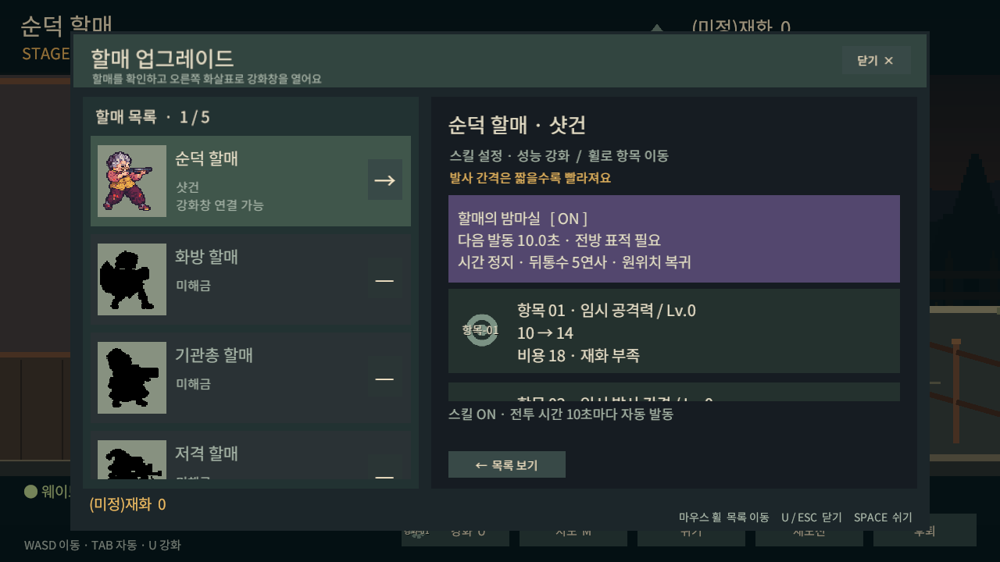
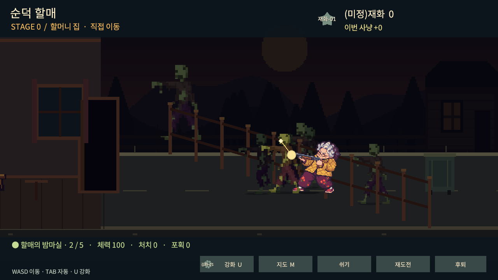

# 할매의 밤마실 구현 검증

2026-10-29 KST · Unity 6000.3.10f1 Editor · active target Web

Status: **PASS — Editor compilation, Play Mode behavior and rendered visual review**.

| Suite / local bridge command | Checks | Result | Report |
|---|---:|---|---|
| `validate-skill` | 33 | PASS | [Skill](ShadowSkill-validation.md) |
| `validate-upgrades` | 103 | PASS | [Upgrade UI](UpgradeConnection-validation.md) |
| `validate-belt` | 156 | PASS | [Belt / stages](BeltScroll-validation.md) |
| `validate-animation` | 45 | PASS | [Sundeok animation](Sundeok120-animation-validation.md) |
| `validate-opening` | 48 | PASS | [Opening / attacks](Stage0-opening-validation.md) |
| Total | **385** | **PASS** | |

All five suites recorded zero runtime errors, exceptions and assertions. Current sources were imported and compiled by the running Editor. The pre-existing `GrandmaShooter.animation` CS0108 warning remains; the belt save-recovery test intentionally emits one warning. No Console history was cleared.

Skill cases cover OFF by default, missing-field legacy saves, saved ON/OFF, first/recurring ten-combat-second activation, normal time/movement/camera freeze, damage immunity, user/map pause restoration, distinct targets and repeated survivors, five damage applications, visual head anchoring, early final-enemy death and exactly-once rewards, no targets, rear-only exclusion, original position/visibility restoration, and cancellation on OFF/retry/retreat/disable.

Visual inspection: skill card OFF/ON and countdown at 1280×720, 1024×768 and 800×450; darkened world with a visible teleporting grandma and a trace/spark at the zombie head. The skill card is first in the detail list; wheel scrolling exposes the original attack/rate purchases below. UI raycasting checks verify that the visible skill card receives pointer hits. No separate native mouse interaction or audio listening review is claimed.

All tests used Library validation profiles. SHA256 preservation is recorded in [ShadowSkill-preservation.json](ShadowSkill-preservation.json): ordinary save, entry scene, package manifest, Player Settings and Build Settings match the fresh pre-task baseline. Existing uncommitted art/UI/animation work was preserved. No scene/prefab wiring is needed.

Implementation: [ShadowSkill-Implementation.md](../ShadowSkill-Implementation.md).

Limitations: ordinary zombies are the execution targets; bosses are excluded. Player/WebGL builds, device checks and long-run profiling were not performed.

